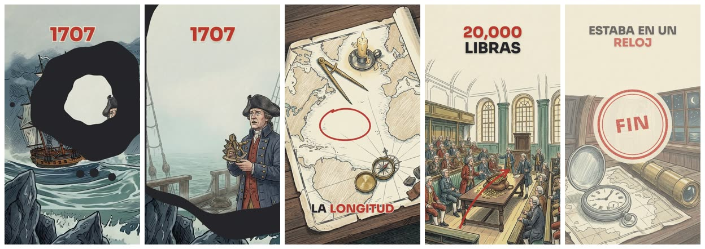
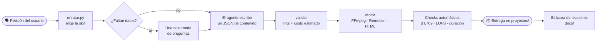
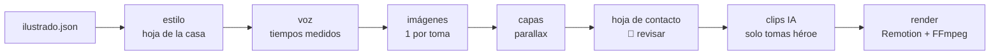
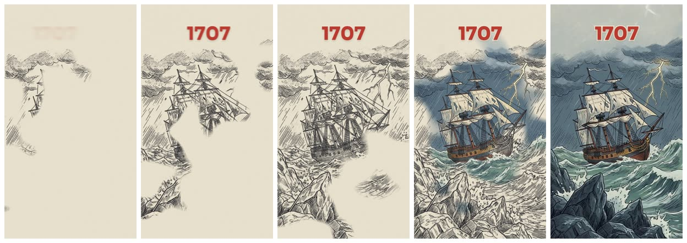
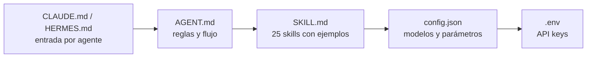

# 🎬 media-agent-toolkit

**Edición de video hecha por agentes de IA: tú pides el video, el agente escribe un JSON y los motores del toolkit hacen
el resto.** FFmpeg primero; modelos de IA solo donde aportan; todo medido, verificado y con su costo a la vista.


<p align="center">
  
  <br><sub>Cuadros de un Short de historia hecho con el motor ilustrado: mancha de tinta, anotaciones a mano, acento de color y sello final. ~0.85 USD en total.</sub>
</p>

---

## ¿Qué puede hacer?

| | Área | Ejemplos |
|---|---|---|
| ✂️ | **Edición básica** | cortar, unir, transiciones, marca de agua, convertir formato y resolución, descargar de YouTube |
| 🔇 | **Limpieza** | quitar silencios (alineado a cuadros), quitar ruido, subtítulos `.srt/.vtt` y quemados |
| 🎙️ | **Voz y audio** | voz en off con verificación contra el guion, clonación, doblaje, música procedural o CC0, SFX, mezcla con ducking a −14 LUFS |
| 🖼️ | **Imagen** | imágenes en el estilo de una referencia, fotos libres de Wikimedia, sustituir una mascota en un video |
| 📱 | **Formatos cortos** | reels verticales narrados, promos con UI animada, traducir el texto incrustado de un video |
| 🎓 | **Cursos en video** | metodología, evaluación entre lecciones, carta descriptiva, quiz para LMS y reproductor HTML |
| ✏️ | **Explicadores ilustrados** | historia o divulgación con look de ilustración a mano, cámara, parallax y clips de IA en tomas clave |
| ⚛️ | **Motion graphics libres** | composiciones React → MP4 con Remotion |

Son **25 skills** descritas en [SKILL.md](SKILL.md). El agente elige la correcta con un clasificador de ~0.00003 USD.

---

## ¿Cómo funciona?



**La regla de oro:** el agente **no escribe código de video**. Escribe contenido (`promo.json`, `curso.json`,
`ilustrado.json`…) y los motores ponen tiempos, animación, audio y control de calidad. Así el resultado es repetible y
barato de corregir.

| El agente escribe | Motor | Comando | Detalle |
|---|---|---|---|
| `promo.json` | Promo (HTML → cuadros → FFmpeg) | `python3 scripts/promo.py todo <p>` | [Motor-Promo](docs/Motor-Promo.md) |
| `curso.json` | Cursos (mundo continuo, Remotion) | `python3 scripts/curso.py todo <p> --qa` | [Motor-Curso](docs/Motor-Curso.md) |
| `ilustrado.json` | Ilustrado (imágenes + Remotion) | `python3 scripts/ilustrar.py todo <p>` | [Motor-Ilustrado](docs/Motor-Ilustrado.md) |
| `reel.json` | Reels (Ken Burns + ASS + FFmpeg) | `python3 scripts/reel.py --spec … todo` | [SKILL](SKILL.md) |
| `doblaje.json` | Doblaje | `python3 scripts/doblar.py todo …` | [SKILL](SKILL.md) |
| TSX + `remotion.json` | Remotion libre | `python3 scripts/remotion.py render <p>` | [Motor-Remotion](docs/Motor-Remotion.md) |

---

## ✏️ Destacado: el motor ilustrado y su firma

Explicadores con look de **ilustración a mano**: tinta, lavados sepia, lápiz de color y papel. Una sola
`OPENROUTER_API_KEY` para imágenes, voz y video.



**La ilustración se dibuja sola.** El *entintado* saca la tinta de la misma imagen, la traza y luego entra el color como
acuarela. Se calcula en local, cuesta 0 USD y su último cuadro es la ilustración exacta:

<p align="center"></p>

<table>
<tr>
<td width="68%">

| Pieza de la firma | En `ilustrado.json` |
|---|---|
| **Estilo de la casa**: sepia + un solo acento bermellón | sin `estilo.prompt` |
| **Entintado**: se dibuja y se pinta | `"entrada": {"tipo": "entintado"}` |
| **Mancha**: gota de tinta que revela la toma | `"transicion": "mancha"` |
| **Anotaciones** a mano, sincronizadas con la voz | `"anotaciones": [{"tipo": "circulo", "x": .5, "y": .4, "en": "palabra"}]` |
| **Acento** en el titular | `"titulo": {"texto": "Solo *5 segundos*"}` |
| **Sello** final con golpe de sonido | `"cierre": true` |

Cuatro niveles de movimiento por toma, del más barato al más caro: `imagen` (cámara, 0 USD) → `parallax` (capas,
~0.08 USD) → `clip` (Blender o metraje propio) → `video_ia` (~0.026 USD/s con Seedance 1.5 Pro).

</td>
<td width="32%" align="center">
<br>
<sub>Hoja canónica de la casa: viaja como referencia en cada imagen para que todos los videos se vean iguales.</sub>
</td>
</tr>
</table>

---

## 🚀 Instalación

```bash
git clone <este-repo> && cd media-agent-toolkit
cp .env.example .env        # rellena al menos OPENROUTER_API_KEY
```

<details open>
<summary><b>macOS / Linux</b></summary>

```bash
zsh scripts/preflight.sh    # verifica e instala FFmpeg, python3, curl y jq (allowlist fija)
```

</details>

<details>
<summary><b>Windows 11</b></summary>

```powershell
winget install --id Gyan.FFmpeg -e      # full_build: libass, xfade, loudnorm, drawtext, sidechaincompress
winget install --id jqlang.jq -e
```

Abre una terminal nueva después de instalar, porque winget cambia el PATH del usuario. `preflight.sh` todavía no corre en
Windows; las notas están en [Lecciones-2026-11-10-compatibilidad-windows](docs/Lecciones-2026-11-10-compatibilidad-windows.md).

</details>

<details>
<summary><b>Motores opcionales (Node ≥ 20)</b></summary>

- **Promo:** `npm ci --prefix promo`. Usa el Chrome del sistema, o el Chromium de Playwright si no hay Chrome.
- **Remotion** (cursos, ilustrado, composiciones libres): `npm ci --prefix remotion && npx --prefix remotion remotion browser ensure`
  (~850 MB). Licencia: gratis para personas, ONG y empresas de hasta 3 personas; con 4 o más hace falta la
  [Company License](https://remotion.pro/license). Fíjala en `config.local.json` → `{"remotion": {"licencia": "gratuita"}}`.
- **Blender ≥ 5.1** (opcional): animaciones técnicas 3D que entran como escena de un curso o toma `clip`, con el estilo de la casa a todo color (`scripts/blender_estilo.py`) y lint de sincronía antes del render (`scripts/lint_w3d.py`).
- Herramientas opcionales sobre las que avisa el preflight: `faster-whisper`, `auto-editor`, `deepFilter`, `yt-dlp`, `tesseract`.

Detalle en [Preflight-Software](docs/Preflight-Software.md).

</details>

---

## 🧭 Para agentes

El repo está pensado para que un agente (Claude Code, OpenCode, KiloCode, Hermes…) lo cargue al iniciar:



1. **Elegir la skill:** `python3 scripts/enrutar.py "<petición>"`.
2. **Preguntar una sola vez:** orientación (siempre), nombre, voz, música, subtítulos y duración, todo antes de gastar.
3. **Trabajar en un proyecto:** `proyectos/<slug>_<DDMMAAAA>/`, con `recursos/` para insumos e intermedios. Su contenido
   **nunca** se sube a git.
4. **Renderizar en segundo plano** con avance en vivo (`python3 scripts/tablero.py` → http://127.0.0.1:8765/).
5. **Reportar costos** (`python3 scripts/costo_generacion.py`) y **escribir la bitácora** en `docs/Lecciones-*.md`.

> Las personalizaciones de cada copia van en `config.local.json` y `docs/Preferencias-Usuario.md` (los dos están en
> gitignore). Solo con «esto va en la versión base» se tocan los archivos base ([AGENT.md](AGENT.md) §16).

---

## 📚 Recetas rápidas

<details>
<summary><b>✏️ Explicador ilustrado (Short de historia o divulgación)</b></summary>

```bash
python3 scripts/ilustrar.py nuevo reloj-longitud --orientacion vertical   # plantilla con la firma de la casa
python3 scripts/ilustrar.py validar reloj-longitud    # lints + costo estimado, sin gastar
python3 scripts/ilustrar.py estilo  reloj-longitud    # hoja de la casa (0 USD) o una propia
python3 scripts/ilustrar.py voz     reloj-longitud    # la duración de cada toma sale de la voz medida
python3 scripts/ilustrar.py imagenes reloj-longitud && python3 scripts/ilustrar.py capas reloj-longitud
python3 scripts/ilustrar.py hoja    reloj-longitud    # 👀 revisar antes de pagar video
python3 scripts/ilustrar.py clips   reloj-longitud --confirmar
python3 scripts/ilustrar.py render  reloj-longitud    # --borrador = 540p para revisar rápido
```

Solo el video IA: `python3 scripts/video_ia.py modelos --i2v --relacion 9:16` (precios leídos al momento), `generar` y
`comparar --modelos a,b,c`.

</details>

<details>
<summary><b>🎓 Curso en video</b></summary>

```bash
python3 scripts/curso.py nuevo mi-curso      # copia el ejemplo de oro
python3 scripts/curso.py validar mi-curso    # lints pedagógicos, sin costo
python3 scripts/curso.py todo mi-curso --qa  # voz, stills, render, carta, quiz y transcripciones
```

- **Antes de empezar:** un cuestionario de propósito, público, evaluación, entrega, voz y forma.
- **Cada lección es un mundo continuo:** cámara y actores que se mueven con las palabras del guion.
- **Por lección se entrega:** MP4 a −16 LUFS, `.srt`, `.vtt` y la transcripción.
- **Por curso se entrega:** la carta descriptiva, `quiz.json`/`quiz.md` y un `reproductor.html` que bloquea la siguiente
  lección hasta aprobar.

Metodología en [Metodologia-Cursos-Video](docs/Metodologia-Cursos-Video.md).

</details>

<details>
<summary><b>📣 Promo con UI animada</b></summary>

```bash
python3 scripts/promo.py validar <proyecto>
python3 scripts/promo.py voz     <proyecto>   # Fish por defecto, karaoke por palabra
python3 scripts/promo.py audio   <proyecto>   # música procedural + SFX (+ voz) → mezcla.wav
python3 scripts/promo.py todo    <proyecto>
```

</details>

<details>
<summary><b>🎙️ Voz en off, música y efectos</b></summary>

```bash
python3 scripts/lint_voz.py --guion guion.txt          # antes de pagar el TTS: cifras, preguntas, dos puntos, marcas
python3 scripts/narrar.py proyectos/<p>                # una toma por escena, tiempos medidos y .srt
python3 scripts/verificar_voz.py --guion guion.txt --wav-dir proyectos/<p>/recursos
python3 scripts/fetch_audio.py "whoosh transition" -n 6 --profile sfx   # solo CC0 (Openverse / Freesound)
```

- **Voz por defecto:** `config.json > voz_default` (Gemini TTS). Cada copia puede cambiarla en `config.local.json`.
- **Clonación:** la muestra va en `muestras/`, que nunca se sube a git.
- **Por qué hay lint y verificación:** a veces los modelos «contestan» el guion en vez de leerlo. El lint lo frena antes
  de gastar y la verificación compara contra el guion.
- **Mezcla:** voz a −16 LUFS, música a −24 con ducking y máster a −14 LUFS / −1.5 dBTP. Se comprueba que la voz quede al
  menos 9 dB por encima de la música.

</details>

<details>
<summary><b>💬 Subtítulos y silencios</b></summary>

```bash
python3 scripts/subtitulos.py <video|audio> --quemar --glosario "ACME,HIKVISION,WhatsApp"
python3 scripts/silencios.py <entrada> --reporte                              # simulacro
python3 scripts/silencios.py <entrada> --proyecto proyectos/<slug>_<DDMMAAAA>
```

Los tiempos salen de pausas medidas o de faster-whisper, nunca de un LLM. Detalle en
[Subtitulos-y-Silencios](docs/Subtitulos-y-Silencios.md).

</details>

<details>
<summary><b>📱 Reels verticales narrados</b></summary>

```bash
python3 scripts/reel.py --spec proyectos/<slug>_<DDMMAAAA>/reel.json todo   # etapas | segmentos | ass | audio | video | verificar
```

Escenas con Ken Burns y `xfade`, rótulos ASS, voz a −15 LUFS y música procedural. Hay un ejemplo en
`scripts/reel.ejemplo.json`.

</details>

<details>
<summary><b>🌐 Doblar un video o traducir su texto incrustado</b></summary>

```bash
python3 scripts/doblar.py transcribir proyectos/<p>/recursos/origen/original.mp4 --proyecto proyectos/<p>
python3 scripts/doblar.py unidades proyectos/<p>      # → doblaje.json; el agente traduce `es`
python3 scripts/doblar.py todo proyectos/<p>/doblaje.json && python3 scripts/doblar.py verificar proyectos/<p>/doblaje.json

python3 scripts/pantalla.py detectar <video> --json caps.json    # texto incrustado → editar la traducción
python3 scripts/pantalla.py generar caps.json --render
```

</details>

<details>
<summary><b>🖼️ Imágenes: estilo de referencia, fotos libres y reemplazo de personaje</b></summary>

```bash
python3 scripts/imagen.py generar --prompt-archivo proyectos/<p>/recursos/prompt.md \
    --referencia proyectos/<p>/recursos/referencia/ref.jpg --relacion 9:16 --salida proyectos/<p>/imagen.png
python3 scripts/commons.py buscar consultas.json proyectos/<p>/recursos/busqueda   # Wikimedia, licencia verificada
```

Sustituir una mascota fija: `scripts/reemplazar_personaje.py rastrear | solape | reemplazar` (skill
`reemplazar-personaje-video`).

</details>

<details>
<summary><b>⚛️ Composiciones libres con Remotion</b></summary>

```bash
python3 scripts/remotion.py nuevo demo-producto --duracion 12
python3 scripts/remotion.py validar demo-producto
python3 scripts/remotion.py estudio demo-producto   # vista previa en http://localhost:3000
python3 scripts/remotion.py render demo-producto    # h264 + acabado FFmpeg (BT.709, −14 LUFS, faststart)
```

Solo para motion graphics que `promo-ui` no puede expresar. Las piezas comunes (karaoke, titulares, curvas, fuentes)
están en `remotion/src/componentes/` y `remotion/src/lib/`.

</details>

---

## 💰 Costos de referencia (medidos)

| Pieza | Costo | Notas |
|---|---|---|
| Elegir la skill (`enrutar.py`) | ~0.00003 USD | clasificador JEV |
| Una imagen ilustrada | ~0.04 USD | Nano Banana 2.1, con hoja de estilo |
| Video IA desde una imagen | ~0.026 USD/s | Seedance 1.5 Pro a 720p, sin audio |
| Short ilustrado de 52 s, 8 tomas | **~0.85 USD** | imágenes + 2 clips héroe + voz; la firma de la casa cuesta 0 |
| Voz de una lección de 4 min | ≤ 0.06 USD | caché por huella: rehacer no vuelve a pagar |

Cada llamada queda registrada en `recursos/costos.jsonl` del proyecto. Los topes de gasto (`ilustrado.tope_usd_por_pieza`,
`tope_usd_por_llamada`) exigen `--confirmar` para pasarse. Más en [Costos-y-Avance](docs/Costos-y-Avance.md).

---

## ⚙️ Configuración

```
config.json          fuente de verdad: modelos por tarea, herramientas, motores, topes, versión
config.local.json    tus valores (gitignored), fusionados clave a clave: voz, sello del canal, licencia de Remotion…
.env                 OPENROUTER_API_KEY (requerida) · ELEVENLABS_API_KEY · PEXELS/PIXABAY/UNSPLASH · FREESOUND_TOKEN (opcionales)
```

```
media-agent-toolkit/
├── AGENT.md · SKILL.md · CLAUDE.md · HERMES.md     contexto para agentes
├── scripts/        motores y utilidades en Python (FFmpeg primero) + pruebas
├── remotion/       composiciones React → MP4 (Ilustrado, Lección, Ejemplo…)
├── promo/          motor promo (HTML → cuadros)
├── assets/         recursos de la casa (hoja de estilo, música)
├── docs/           motores, metodología y bitácoras de lecciones
└── proyectos/      tu trabajo (vacío en git; nunca se respalda)
```

Índice completo de la documentación: [docs/Home.md](docs/Home.md).

---

## Licencia

Ver [LICENSE](LICENSE). La música y las imágenes de terceros se usan solo de fuentes libres de derechos
([música](docs/Musica-Libre-de-Derechos.md), [imágenes](docs/Imagenes-Libres-de-Derechos.md), [audio CC0](docs/Audio-CC0.md)).
