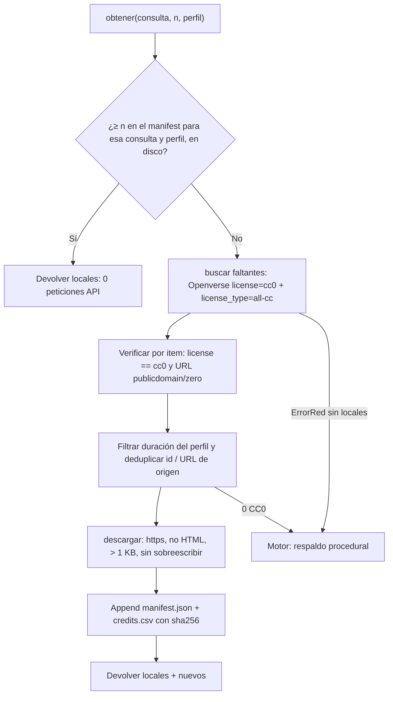

# Audio CC0 (música y efectos)

`scripts/fetch_audio.py` busca y descarga **música y efectos de sonido con licencia CC0 1.0 únicamente** para los videos de marketing (reels verticales, promos). Solo librería estándar de Python; sin API keys obligatorias. Complementa las fuentes de [[Musica-Libre-de-Derechos]] y la usa el [[Motor-Promo]]. Reglas generales en [[AGENT]] §8.

## Política de licencia: solo CC0 1.0

- **Única licencia aceptada: `cc0`.** Nada de BY, BY-SA, BY-NC, BY-NC-ND ni "royalty free" ambiguo: todo lo descargado se puede usar en publicidad comercial, modificar y publicar **sin atribución obligatoria**.
- **Verificación por item**, además del filtro de la consulta: `license.lower() == "cc0"` y, si trae URL de licencia, que sea la de dominio público (`publicdomain/zero`). Un item marcado `cc0` con URL de licencia BY se descarta por incoherente. Lo que no cumple se **descarta y se cuenta** (`descartados: N no-CC0`).
- **Prohibido relajar el filtro** para "obtener más resultados". Si no hay CC0, el script lo dice y sale con código ≠ 0; no inventa archivos, títulos ni rutas.
- `--license` existe solo para **fallar de forma explícita**: cualquier valor distinto de `cc0` → `Rechazado: solo CC0…`, exit 1, sin tocar la red.
- La verificación se repite al descargar (defensa en profundidad), incluso si el motor pasa items armados a mano.

## Uso (CLI)

```bash
python3 scripts/fetch_audio.py "whoosh transition" -n 6 --profile sfx
python3 scripts/fetch_audio.py "click ui" -n 4 --profile sfx --max-dur 1
python3 scripts/fetch_audio.py "riser" -n 3 --profile bgm --out proyectos/<slug>_<DDMMAAAA>/recursos/audio
python3 scripts/fetch_audio.py "pop" -n 4 --profile sfx --source freesound   # requiere FREESOUND_TOKEN
python3 scripts/fetch_audio.py --verificar                                    # sha256 del manifest vs disco
```

| Flag | Efecto |
|---|---|
| `-n N` | Cuántos archivos (1–100, default 5). |
| `--profile sfx\|bgm\|any` | `sfx` → máx. 6 s · `bgm` → mín. 30 s · `any` → sin límite. Items sin duración conocida se descartan si hay límite. |
| `--max-dur S` / `--min-dur S` | Anulan el extremo correspondiente del perfil (`--profile sfx --max-dur 1` = ≤1 s). Mínimo > máximo → error. |
| `--out DIR` | Carpeta de salida. Default: `config.json > audio_cc0.salida` si existe (relativa a la raíz del repo o con `~`), si no `~/Music/media-stock`. |
| `--source openverse\|freesound` | Default `openverse` (sin key). `freesound` solo con `FREESOUND_TOKEN`. |
| `--license` | Solo `cc0`; otro valor → rechazo, exit 1. |
| `--paginas N` | Páginas máximas por búsqueda (1–10, default 3). Cuida el cupo anónimo de Openverse. |
| `--sin-cache` | No reutiliza lo descargado antes para la consulta: trae archivos que aún no están en el manifest. |
| `--verificar` | Solo compara los sha256 del manifest con los archivos en disco. |

**Salida concisa** (pensada para un agente que paga por token): una línea por archivo (`+` nuevo, `=` reutilizado del cache), los descartes, el total y las dos rutas de metadatos:

```
+ impact_1.mp3  60 KB  2.6 s  cc0  chriskalos
+ whoosh_1.mp3  20 KB  0.73 s  cc0  LloydEvans09
descartados: 2 fuera de duración
total: 6 CC0 (6 nuevos, 0 reutilizados) · 1 consulta(s) API · /…/media-stock
créditos: /…/media-stock/credits.csv
manifest: /…/media-stock/manifest.json
```

**Códigos de salida:** `0` ok · `1` rechazo de política (`--license` ≠ cc0) o sin resultados CC0 · `2` uso/configuración (argumentos, falta `FREESOUND_TOKEN`, manifest ilegible) · `3` verificación sha256 fallida · `4` falla de red/API tras reintentos.

## Salida y trazabilidad

- **Audios:** `<slug>_<n>.<ext>`; `slug` = título saneado (ascii, minúsculas, `[a-z0-9-]`, ≤60 chars, sin la extensión que a veces trae el título). **Nunca se sobreescribe**: se usa el primer `n` libre en disco y en el manifest (creación exclusiva del archivo).
- **`manifest.json`:** `{"politica_licencia": "CC0 1.0 unicamente", "items": [...]}`. Cada item: `archivo, id, titulo, autor, licencia, licencia_url, origen_url, descarga_url, duracion_s, formato, proveedor, api, consulta, consultas, bytes, sha256, fecha`. Se escribe de forma atómica y después de cada archivo (un corte a medias no pierde la trazabilidad de lo ya bajado).
- **`credits.csv`:** append, encabezado solo si el archivo no existía; columnas `archivo, id, titulo, autor, licencia, licencia_url, origen_url, duracion_s, proveedor, consulta, bytes, sha256, fecha`. Textos de terceros que empiezan con `= + - @` se prefijan con `'` para que Excel/Numbers no los ejecuten como fórmula.
- **Sin duplicados:** deduplicación por `id` y por URL de origen (la misma obra puede llegar vía Openverse o vía Freesound con otro id). Re-ejecutar un comando **no borra ni duplica** entradas: lo que ya está en el manifest con su archivo en disco se reutiliza sin volver a bajarlo.
- **Cache primero:** cada item guarda la `consulta` que lo trajo (y en `consultas` las siguientes que lo reutilizaron). Si ya hay ≥ N archivos para la misma consulta (normalizada) que cumplen el perfil, **no se llama a la API**. Esto importa porque Openverse anónimo da ≈100 peticiones/día.
- **Validación de descarga:** solo `https` (también en redirecciones), rechaza `Content-Type` `text/*`/JSON/XML o cuerpos que empiezan como HTML, descarta ≤1 KB (corrupto/página de error) y >50 MB sin dejar archivo. Si una descarga falla, se usa un item de reserva de la misma página, sin pedir otra página.
- **Red:** `User-Agent: media-agent-toolkit/1.0 (+CC0 audio fetch)`, timeouts (30 s API / 90 s descarga), backoff exponencial en 429/5xx y fallos de conexión (4 intentos en la API y 3 por descarga, con esperas de 1.5 s, 3 s y 6 s; respeta `Retry-After` ≤30 s y falla rápido si es mayor, que significa cupo agotado). Los demás 4xx fallan de inmediato.
- **Concurrencia:** un candado (`.fetch_audio.lock`) serializa las escrituras si el motor lanza varias descargas a la vez sobre la misma carpeta.
- Compatible con el manifest del prototipo que ya vive en `~/Music/media-stock` (items sin `id`, con `query` y `fuente`): se reutilizan por consulta y por URL de origen, y el CSV heredado se amplía con las columnas nuevas conservando sus filas.

## API Python

```python
from fetch_audio import buscar, descargar, obtener, verificar_manifest, ErrorRed, ErrorConfig

buscar(query, n=5, perfil="any", min_dur=None, max_dur=None, fuente="openverse", pagina_max=3)
    # -> list[dict] SOLO búsqueda: items CC0 verificados y normalizados
    #    (id, titulo, autor, licencia, licencia_url, origen_url, descarga_url, duracion_s,
    #     formato, proveedor, api, consulta). Extras opcionales: excluir=, reserva=, stats=
descargar(items, out_dir)
    # -> list[dict] entradas del manifest (+ archivo, bytes, sha256, fecha) con `ruta` absoluta y
    #    `reutilizado`; append a credits.csv y manifest.json. Extras: maximo=, stats=
obtener(query, n=5, perfil="any", out_dir=None, min_dur=None, max_dur=None, fuente="openverse",
        pagina_max=3, usar_cache=True, stats=None)
    # -> list[dict] cache primero; solo llama a la API por los faltantes
verificar_manifest(out_dir=None)
    # -> (ok_count, [(archivo, motivo), ...])
```

- `stats` (dict opcional) recibe `consultas_api`, `no_cc0`, `fuera_duracion`, `duplicados`, `sin_url`, `ya_locales`, `descartes_descarga`, `fallos_red`, `fallos` y `aviso_red`.
- `obtener()` lanza `ErrorRed` **solo** si no hay nada que devolver por culpa de la red; sin coincidencias CC0 devuelve `[]`. Con cache parcial y red caída devuelve lo local y deja `stats["aviso_red"]`.
- `ErrorConfig`: falta `FREESOUND_TOKEN` con `fuente="freesound"` o manifest ilegible (nunca se sobreescribe un manifest que no se pudo leer).

## Uso desde el motor promo

Contrato previsto (la integración la implementa [[Motor-Promo]] en `scripts/promo.py` / `scripts/sonido.py`; este es el acuerdo de interfaz):

- En `promo.json`, `audio.musica.tipo: "cc0"` con `audio.musica.busqueda` (p. ej. `"ambient pad loop"`) → el motor llama `obtener(busqueda, n=1, perfil="bgm")`, luego **hace loop/recorte con ffmpeg** a la duración del video (recetas abajo) y normaliza como cualquier pista.
- `audio.sfx_fuente: "cc0"` → por cada tipo de cue el motor llama `obtener(consulta, n=1, perfil="sfx")` con consultas por defecto:

| Cue | Consulta por defecto |
|---|---|
| `pop` | `pop` |
| `tick` | `ui click` |
| `whoosh` | `whoosh transition` |
| `ping` | `notification chime` |
| `notif` | `notification chime` |
| `exito` | `success chime` |
| `revelar` | `riser` |
| `tecleo` | `keyboard typing` |

- **Respaldo:** si `obtener()` devuelve `[]` o lanza `ErrorRed`, el motor usa la cama/SFX **procedural** (sigue siendo la fuente garantizada).
- **Cupo:** la primera pieza cuesta como máximo 1 búsqueda por consulta distinta (1–3 peticiones cada una); las siguientes, **0 peticiones** gracias al cache. Conviene compartir la carpeta de salida entre proyectos (el default) para aprovecharlo.
- **Trazabilidad por pieza:** el motor puede registrar en el `recursos/` del proyecto los `id`/`archivo` usados; CC0 no exige créditos, pero el manifest permite auditar el origen de cada sonido.



## Fuentes

| Fuente | Estado | Key | Notas |
|---|---|---|---|
| Openverse | ✅ sin key | — | `https://api.openverse.org/v1/audio/`, anónimo ≈100 req/día. CC0 con `license=cc0&license_type=all-cc`. Con CC0 casi todo proviene de Freesound. |
| Freesound | ✅ token gratis | `FREESOUND_TOKEN` (entorno o `.env`) | Token en https://freesound.org/apiv2/apply; sin token = HTTP 401. Filtro `license:"Creative Commons 0"` + duración del perfil; se bajan previews HQ mp3 (el original exige OAuth2). El token solo se envía a `freesound.org`. |
| Pixabay | ⚠️ solo manual | — | Su API no expone audio (solo imágenes y video). Además su licencia es la Pixabay Content License, no CC0: queda fuera de esta herramienta; ver [[Musica-Libre-de-Derechos]]. |
| Free Music Archive | ❌ caída | — | API responde HTTP 502. No se usa. |
| Jamendo | ❌ NC-ND prohibido | `client_id` | Catálogo mayoritariamente BY-NC-ND: incompatible con la política CC0. No se integra. |
| archive.org | ⚠️ inestable | — | `advancedsearch` devolvió `BACKEND_ERROR`; no integrada. Verificar antes de depender de ella. |

Hechos verificados 2026-09 que el código respeta: `license_type` no acepta licencias finas (`license_type=cc0` → HTTP 400); **nunca combinar `category` con `license`** (`q=corporate&license=cc0&category=music` → 0 resultados: son conjuntos disjuntos en el índice).

## Limitaciones (honestas)

- **Música larga CC0 prácticamente no existe vía Openverse:** el catálogo musical (Jamendo) está indexado como BY / BY-NC-ND. Con `--profile bgm` espera **loops, pads, ambientes, risers y jingles** de Freesound, no temas de 3 minutos. En la prueba del 2026-09-28, `"riser" --profile bgm` sí trajo 3 CC0 de 50–83 s (risers/stings ambientales), pero son efectos largos, no canciones.
- La **cama procedural del motor** sigue siendo el respaldo garantizado para música de fondo.
- Lo que llega de Freesound (vía Openverse o directo) son **previews HQ mp3** de `cdn.freesound.org` (medido: 44.1 kHz estéreo, ~185 kbps): suficientes para reels, pero no son el original sin pérdidas.
- Duraciones y títulos vienen de la API; el filtro de duración usa esa metadata (en la prueba coincidió con `ffprobe` en los 13 archivos).
- El cupo anónimo de Openverse (≈100 req/día) es el cuello de botella real: por eso cache primero, `--paginas` bajo y una pausa de 0.5 s entre páginas.

## Post-proceso con ffmpeg

Usa **siempre la sintaxis explícita** de `afade` (`t=`, `st=`, `d=`): en builds recientes la forma corta `afade=in:0:0.3` falla con `Value for parameter 'nb_samples' out of range` (el tercer valor posicional es `nb_samples`, no la duración). Verificado con ffmpeg 7.1.

```bash
# Normalizar a −14 LUFS para YouTube / redes
ffmpeg -i in.mp3 -af loudnorm=I=-14:TP=-1.5:LRA=11 -ar 48k out.wav

# Recorte (12 s desde el segundo 4) + fundidos de 0.3 s
ffmpeg -ss 4 -t 12 -i in.mp3 -af "afade=t=in:st=0:d=0.3,afade=t=out:st=11.7:d=0.3" out.wav

# Loop de un efecto corto a cama de fondo de 30 s
ffmpeg -stream_loop 9 -i sfx.mp3 -t 30 out.wav

# Loop exacto a 30 s aunque el efecto sea muy corto, con salida suave
ffmpeg -stream_loop -1 -i sfx.mp3 -af "asetpts=N/SR/TB,atrim=duration=30,afade=t=out:st=29:d=1" out.wav
```

- **Recorte:** `-ss`/`-t` van **antes** de `-i`. Así el tiempo del filtro empieza en 0 y `st=11.7` cae al final del clip. Con `-ss 4 -t 12` **después** de `-i`, `afade` ve los tiempos del archivo original: el fundido de entrada se pierde y desde el segundo ~7.7 del clip queda **silencio**. Medido 2026-09-28: −91 dB en 9–11 s contra −20 dB con la forma correcta.
- **Loop:** `-stream_loop 9` son 10 reproducciones. Solo llega a 30 s si el efecto dura ≥3 s: con uno de 2.6 s salen 26.2 s. Para efectos cortos usa la última receta (`-stream_loop -1` + `asetpts` + `atrim`), que da 30.000 s exactos.
- Para mezclar bajo voz (−15 / −21 LUFS, ducking) sigue [[Musica-Libre-de-Derechos]] § Niveles de mezcla.

## Aviso operativo

- **No uses audio CC0 para imitar o "fingir" una canción reconocible** (melodías, estilos o nombres de obras con copyright), ni lo **revendas o redistribuyas como stock** (packs de sonidos, bibliotecas). CC0 cubre la obra descargada, no autoriza imitar obras de terceros.
- No descargar con credenciales del usuario ni scrapear sitios que exijan sesión. Nunca commitear ni imprimir `.env` ni el token.

## Pruebas

```bash
python3 scripts/pruebas/test_fetch_audio.py -v                        # offline (red simulada)
CC0_ONLINE=1 python3 scripts/pruebas/test_fetch_audio.py -v PruebaEnLinea   # humo en línea: 1 petición
```

Las pruebas offline sustituyen `http_get` (única puerta a la red) y cubren: filtro de licencias con descartes contados, deduplicación entre páginas, perfiles de duración y overrides, slug y sufijos sin sobreescribir, descarte ≤1 KB/HTML, append sin duplicados al re-ejecutar, verificación sha256, cache primero en `obtener`, rechazo `--license by` (exit 1), backoff 429/5xx, red caída (exit 4), token de Freesound y manifest heredado.

## Enlaces

- [[AGENT]] — §8 recursos libres de derechos, §10 costos
- [[Musica-Libre-de-Derechos]] — fuentes local / procedural / Pixabay y niveles de mezcla
- [[Motor-Promo]] — motor que consume `obtener()` para música y SFX
- [[Home]] — índice de la bóveda
