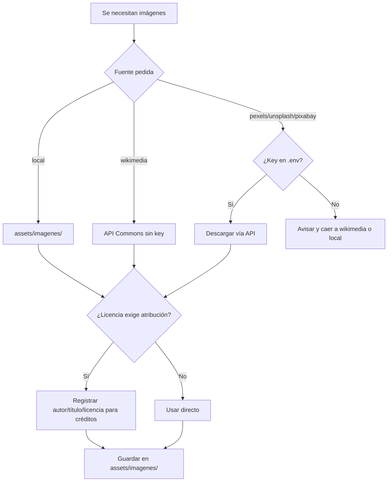

# Imágenes libres de derechos

Fuentes permitidas de imágenes (fondos, B-roll estático, assets). Configuración en `config.json > imagenes_libres`; skill operativo en [[SKILL]] → `imagenes-libres`.

## Fuentes, keys y licencias

| Fuente | Requiere key | Endpoint (`url_base`) | Licencia |
|---|---|---|---|
| `local` | No | — | La que tenga cada archivo; carpeta `assets/imagenes/` (`imagenes_libres.carpeta_local`). |
| `wikimedia` | **No** | `https://commons.wikimedia.org/w/api.php` | CC variadas (CC-BY, CC-BY-SA, dominio público…). **Verificar por archivo** y dar atribución cuando aplique. |
| `pexels` | `PEXELS_API_KEY` | `https://api.pexels.com/v1/` (fotos) · `https://api.pexels.com/videos/` (**videos**, B-roll en movimiento) | [Pexels License](https://www.pexels.com/license/) — uso libre, atribución apreciada pero no obligatoria. |
| `unsplash` | `UNSPLASH_ACCESS_KEY` | `https://api.unsplash.com/` | [Unsplash License](https://unsplash.com/license) — uso libre, atribución apreciada pero no obligatoria. |
| `pixabay` | `PIXABAY_API_KEY` | `https://pixabay.com/api/` | [Pixabay Content License](https://pixabay.com/service/license-summary/) — uso libre sin atribución obligatoria. |

**Regla de oro:** solo estas fuentes. Nunca imágenes con copyright. Si falta una key, caer a `wikimedia` o `local` y avisar.

## Flujo



## Atribución (Wikimedia / CC)

Cuando la licencia lo exija (CC-BY, CC-BY-SA), incluir en los créditos o la descripción de la entrega:

1. **Título** del archivo (enlace a la página del archivo en Commons).
2. **Autor** (tal como aparece en la ficha).
3. **Licencia** (con enlace, p. ej. `CC BY-SA 4.0`).
4. Indicación de si se modificó la imagen (recorte, color, etc.).

La metadata de licencia se obtiene del propio API con `prop=imageinfo&iiprop=url|extmetadata` (campos `Artist`, `LicenseShortName`, `LicenseUrl`).

## Script: `scripts/commons.py` (búsqueda, hoja de contactos y descarga con atribución)

```bash
python3 scripts/commons.py buscar recursos/busqueda/consultas.json recursos/busqueda      # {"clave": "texto", …}
python3 scripts/commons.py bajar recursos/busqueda/elegidas.json recursos/busqueda/candidatos.json recursos/img --pausa 10
```

- `buscar` consulta el API por cada clave, se queda solo con dominio público / CC0 / CC BY / CC BY-SA (por archivo,
  `extmetadata.LicenseShortName`), baja miniaturas de 320 px y, si hay Pillow, arma `hoja_<n>.png` con el índice
  `clave_i` de cada candidata para elegir a ojo.
- `bajar` recibe `{"nombre_destino": "clave_i"}`, baja el **original** cuando mide ≤ 4700 px (el thumb de 1600 solo
  para gigapíxeles) y **fusiona** la atribución (título, página, autor, licencia, URL de licencia, medidas) en
  `creditos.json`, que luego leen los compositores para el crédito en pantalla.
- **Rate limit:** Commons responde `429` a un User-Agent sin contacto, no por el ritmo. El script usa
  `media-agent-toolkit/1.0 (<URL del repo>; educational video)` (solo ASCII: `urllib` codifica cabeceras en latin-1)
  y pausas de 2.5 s entre consultas y 5–10 s entre descargas. Verificado 2026-10-31: 51 fotos seguidas sin un 429.

## Ejemplo (Wikimedia Commons)

```bash
curl -s "https://commons.wikimedia.org/w/api.php?action=query&format=json&generator=search&gsrsearch=cielo&gsrlimit=5&prop=imageinfo&iiprop=url|extmetadata" | jq '.query.pages'
```

## Ejemplo (Pexels videos — B-roll libre de copyright)

```bash
curl -s -H "Authorization: $PEXELS_API_KEY" \
  "https://api.pexels.com/videos/search?query=ocean&per_page=5&orientation=landscape" | jq '.videos[].video_files'
```

Descargar el `video_files[].link` que mejor calce en calidad/duración y guardarlo en `assets/imagenes/` (o en `recursos/` del proyecto activo).

## Enlaces

- [[SKILL]] — skill `imagenes-libres`
- [[Musica-Libre-de-Derechos]] — equivalente para música
- [[AGENT]] — sección 8 (recursos libres de derechos)
- [[Home]] — índice de la bóveda
