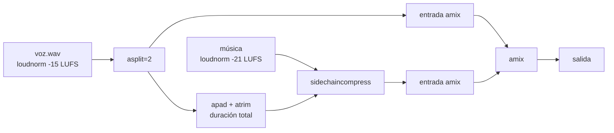

# Lecciones 2026-09-23 — Edición de IMG_7347

Bitácora técnica de la sesión de edición del video IMG_7347 (iPhone, portrait, HLG). Cada lección quedó incorporada en [[AGENT]], [[SKILL]] o `config.json`; esta nota conserva el detalle y el porqué.

## 1. Visión: `z-ai/glm-5.3` no acepta imágenes (404)

- **Síntoma:** llamadas a `chat/completions` con `image_url` devolvían 404.
- **Causa:** ese modelo no soporta entrada multimodal en OpenRouter.
- **Fix:** `config.json > modelos.vision` pasó a `google/gemini-2.5-flash` (ya aplicado).
- **Lección:** antes de usar un modelo de visión, verificar que soporte `image_url` en la cuenta.

## 2. Verificación de escenas contra frames (desfase ~4 s)

- Al pedirle al modelo de visión "en qué segundo pasa X", sus estimaciones llegaron con **~4 s de desfase** contra los frames reales extraídos con FFmpeg.
- **Lección:** tratar los timestamps del modelo de visión como aproximados; verificar cortes finos extrayendo frames (`ffmpeg -ss <t> -i in.mp4 -frames:v 1`).

## 3. TTS real con OpenRouter

- El TTS funciona por `chat/completions` (no existe `/audio/speech` para `openai/gpt-audio-mini`):
  - `modalities: ["text","audio"]` + `audio: {"voice": ..., "format": "pcm16"}`.
  - **Obligatorio `stream: true`** (SSE): el audio llega en `choices[0].delta.audio.data` (base64).
  - Salida: PCM crudo **24 kHz mono** → convertir: `ffmpeg -f s16le -ar 24000 -ac 1 -i voz.pcm -ar 48000 -ac 2 voz.wav`.
- **Anti-muletillas:** con un prompt tipo orden ("Di exactamente…"), el modelo antepone "Claro,". Fix: mensaje `system` = "Repite verbatim el texto del usuario, sin confirmaciones ni palabras extra" y el texto desnudo en `user`.
- Documentado en [[SKILL]] → `crear-audio`.

## 4. iPhone HLG portrait: rotación y conversión

- El clip traía `rotation=-90` en metadata (grabación portrait).
- **`-display_rotation 0` es opción de INPUT** (va antes del `-i`): ignora la rotación de metadata y deja trabajar los pixeles tal cual; luego rotar explícito con `transpose` si hace falta.
- **`tpad` usa `stop_duration`** (no `stop`) para congelar el último frame N segundos:
  `tpad=stop_mode=clone:stop_duration=2`
- En cadenas de `xfade`, cada **`offset` debe ser < duración acumulada** del video hasta ese punto; si no, la transición se corta/corrompe.
- Documentado en [[SKILL]] → `convertir-formato`.

## 5. Mezcla voz + música

- **Niveles verificados:** voz a **-15 LUFS**, música a **-21 LUFS** (`loudnorm` por pista), ducking con `sidechaincompress` usando la voz como sidechain.
- **Bug del auto-split:** si el bus de voz alimenta `sidechaincompress` (sidechain) y `amix` (salida) sin split explícito, el sidechain **atenúa también la voz** (~-11 dB medidos). Fix: `asplit=2` explícito antes de bifurcar.
- **`sidechaincompress` corta la pista principal cuando el sidechain termina.** Fix: padrar el bus de voz a la duración total con `apad` + `atrim`.

## 6. Música de fondo

- La música **procedural** (FFmpeg `aevalsrc` + `lowpass` + `aecho` + `loudnorm`) funcionó, pero el usuario pidió fuentes reales libres de derechos → nació el soporte en `config.json > musica_libre` y la nota [[Musica-Libre-de-Derechos]].

## 7. Proceso

- Dos rondas de preguntas aclaratorias evitaron retrabajo → se formalizó la sección **Aclaración previa** en [[AGENT]].

## Enlaces

- [[AGENT]] — reglas actualizadas (aclaración, preflight, avance, costos)
- [[SKILL]] — skills `crear-audio`, `crear-video`, `convertir-formato`, `musica-fondo`
- [[Home]] — índice de la bóveda
