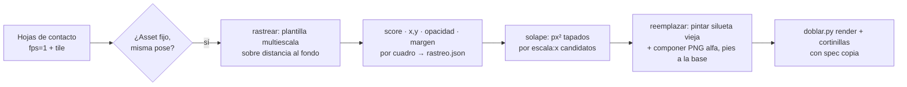

# Lecciones — Sustituir la mascota de un reel por otro personaje (2026-10-30)

**Pedido:** "utilízala en el video, reemplaza el personaje del video por este nuevo personaje": cambiar al científico del
reel doblado (`[[Lecciones-2026-10-30-doblaje-reel]]`) por `Xavier-vulcano.png` (`[[Lecciones-2026-10-30-personaje-spock]]`).
Herramienta nueva: `scripts/reemplazar_personaje.py` (`rastrear` → `solape` → `reemplazar`), con `~/.venvs/imagen/bin/python`
(numpy + OpenCV + Pillow). Luego `doblar.py render` + `cortinillas` sobre el video sustituido con un spec copia
(`doblaje-xavier.json`: `entrada`/`salida` propias) para reutilizar voz, captions y rótulos sin volver a pagar nada.

## Flujo

## Qué se aprendió

1. **Primero mirar cómo aparece el personaje.** Hojas de contacto (`fps=1,scale=180:-2,drawtext=%{pts\:hms},tile=8x4`)
   mostraron que el asset es la misma ilustración de referencia, fija en el borde izquierdo y ausente en ~10 escenas; eso
   decide el método (overlay) antes de escribir código.
2. **Rastreo por plantilla sobre "distancia al fondo":** convertir cuadro y asset a `clip(|px − fondo|)` deja el fondo en
   0 y hace que `TM_CCOEFF_NORMED` sin máscara funcione (con la imagen en bruto, el fondo claro domina la correlación).
   Calibrar la escala en 3–4 cuadros (barrido 0.55–1.0 en pasos de 0.005: 0.92 en todos, score 0.98) y rastrear a media
   resolución: 3853 cuadros en ~1 min. Rellenar con `copyMakeBorder` por la izquierda para assets parcialmente fuera.
3. **El rastreo da más que la posición:** opacidad (mediana de `parche/plantilla` en píxeles fuertes → detecta fundidos;
   aquí siempre 1.0), cuadros desplazados (deslizamientos de entrada/salida: 6–7 cuadros por tramo, x desde −118) y
   **margen libre** (primera columna con contenido a la derecha del personaje) para dimensionar al sustituto.
4. **Medir el solape antes de elegir escala.** El nuevo personaje es más ancho (mano alzada + laptop abierta). Con
   `solape` por candidato: a 0.62 tapaba contenido en el 82 % de los cuadros; a 0.52 con x=−6, en el 22 % y con p90 de
   284 px² (≈17×17). Se eligió 0.52 (80 % de la altura original; pies en la misma base y=1307).
5. **Pintar solo la silueta, no un rectángulo:** máscara del asset viejo (distancia > 20) a su escala, dilatada 11 px para
   el antialias, rellenada con el fondo **muestreado en cada cuadro** (mediana de una zona vacía) → sin fantasmas ni
   cajas. Los elementos del reel no pisaban al personaje, así que no hubo que reconstruir nada detrás.
6. **Seguir el deslizamiento:** `x_nuevo = x_reposo + (x_medido − x_modal)`; el nuevo entra y sale igual que el viejo.
7. **Composición en Python, codificación en FFmpeg:** decodificar y codificar por tuberías `rawvideo bgr24` (x264 CRF 16,
   audio copiado) y hacer el `alpha composite` en numpy solo en el rectángulo del personaje; mucho más flexible que
   encadenar decenas de `overlay` con `enable`, y sigue reportando avance al tablero (etapa `reemplazo`).
8. **Verificar con muestras antes|después** (`--muestras n,n`: `hstack` del cuadro original y el procesado) en 2–3 escenas
   distintas y una del deslizamiento, antes del render completo.
9. **Rehacer el doblaje sin repetir trabajo:** spec copia con `entrada` = video sustituido y `salida` nueva; `render`
   reutiliza `voz_es.wav`, `tiempos.json` y overlays. `ruta_cuerpo` es fija (`recursos/doblaje/cuerpo.mp4`): respaldar el
   cuerpo anterior (`cuerpo-v1.mp4`) antes.
10. **El saludo vulcano:** `gemini-2.5-flash-image` no abre la V ni con foto de referencia (6 intentos); lo resolvió
    `google/gemini-3-pro-image` por OpenRouter (0.14 USD) con la misma edición. Cuando un modelo falla tres veces en lo
    mismo, cambiar de modelo o de herramienta (la cizalla afín manual quedó como plan C), no de prompt.

11. **El alfa del PNG nuevo necesita limpieza:** el fondo de Gemini 3 Pro no es plano (±4 por canal, distancia máx 9), y
    con la rampa 6→30 el recorte arrastró 800 píxeles fantasma y un bbox de toda la imagen (asset de 716×1312 en vez de
    539×1158), lo que desplaza `--pies` y el tamaño en pantalla. Receta: fondo por mediana del borde, rampa 12→40 y
    quedarse con las componentes conectadas ≥ 200 px. Comprobar siempre `bbox alfa>200` contra `bbox alfa>0`.
12. **Tiempos reales:** rastreo 3 853 cuadros ≈ 60 s; sustitución (decodificar VP9 + componer + x264 CRF 16) ≈ 40 s;
    `doblar.py render` ≈ 30 s; cortinillas ≈ 30 s. Toda la cadena, 2 min y 0 USD por iteración.
13. **Entrega por el chat tiene tope de tamaño:** el envío de archivos por Remote Control rechaza más de 30 MiB y el final
    (138.7 s, 1080×1920, CRF 18) pesa 44.5 MiB. Receta: copia aparte en `recursos/entrega/<nombre>-chat.mp4` con tasa fija
    calculada para el tope (`(30 MiB × 0.9 × 8) / duración − audio` ≈ 1.45 Mbps aquí → `-b:v 1300k -maxrate 1600k
    -bufsize 3000k -c:a aac -b:a 96k -movflags +faststart`): 22.1 MB, misma duración y resolución. La versión completa no se
    toca (raíz del proyecto y `~/Movies`) y en el mensaje se dice cuál es cuál. No bajar la resolución: a 1.3 Mbps el texto
    de los captions sigue legible y el personaje, nítido.

## Preguntas de `[[AGENT]]` §15

**¿Cómo optimizar?** Para un asset fijo, el flujo completo (hojas → rastrear → solape → muestras → reemplazar → render) cabe
en ~15 min de máquina y 0 USD. Si el personaje tuviera varias poses o animación propia, haría falta rastrear por escena
con una plantilla por pose, o generar las poses nuevas con el modelo de imagen (edición guiada) y tratarlas igual.

**¿Qué nuevas funciones?** `cv2.matchTemplate` multiescala sobre distancia al fondo; métrica de solape por candidato;
`Image.transform(AFFINE, BICUBIC)` a 4x para deformar trazos planos sin escalones; tuberías rawvideo numpy ↔ ffmpeg con
`-map 1:a? -c:a copy`. Pendiente de verificar: comportamiento con fundidos (opacidad < 1) — el código lo mide pero no lo
aplica al nuevo personaje. Verificado el final con `doblar.py verificar` (`recursos/doblaje/verificar-xavier.log`): duración
138.70 s, voz 36/37 unidades por ASR, rótulos 19/20 por OCR, captions 6/8 cues de muestra, −16.3 LUFS; las 4 observaciones son
las mismas que tenía el doblaje antes de sustituir al personaje (u31 con ratio 0.46, «mcp» leído «mep», dos captions que el OCR
no lee pero se ven bien en los fotogramas), así que la sustitución no tocó voz, rótulos ni captions.
