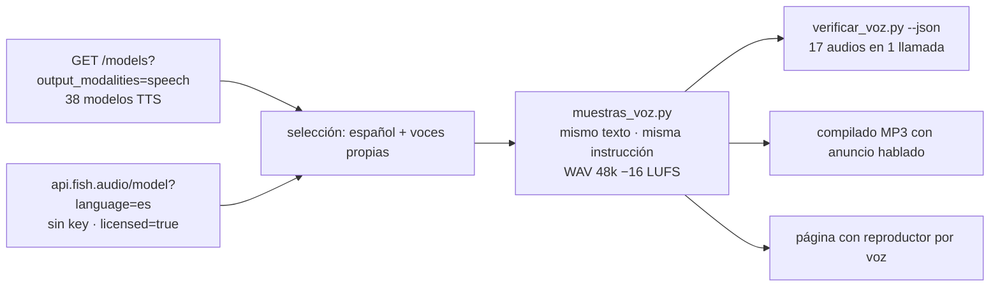

# Lecciones — Casting de voz para cursos en línea (2026-10-31)

**Pedido:** «Dame ejemplos de voces alegres e ideales para un curso en línea, en español, maduras; quiero elegir un
estilo para que se use la misma voz siempre.» No es una edición de video sino un **casting**: el mismo texto con
muchas voces para fijar una. Proyecto: `proyectos/muestras-voz-curso_31102026/`.

## Flujo que quedó

## Qué se aprendió

1. **OpenRouter tiene un catálogo TTS aparte del de chat:** `GET /api/v1/models?output_modalities=speech` (38 modelos
   el 2026-10-31); `output_modalities=audio` solo devuelve los de chat con audio (`gpt-audio`, Lyria). Todos van por
   `POST /audio/speech` con `model`, `input`, `voice`, `response_format` (`mp3`|`pcm`) e `instructions`; la respuesta
   son bytes de audio y el id de cobro viene en `X-Generation-Id`.
2. **Fish S2 Pro sí admite `voice` e `instructions` por OpenRouter** (verificado): `voice` es el id de 32 hex de una
   voz de la biblioteca de Fish y `instructions` el estilo en lenguaje natural. `voz.tts_fish` hoy los ignora (y la
   huella de caché también): si se fija una voz de Fish para cursos hay que añadirlos. **Las instrucciones se cobran
   como caracteres** (300 de texto + 200 de instrucción = 0.0075 USD, el doble de lo esperado).
3. **La biblioteca de Fish se consulta sin key:** `GET https://api.fish.audio/model?language=es&page_size=50&sort_by=task_count`
   (tope de 1000 resultados) y `licensed=true` filtra las voces oficiales (26 en español, casi todas «serenas»). Las
   demás son subidas de usuarios (clones de personajes y personas reales): para una pieza comercial, derechos no
   verificables. Campos útiles: `_id`, `title`, `tags`, `description`, `task_count`, `licensed`, `languages`.
4. **Microsoft MAI-Voice 2.1** por OpenRouter: `voice` = `es-MX-<Nombre>:MAI-Voice-2.1` (es-MX: Alejo, Grant, Harper,
   Valeria; es-ES: Marta), MP3 a 24 kHz, 0.022 USD/1k caracteres. Acepta `instructions` sin error, pero no se nota un
   cambio de entrega. Alejo habla notablemente más lento (0.278 s/sílaba frente a ~0.20 del resto).
5. **Gemini 3.8 Flash TTS** solo entrega `response_format: "pcm"` (`400` con mp3); PCM 16 bit mono a 24 kHz
   (`rate=` en el `Content-Type`). Tiene 30 voces con nombre (Gacrux «madura», Sulafat «cálida», Puck «animado»,
   Achird «amigable», Charon neutro para anuncios). Su precio por token de audio de salida pesa más que el de entrada:
   ~0.0046 USD por muestra de 20 s, no «casi gratis».
6. **gpt-audio-mini sigue siendo el más barato** (0.0013 USD por 20 s, 6× menos que Fish) y lee verbatim con
   `SYSTEM_BASE` + estilo; el estilo es aproximado.
7. **Comparar en igualdad:** mismo texto (55 palabras, 101 sílabas, afirmaciones sin preguntas ni fragmentos con dos
   puntos), misma instrucción, todo a 48 kHz mono y `loudnorm` −16 LUFS, s/sílaba medido por muestra. Las 17 pasaron
   `verificar_voz.py --json` en una sola llamada (0.016 USD): ningún proveedor añadió ni omitió palabras.
8. **Entrega para elegir:** un MP3 compilado con anuncio hablado antes de cada muestra («Muestra tres. Mizuki, de
   Fish, licenciada»; Gemini Charon, ~0.0008 USD cada uno) para oír en el teléfono, y una página con reproductor por
   voz, filtros (género, derechos) y candidatas ★ guardadas en el navegador.

**Resultado:** Xavier eligió la muestra 13 (**Achird**, Gemini 3.8 Flash TTS) como voz por defecto y guardó Puck,
Sulafat y Gacrux como alternas. Quedó aplicada en `config.local.json > voz_default` (gitignored; `comun.cargar_config`
lo fusiona sobre `config.json`) y la resuelve `voz.resolver_voz` (spec del proyecto > default > casa); `voz.tts_speech`
acepta `voice` e `instructions` para cualquier modelo de `/audio/speech`. Primer uso real: la v2 del explicador de
Star Trek ([[Lecciones-2026-10-31-star-trek-cronologia]]), 33 tomas sin una sola observación en el diff dirigido.

## Medidas

- 17 muestras + 17 anuncios + 1 verificación = **0.116 USD** (Fish 0.037, Gemini 0.032, Microsoft 0.026, verificación
  0.016, OpenAI 0.005). Por minuto de locución: Fish ≈ 0.026 USD (con instrucciones), Microsoft ≈ 0.019, Gemini ≈
  0.014, OpenAI ≈ 0.004 → un curso de 5 h cuesta entre 1 y 8 USD de voz con cualquiera.
- Latencia por muestra de 20 s: Fish/Microsoft/OpenAI 2–5 s; Gemini 7–9 s.
- Ritmo (s/sílaba): Fish 0.165–0.197, Microsoft 0.197–0.278, Gemini 0.187–0.208, OpenAI 0.171–0.189.

## Preguntas de [[AGENT]] §15

**¿Cómo optimizar?** (1) Promover `muestras_voz.py` a `scripts/casting_voz.py` (lista de candidatas JSON → WAV
normalizados → verificación → compilado → página): el flujo es genérico para cualquier casting. (2) Añadir `voice` e
`instructions` a `voz.tts_fish` y a la huella de caché, y un `audio.voz.voice` en los specs, para que la voz elegida
se use en reel/promo/doblar/explicador sin tocar código. (3) Guardar la voz elegida en `docs/Preferencias-Usuario.md`
(proveedor, modelo, id de voz, instrucción) y leerla como default. (4) Pedir las instrucciones de Fish cortas: se cobran.

**¿Qué nuevas funciones utilicé?** `GET /models?output_modalities=speech`, `/audio/speech` con `voice` +
`instructions` (Fish, Microsoft, Gemini), API pública de Fish con `licensed=true`, voces `es-MX-*:MAI-Voice-2.1`,
Gemini TTS en PCM, `verificar_voz.py` con 17 audios en una llamada, anuncios hablados para un compilado de escucha.
Pendiente: medir si `instructions` cambia algo en Microsoft (parece ignorarse) y probar `speed` en los que lo admiten.

Relacionado: [[Lecciones-2026-10-31-star-trek-cronologia]] (voz Fish por tomas), [[Lecciones-2026-09-29-reel-syscomexpo-30s]],
[[Lecciones-2026-09-30-voicestudio-mcp]] (alternativa local, CC-BY-NC), [[Preferencias-Usuario]].
