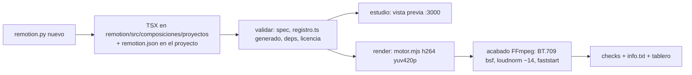

# Lecciones — Remotion como segundo motor opcional; LongCat-Video-Avatar evaluado (2026-10-31)

**Pedido:** revisar si dos repos vistos en redes se pueden agregar a las herramientas del toolkit: **LongCat-Video-Avatar
1.5** (Meituan; foto + audio → avatar que habla, pesos MIT) y **Remotion** (video programático con React, skills oficiales
para agentes). Decisión con Xavier tras la investigación: **Remotion sí, como motor opcional + skills; LongCat no**
(solo esta evaluación). Entregado: `remotion/` + `scripts/remotion.py` (skill `[[SKILL#remotion-video]]`, detalle en
`[[Motor-Remotion]]`), `comun.correr_motor_node`, ruta `remotion_video` en `enrutar.py`, `remotion-deps` opcional en el
preflight, 13 pruebas nuevas, config 1.6.0.

## Flujo que quedó

## Qué se aprendió (Remotion)

1. **Antes de añadir un motor, mirar los que hay.** El repo ya tenía un motor Node + Chromium (`promo/`), así que
   Remotion no entra como "la" herramienta de video sino como la **excepción** para composiciones libres; la regla de
   decisión (FFmpeg → promo-ui → Remotion) vive en SKILL, en AGENT §6/§12 y en la ruta JEV, que es lo que de verdad
   evita que un agente lo use para una promo de la casa (probado: "promo con WhatsApp animado" sigue en `promo_ui`,
   "gráfica animada estilo motion graphics" va a `remotion_video`).
2. **La licencia no es MIT.** Gratis para personas, ONG y empresas ≤ 3 personas; 4+ → Company License (Creators 25
   USD/asiento/mes). Como el repo lo usan varias personas, el aviso va en `validar`/`render` hasta que cada copia fije
   `config.json > remotion.licencia`. Xavier está en el tramo gratuito.
3. **Mismo contrato que el motor promo** (`stdout` = un JSON, `avance NN%` en stderr, códigos 0/1/2/3) → el wrapper,
   las pruebas con stub y el tablero se reutilizan tal cual; `promo.correr_motor` se generalizó en
   `comun.correr_motor_node` sin tocar `promo.py`.
4. **El API de Node de Remotion no lee `remotion.config.ts`** (solo el CLI y el Studio): codec, CRF y preset se pasan
   explícitos al `renderMedia()` desde `config.json > remotion`. `x264Preset`, `pixelFormat`, `audioCodec`,
   `concurrency` y `onProgress` existen en 4.0.539 y se verificaron en el humo.
5. **Remotion entrega h264 yuv420p sin etiquetas de color:** el acabado FFmpeg las agrega con `h264_metadata` (sin
   recodificar), normaliza el audio a −14 LUFS en dos pasadas y pone `+faststart`; los checks de promo (cuadros,
   duración ±1 cuadro, color, sonoridad) aplican igual. Así la regla "FFmpeg primero" se cumple también aquí.
6. **Dónde viven los TSX:** dentro de `remotion/src/composiciones/proyectos/` (gitignored), porque el bundler resuelve
   `react`/`remotion` subiendo desde el archivo que importa; fuera de `remotion/` habría que sobreescribir webpack. Un
   `registro.ts` **generado** (orden alfabético, solo se reescribe si cambia) evita editar TS a mano y no invalida cachés.
7. **`calculateMetadata` desde el spec:** `duracion`, `ancho`, `alto` y `fps` viajan en `--props` y mandan sobre `meta`
   del TSX; `--public-dir recursos/` hace que `staticFile('voz.wav')` lea los recursos del proyecto sin copiarlos
   (verificado con un tono: −14.0 LUFS, AAC 48 kHz). Efecto colateral: en el Studio los `defaultProps` vienen
   calculados y no se pueden guardar desde la UI ("Can't save default props"): se edita `remotion.json`.
8. **Peer deps:** `@types/react-dom` 19.3 exige `@types/react` ^19.3 y rompió `npm install`; como `src/` no importa
   `react-dom`, se quitó. Versiones fijadas (4.0.539, React 19.2.3, TS 5.9.3).
9. **Instalación y tamaño:** `npm install` 8 s, `remotion browser ensure` 13 s, `node_modules` 845 MB de los que 579 MB
   son el Chrome Headless Shell (`node_modules/.remotion`). Por eso es opcional: el preflight solo avisa
   (`remotion-deps`) y nunca lo instala.
10. **Velocidad en el M3 16 GB:** ejemplo de 3 s (90 cuadros, 1080x1920) en 4–6 s de principio a fin; el empaquetado
    (~3 s) domina en piezas cortas; `composiciones` en frío 10 s. Falta medir una pieza de 30 s con metraje real.
11. **Skills oficiales:** `npx skills add remotion-dev/skills -a claude-code -y` **copia** (no enlaza) 12 skills a
    `.claude/skills/remotion-*` y escribe `skills-lock.json`. El repo `remotion-dev/skills` no declara licencia → no se
    vendorizan (gitignored) y el lock sí se versiona para restaurarlas con `npx skills experimental_install`.
12. **Dos Node en la misma Mac:** el shell de login resuelve `/usr/local/bin/node` 22.18 (nodejs.org) y el agente el de
    nvm 22.22. A Remotion le vale cualquiera ≥ 20 (`comun.buscar_node`), pero el CLI `skills` exige ≥ 22.20: usar el de nvm.
13. **Studio con `--no-open` y en segundo plano** (`start_new_session`, pid y log en `recursos/remotion/`), se adjunta
    desde `.claude/launch.json` (`remotion-estudio`, solo URL) y se para con `--detener` (mata el grupo de procesos).
14. **Pruebas sin tocar el repo:** `--raiz` temporal + `REMOTION_DIR` (copia mínima del motor) + `REMOTION_MOTOR` (stub
    Node que copia un MP4 lavfi): el acabado FFmpeg se prueba de verdad (BT.709, −14 LUFS) en 6 s.
15. **Lo generado y gitignored debe poder regenerarse desde cada entrada** (revisión de código tras el commit):
    `index.ts` importa `registro.ts`, que no se versiona, así que en un clon limpio `npm test`, el Studio y
    `composiciones` fallaban hasta correr `remotion.py`. Ahora `motor.mjs` crea un registro vacío (byte a byte igual al
    de Python, con prueba cruzada) si falta, y `npm test`/`estudio`/`composiciones` lo llaman en su `pre*`. De la misma
    revisión: `comun.avance` solo entiende `en_curso|listo|aviso|error` (un `estado="ok"` dejaba «en curso» para siempre
    las etapas `imagen` y `reemplazo`), `ffmpeg_con_progreso` recibe la `etapa` del llamador en vez de escribir siempre en
    `render`, `rastrear` no fijaba `AVANCE_DIR` y calculaba el porcentaje contra los fps, `tablero.py` podía elegir
    `proyectos/_enrutador` como proyecto reciente, `imagen.py` renombraba `.jpg` a `.jpeg`, `--workers` llegaba sin
    validar al motor y `--muestras` ocupaba el nombre del MP4 final como carpeta.

## Evaluado y descartado: avatar parlante (LongCat-Video-Avatar 1.5, Meituan, pesos MIT)

- **Qué es:** foto + audio → video con labios sincronizados a 480p/720p; una o varias personas, anime y animales;
  encoder de audio Whisper-large-v3; distilación DMD2 en 8 pasos; videos largos por continuación de segmentos.
  Liberado 2026-05-21; pesos MIT sin derechos de marca ni patentes de Meituan.
- **No corre en esta Mac (M3, 16 GB):** el port MLX (`mlx-community/LongCat-Video-Avatar-1.5-bf16`) recomienda **64 GB+**
  (bf16 46 GB; q8 31 GB; q4 24 GB para Macs de 32–48 GB); los GGUF Q2–Q8 (8–19 GB) son para ComfyUI + WanVideoWrapper en
  CUDA. No reevaluar sin cambio de hardware.
- **OpenRouter no sirve:** 0 de 452 modelos con salida de video (verificado 2026-10-31), así que no cabe en la regla
  §4 de "modelos complementarios por OpenRouter": exigiría un proveedor y una key nuevos.
- **Nube, si algún día se quiere:** WaveSpeed `POST /api/v3/wavespeed-ai/longcat-avatar-1.5` (0.04 USD/s a 480p, 0.08 a
  720p; mínimo 3 s, máximo **64 s por clip**; entradas por URL con subida previa y archivos retenidos 7 días; sondeo de
  `predictions/{id}/result`; sin costo en la respuesta → se registra por tarifa). Un reel de 30 s ≈ 1.20 USD a 480p; uno
  de 128 s (el doblaje de `[[Lecciones-2026-10-30-doblaje-reel]]`) ≈ 5 USD. fal.ai cobra 0.15/0.30 USD/s. Space gratuito
  `victor/LongCat-Video-Avatar-1.5` (ZeroGPU): endpoint `/generate` con 7 parámetros, salida **fija de 5 s** (125 cuadros a
  25 fps), ~1–2 clips al día con cuenta gratuita (5 min/día y `xlarge` cuenta doble), 40 min/día con PRO: sirve para
  probar, no para una pieza.
- **Privacidad (AGENT §11):** la foto y la voz del usuario saldrían de la máquina a un tercero; exigiría confirmación
  explícita antes de la primera llamada.
- **Cómo encajaría:** `scripts/avatar.py` como `tipo: "nube"` con proveedor distinto de OpenRouter, key opcional con la
  regla de ElevenLabs (§5), `estimar` antes de pagar (`--max-usd`), `avance("avatar")`, `costos.jsonl` por tramo con
  `proveedor`, y la pista `voz_es.wav` de `doblar.py` troceada en clips ≤ 64 s cortados en fronteras de unidad de
  `tiempos.json`; el resultado se compondría con FFmpeg o con `reemplazar_personaje.py`.

## Preguntas de `[[AGENT]]` §15

**¿Cómo optimizar?** Para una composición nueva: `nuevo` → `/remotion-markup` para el TSX → `validar` → `estudio` para
ver antes de pagar tokens de render → `render`. En piezas cortas el empaquetado domina: iterar en el Studio (recarga en
caliente) y renderizar una vez. Si la pieza es la UI de la casa, no usar Remotion: `promo-ui` cuesta menos tokens y trae QA.

**¿Qué nuevas funciones?** `scripts/remotion.py` (spec, registro generado, acabado FFmpeg con checks, Studio en
background), `remotion/motor.mjs` (bundle + renderMedia con el contrato de promo), `comun.correr_motor_node`,
`metadataDesde` probada con `node --test`, ruta JEV `remotion_video`, `remotion-deps` opcional en el preflight, skills
oficiales con `skills-lock.json`. Verificado en humo real (3 s con y sin audio, Studio en el navegador integrado).
Pendiente: medir una pieza de 30 s con metraje real y `<OffthreadVideo>`.

Relacionado: `[[Motor-Promo]]` (el motor de la casa), `[[Lecciones-2026-09-28-motor-promo]]`,
`[[Lecciones-2026-10-30-doblaje-reel]]` (la voz que un avatar usaría).
