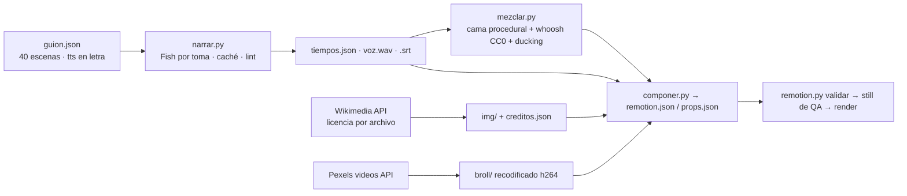

# Lecciones — Video explicativo «Star Trek: qué es y su cronología» (2026-10-31)

**Pedido:** «Genera un video explicando qué es Star Trek y un resumen de la línea cronológica de todas las series y
películas; usa imágenes, clips y demás; tú haz el guion y las animaciones con los recursos del repo; la duración la
decides tú.» Primer **explicador largo horizontal** del toolkit (6 min 36 s, 1920x1080) y primera pieza real con el
[[Motor-Remotion]] (el humo anterior era de 3 s). Proyecto: `proyectos/star-trek-cronologia_31102026/`.

## Flujo que quedó

## Qué se aprendió

1. **Enrutar primero sirvió:** `enrutar.py` dio `remotion_video` (0.98) y era la ruta correcta: una línea de tiempo con
   zoom por siglo, tarjetas y regla de años no la expresa el motor promo ni sale razonable con `drawtext`.
2. **Guion → tiempos medidos, nunca al revés.** Cada escena se locuta en una toma (`narrar.py`, Fish S2 Pro por
   `/audio/speech`), se mide el WAV y la escena dura `max(min, 0.35 + voz + pausa)`. 32 tomas, 952 palabras, 0.15–0.21
   s/sílaba, diff dirigido con `verificar_voz.py --json`: 0 observaciones. **Años en letra en `tts`** («mil novecientos
   sesenta y seis») y cifras solo en pantalla: pasa el lint `E-TTS-CIFRA` y Fish los lee bien; el `.srt` hereda la letra.
3. **Wikimedia Commons es la fuente de retratos y fotos históricas**, pero hay que filtrar la licencia por archivo
   (`extmetadata.LicenseShortName` ∈ dominio público / CC0 / CC BY / CC BY-SA) y **respetar su rate limit**: ~20
   consultas seguidas al API dan `429`, y las miniaturas generadas (`iiurlwidth=2560`) se bloquean mucho antes que los
   originales. Lo que funcionó: pausas de 2.5 s entre consultas, bajar el **original** cuando mide ≤ 4700 px y el thumb de
   1600 solo para gigapíxeles (JWST 11264 px, Orión 18000 px), 5 s entre descargas, dos intentos y seguir. Hoja de
   contactos con Pillow (`~/.venvs/imagen`) para elegir 43 candidatas de 310 en dos lecturas.
4. **Pexels bloquea el User-Agent de `urllib`** (`403`), con `curl` o un UA de navegador responde `200`. Sus clips
   «cósmicos» de 120 s pesan 700–900 MB (50 Mbps, ruido de estrellas): recodificar con FFmpeg (`crf 27`, 30 fps) antes
   del render (starfield 742 → 305 MB, cosmos 244 → 97 MB). Revisar siempre un fotograma por clip en hoja de contactos:
   tres de diez se descartaron por aspecto (amarillo chillón, manchas, nave genérica).
5. **Pixabay con key inválida** (`[ERROR 400]`) y **Openverse caído** (timeouts en 3 intentos a lo largo de una hora): la
   cama procedural de FFmpeg volvió a ser el respaldo (pads Am–F–C–G de 16.5 s con `concat`, bajo 55 Hz, «aire» de ruido
   rosa filtrado, `loudnorm -18`), y los whoosh salieron del **caché CC0** `~/Music/syscom-stock` (manifest de septiembre).
6. **Remotion para explicadores largos:** composición **declarativa** (`props.escenas` con tipo, tiempos y datos; el TSX
   solo pinta) para poder regenerar el video al cambiar el guion sin tocar React. Patrones que funcionaron:
   `<Sequence from={inicio·fps − 15}>` con fundido de 15 cuadros = el fade de 0.5 s de la casa; fondo continuo de B-roll
   (`<Loop>` + `<OffthreadVideo trimBefore>`), fuentes con `@remotion/google-fonts` (Orbitron + Inter, instalado en
   `remotion/package.json` a 4.0.539 fijo), `spring` con `delay` escalonado para listas, `scale`/`translate` como propiedades
   CSS sueltas (recomendación de `/remotion-markup`).
7. **Línea de tiempo con 800 años vacíos:** eje por tramos (`vistaDe`: dos segmentos con corte «· · ·» para la vista
   global, uno para cada siglo) e interpolación del foco anterior al actual (45 cuadros, `Easing.inOut`). Las etiquetas
   se amontonaban: **acomodo automático de filas por vista** (ancho estimado = caracteres × 13.5 px; primera fila libre)
   y, en la vista global, **rótulos de era** escalonados en vez de 18 etiquetas. Revisado con `npx remotion still` (12
   fotogramas a `--scale 0.5` en ~2 min) antes de pagar el render: tres rondas de corrección sin renderizar el video.
8. **`remotion still` es el QA barato del motor:** `npx remotion still src/index.ts <Id> out.png --frame=N
   --props=recursos/remotion/props.json --public-dir=recursos/`; `componer.py` escribe ese `props.json` con el mismo
   contrato que `remotion.py render` para no depender del Studio.
9. **Créditos CC en pantalla:** cada foto lleva «Foto: autor · licencia» sobre un degradado y hay una pantalla final de
   créditos (3 columnas, 20 px) con título, autor, licencia y fuente; CC BY-SA exige atribución y el render la cumple.

## Medidas

- Nube: **0.10 USD** — 32 llamadas Fish S2 Pro (0.084 USD por 952 palabras) + 1 verificación `gemini-2.5-flash` de los
  32 WAV en una llamada (0.014 USD). `costo_sesion_hermes.py` sumó además 0.05 USD de `~/.hermes/state.db`, que es la
  última sesión de Hermes, no esta sesión de Claude: en sesiones de Claude esa partida no aplica (el script no distingue).
- Búsqueda de recursos: 54 consultas Commons (tres tandas por 429) + 6 Pexels; 310 candidatas → 43 elegidas → 34
  descargadas (5 bloqueadas por 429 persistente y sustituidas en el guion) y 10 clips (7 usados).
- Tiempo de agente: ~2 h de pared, de las que ~1 h fue esperar a Commons (429) y a las descargas de Pexels.
- Render (M3 16 GB): 11 877 cuadros 1920x1080 con B-roll por `<OffthreadVideo>` en **1129 s de motor (~10.5 cuadros/s)
  + 36 s de acabado FFmpeg** = 19.4 min; salida 438 MB (CRF 17 preset slow, 8.9 Mbps), yuv420p/BT.709, −14.0 LUFS, checks
  ok. Copia para el chat: 1280x720 a 430 kbps + AAC 96k = 25 MB (`recursos/entrega/`). Con Node en un hilo por cuadro, el
  cuello es el decodificado de B-roll: para piezas de 6 min conviene `--borrador` para revisar movimiento y el render
  final una sola vez.

## Segunda versión (v2, la misma noche): más fotos, más gráfico, voz Achird

Pedido: «agrega más ejemplos en imágenes, sé más gráfico, observa los detalles, planea de nuevo y usa la voz nueva por
defecto». Plan en `proyectos/star-trek-cronologia_31102026/plan-v2.md`; diagnóstico con dos fotogramas por escena
(hoja de contactos con FFmpeg + Pillow): una sola foto por escena, 16 escenas sin foto, rótulos de Comic-Con, etiquetas
de años recortadas y créditos de 20 px.

10. **El contrato de imágenes se extendió sin romper el v1:** `img` sigue valiendo y se añadieron `imgs` (1–3 fotos con
    `pie`), `pantalla.mosaico` (portada), `pantalla.tira` (capítulo, 2x2), `pantalla.retratos` + `pantalla.nave` (ficha
    de serie), `items[].img` (tarjeta de película) y `timeline.items[].img` (miniatura circular). `componer.py` resuelve
    cada referencia (`clave` o `{clave, pie}`) y los créditos salen solo de lo usado, sin repetir. La composición pinta
    por tipo y degrada sola: con 2 retratos o sin nave cambia el acomodo, no falla.
11. **Commons devolvía 429 aunque el ritmo fuera lento (5 s): el problema era el User-Agent.** Con un UA que lleva
    un contacto real (`media-agent-toolkit/1.0 (https://github.com/Xavier-Guereque/media-agent-toolkit; …)`) bajaron las 51
    fotos sin un solo 429 a 10 s por archivo; con «contact: local» fallaban 3 de cada 10 incluso con esperas de 40 s.
    Wikimedia lo documenta en su política de UA; `scripts/commons.py` (nuevo: `buscar` con filtro de licencia, hoja
    de contactos y `bajar` con fusión de `creditos.json`) ya lo trae.
12. **Las cabeceras HTTP de `urllib` son latin-1:** un guion largo («—») en el UA lanza `UnicodeEncodeError`. Solo ASCII.
13. **Gemini TTS (Achird) habla un 6.5 % más lento que Fish en el mismo guion** (422 s frente a 396 s): el «En seis
    minutos» del guion pasó a «siete». Cada cambio de voz obliga a releer las cifras que dependen de la duración.
14. **La cama musical estaba cacheada a la duración de la v1** (`if not exists(cama.wav)`): la mezcla v2 dejó los
    créditos en silencio (cola −91 dB) hasta regenerarla. Las cachés por existencia de archivo deben llevar la duración
    en el nombre o invalidarse al cambiar `tiempos.json`.
15. **QA por hojas de 12 stills** (`npx remotion still … --scale=0.5`, ~10 s cada uno): tres rondas detectaron el rótulo
    de era chocando con la fila Kelvin, el recorte de «2020 – 2023» (la etiqueta se partía en dos líneas: ahora
    `whiteSpace: nowrap` y centrada dentro de la regla) y «Picard 2399–2401» rozando el borde (foco XXIV a 2416).
16. **Voz por defecto de la casa:** `config.local.json > voz_default` + `voz.resolver_voz` (spec > default > casa) y
    `voz.tts_speech` (cualquier modelo de `/audio/speech` con `voice` e `instructions`); `narrar.py` solo cambió
    tres líneas. Elección y alternas en `docs/Preferencias-Usuario.md`.

Medidas v2: 78 fotos distintas (34 de la v1 + 51 nuevas; 7 sin usar), 87 créditos; voz 0.085 USD (33 tomas Gemini) +
verificación 0.015 = **0.10 USD**; búsqueda de 62 consultas y descarga en ~25 min de pared (contra ~1 h en la v1).
Render: 12 646 cuadros en **1331 s de motor (~9.5 cuadros/s, un 12 % más lento que la v1 por las 78 ``)** + 37 s
de acabado; máster 450 MB, −14.0 LUFS, pico −1.4 dBFS, checks ok. Aviso del acabado: `loudnorm` cayó a modo
*dynamic* porque la mezcla llegaba con pico −0.8 dBTP (la ganancia lineal de +1 dB habría pasado de −1.5 dBTP); el LRA
de 2.9 LU es el de la propia mezcla (narración con cama y ducking), no un efecto del limitador. Para forzar el modo
lineal, `mezclar.py` debería dejar el pico en ≤ −3 dBTP (`alimiter`) antes del acabado.

## Preguntas de [[AGENT]] §15

**¿Cómo optimizar?** (1) Promover `narrar.py` + `componer.py` a `scripts/explicador.py` (guion.json → voz → tiempos →
props) y la composición a una base `Explicador.tsx` parametrizable: el 80 % del trabajo fue genérico. (2) Un
`scripts/commons.py` con búsqueda, filtro de licencia, hoja de contactos y descarga con ritmo (originales ≤ 4700 px, 5 s
entre descargas) evitaría la hora perdida en 429. (3) Pexels: User-Agent de navegador y recodificar los clips > 100 MB
antes de nada. (4) Hacer siempre los stills de QA antes del render.

**¿Qué nuevas funciones?** `@remotion/google-fonts` y `@remotion/transitions` (instaladas; transitions no se usó al final:
el fundido manual bastó), `<Loop>` + `<OffthreadVideo trimBefore>`, `npx remotion still` con `--props`/`--public-dir`,
acomodo automático de filas en una línea de tiempo, eje por tramos con corte, verificación de 32 tomas en una sola
llamada de `verificar_voz.py --json`, descarga de Commons con `iiurlwidth` y `extmetadata` para atribución, Pexels videos
API con UA. Pendiente: medir si `OffthreadVideo` con clips de 300 MB penaliza el render frente a 100 MB.

Relacionado: [[Motor-Remotion]], [[Lecciones-2026-10-31-remotion-y-longcat]], [[Imagenes-Libres-de-Derechos]],
[[Audio-CC0]], [[Lecciones-2026-09-29-reel-syscomexpo-30s]] (voz Fish por tomas).
