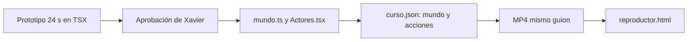

# Lecciones — Cursos como mundo continuo y reproductor interactivo (2026-11-01)

**Pedido:** «Quiero que los hagas con muchas animaciones, que no parezca presentación, sino un video interactivo impresionante.» Prueba real: `proyectos/ejemplo-ip_01112026/`, lección `m1-l1`.

## Flujo que quedó

## Qué se aprendió

1. **Lo que hacía presentación era la estructura, no el color:** el salto vino de un solo mundo con cámara, no de más efectos.
2. **Prototipar primero acotó el riesgo:** 24 s a mano fijaron el lenguaje; luego el motor lo reprodujo desde `curso.json`, sobre las mismas palabras.
3. **`requestAnimationFrame` no basta para vigilar el video:** se detiene en segundo plano y el alumno se saltaría la pregunta. La prueba real lo mostró; se reforzó con `timeupdate` y `seeking`.
4. **Una acción no se ve si no cambia nada:** resaltar en azul lo que ya es azul era invisible; `resalta` ahora da un pulso.
5. **Encuadrar hacia lo que se nombra:** un acercamiento dejó fuera el `.10` justo al decirlo. Las hojas de contacto lo atraparon, no las pruebas.
6. **El contenido de la última escena debe sobrevivir a la cola:** la escena termina antes que el video.
7. **`file://` no sirve en el navegador integrado:** para probar `<video>` con saltos hace falta un servidor con `Range`; el `http.server` de Python no lo trae.

## Medidas

| Medida | Antes | Ahora |
|---|---|---|
| Lección 63.6 s, motor | 26 s | 51–53 s |
| Voz nueva | 0.012 USD | 0 USD (caché) |
| Sonoridad | −16.0 LUFS | −16.0 LUFS, checks ok |

## Preguntas de [[AGENT]] §15

**¿Cómo optimizar?** (1) Hacer hoja de contacto del MP4 cada 3–4 s antes de revisar en detalle. (2) Reutilizar `m1-l1` como plantilla. (3) Usar `--borrador` con voz simulada para validar cámara y encuadres.

**¿Qué funciones nuevas usé?** Interpolación logarítmica de zoom, `justify-content: safe center`, `color-mix`, y `<track>` desde `Blob` para que los subtítulos funcionen en `file://`.

**Pendiente:** 9:16, escena `screencast` con clip real, migrar `m1-l2` a mundo, música de intro y cierre (se usaron solo SFX), probar la página abierta directamente como `file://` en Chrome y Safari, y medir aprendizaje con personas (Kirkpatrick 2).

Relacionado: [[Motor-Curso]], [[Metodologia-Cursos-Video]], [[Lecciones-2026-11-01-metodologia-cursos]].
