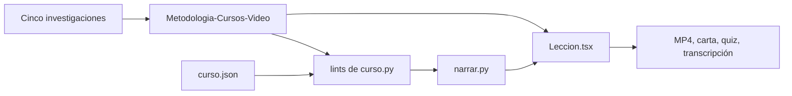

# Lecciones — Metodología y motor de cursos en video (2026-11-01)

**Pedido:** «Investiga las mejores metodologías del mundo para crear cursos en video, sustentadas científicamente, que cumplan lo mínimo de la SEP y las mejores instancias educativas, y la mejor manera visual de enseñar.» Prueba real: `proyectos/ejemplo-ip_01112026/`.

## Flujo que quedó

## Qué se aprendió

1. **No hay «la mejor metodología»:** hay cinco capas convergentes, y la evidencia fuerte está en prácticas concretas, no en marcos con nombre.
2. **La evidencia cambió el diseño:** el plan inicial tenía viñetas animadas; el reporte exigió dibujo dinámico con puntero, porque sin mano o puntero el dibujo no supera al diagrama terminado.
3. **Un MP4 no obliga a responder:** el efecto grande de las preguntas requiere un LMS. Por eso `carta` entrega `quiz.json`.
4. **`pathLength` no convive con `vector-effect: non-scaling-stroke`:** el trazo salió punteado y solo se vio en los stills. El SVG pasó a píxeles reales.
5. **Atenuar hasta el final deja poco contraste:** los stills mostraron la escena final en gris. Ahora todo vuelve a contraste pleno al terminar la voz.
6. **Whisper alinea bien tomas de Gemini TTS:** con `difflib` el guion manda y lo no reconocido hereda el reparto por sílabas.

## Medidas

| Medida | Valor |
|---|---|
| Lección real | 63.6 s, 1909 cuadros, 1920x1080 |
| Render | motor 26 s, total 32 s (M3 16 GB) |
| Voz | 8 tomas Achird, 0.012 USD |
| Sonoridad | −16.0 LUFS, checks ok |

`loudnorm` cayó a modo dinámico (TP medido −2.83 dBTP, LRA 3.1 LU). Los checks pasan y queda pendiente evaluar si conviene un limitador previo.

## Preguntas de [[AGENT]] §15

**¿Cómo optimizar?** (1) Producir primero una lección muestra y revisar su hoja de stills. (2) Usar `--leccion` al corregir, porque la caché evita pagar lo demás. (3) Usar `--borrador` antes del render final.

**¿Qué funciones nuevas usé?** `Proyecto.avance_rango` y `lufs`, faster-whisper por subproceso desde `~/.venvs/whisper`, `difflib.SequenceMatcher` para alinear, `pathLength` en SVG con `strokeDashoffset`, y hard links por lección.

**Pendiente:** humo en orientación vertical, escena `screencast` con un clip real, y prueba con personas reales para medir aprendizaje (Kirkpatrick 2).

Relacionado: [[Metodologia-Cursos-Video]], [[Motor-Curso]], [[Lecciones-2026-10-31-star-trek-cronologia]], [[Lecciones-2026-10-31-muestras-voz-curso]].
