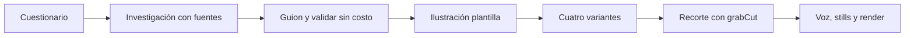

# Lecciones — Muestra «La trampa de la chaqueta roja» (2026-11-01)

**Pedido:** curso de Star Trek sobre uniformes, colores, rangos y naves. Se produjo la lección 2.3 como muestra. Proyecto: `proyectos/star-trek-flota_01112026/`. Primera prueba real de [[Lecciones-2026-11-01-cuestionario-cursos]].

## Flujo que quedó

## Qué se aprendió

1. **Flash no sirve para variantes de color exactas:** dejó cuellos blancos y bandas faltantes. `gemini-3-pro-image` lo resolvió (ver [[preferencia-modelo-antes-que-parche-manual]]).
2. **Primero una plantilla, luego las variantes:** cuesta menos corregir una imagen y derivar las demás que corregir cinco.
3. **Referencia con persona y plantilla a la vez puede fallar:** Mando heredó el uniforme viejo; salió bien con una sola referencia y la persona descrita en texto.
4. **Un actor `imagen` con fondo se ve como rectángulo:** hay que entregar PNG con alfa. `floodFill` se comió las figuras; `grabCut` con contorno exterior funcionó.
5. **`objetivo` sin velo se encima con actores centrados:** en mundos llenos conviene `plano: "estacion"`.
6. **El crédito por actor ensucia cuando se repite:** con ilustración propia basta el aviso de IA.
7. **La lección real duró 1.4 min, no 6:** el temario de 100 min probablemente sobra.

## Medidas

| Medida | Valor |
|---|---|
| Duración | 85.7 s, 1920x1080, −16.0 LUFS, checks ok |
| Render | 78 s de motor, 86 s en total |
| Costo registrado | 1.35 USD: 12 imágenes de 0.04 a 0.14 USD y 9 tomas de voz |
| Estimado previo | 0.22 USD |

## Curso completo (21 lecciones)

8. **Corregir un lado no le sale al modelo:** Pro no movió la tira de hombro en 5 de 5 intentos. Reflejar el uniforme y conservar los brazos originales con FFmpeg/OpenCV lo resolvió sin costo (`recursos/espejo.py`).
9. **Generar por familia rindió:** 20 imágenes nuevas y 4 recolores salieron sin reintentos con Pro, con una referencia solo de estilo.
10. **Las naves se recortan por distancia al color de fondo:** `grabCut` pierde piezas delgadas (`recursos/recorte2.py`).
11. **La fuente mono no trae `━ ┄`:** se desbordaban o salían finos; ASCII (`===`, `- -`) mide lo que el motor espera.
12. **Los rótulos tapan etiquetas al acercar:** en escenas con `puntos` o `solucion`, limitar `z` a 1.3 y bajar la cámara (`recursos/ajustes_qa.py`).
13. **`costos.jsonl` no da costo de voz:** registra caracteres, no `usage.cost`; el total real sale de `/auth/key`.

| Medida del curso | Valor |
|---|---|
| Video | 21 lecciones, 29.4 min, 1.5 GB, −16.0 LUFS, checks ok |
| Render | ~38 min en M3 |
| Reproductor | 23 preguntas; abre, cambia de lección, la pregunta detiene el video y reanuda |

## Preguntas de [[AGENT]] §15

**¿Cómo optimizar?** Usar Pro desde la plantilla y agregar `recorte.py` al repo como comando, porque aquí vivió fuera de `scripts/`.

**¿Qué funciones nuevas usé?** `cv2.grabCut` con relleno por contorno para recortar figuras.

**Pendiente:** cotejar colores y siluetas con fotogramas. Escuchar la voz, porque el QA no la evalúa. Definir si el curso es gratuito o comercial.

Relacionado: [[Motor-Curso]], [[Metodologia-Cursos-Video]], [[Lecciones-2026-10-31-star-trek-cronologia]].
