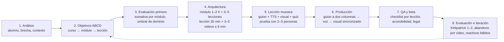
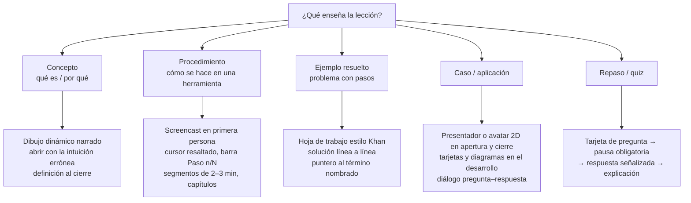

# Metodología de cursos en video con IA — Segmenta, señaliza y pregunta

> Fundamento pedagógico, normativo y visual de la skill `crear-curso` de [[SKILL]]. Motor y contratos en [[Motor-Curso]]. Bitácora en [[Lecciones-2026-11-01-metodologia-cursos]]. Notas completas de investigación, con todas sus URL, en `docs/fuentes/cursos/` ([[Fuentes-Cursos]]).

## Cómo usar este documento

1. **Quien diseña el curso** sigue el flujo de ocho pasos y la anatomía de lección de abajo, y escribe `curso.json`.
2. **El motor aplica lo automatizable:** `scripts/curso.py validar` convierte estas reglas en errores y avisos, y `Leccion.tsx` aplica las reglas visuales.
3. **Lo no automatizable sigue siendo humano:** veracidad del contenido, revisión de subtítulos, prueba con 2–3 personas, trámites DC-5/RVOE y carga del quiz en un LMS.

**Límites honestos:** esta metodología no es una certificación. Un curso generado aquí puede estar «listo para DC-3» y «diseñado conforme a EC0301/EC0366», pero no tiene validez oficial ni constancia por sí mismo. Un MP4 lineal tampoco puede obligar a responder: la pregunta obligatoria, que es donde está la evidencia fuerte, requiere cargar `quiz.json` en un LMS.

## Plantilla de guion a dos columnas

Cada escena de `curso.json` es una fila: `tts` es la columna de audio y `pantalla` la visual. `en` une ambas: nombra la palabra sobre la que se dibuja el elemento.

| Bloque | Tipo de escena | Audio (`tts`) | Visual (`pantalla`) |
|---|---|---|---|
| Gancho | `gancho` | Problema real o intuición errónea, en segunda persona | Una frase grande |
| Objetivo | `objetivo` | «Al terminar vas a…» | Objetivo y criterio de éxito (automático) |
| Activación | `activacion` | Enlace con lo anterior | Una frase |
| Pre-entrenamiento | `preentrenamiento` | 2–3 términos clave | Términos |
| Bloque ≤ 6 min | `concepto` | Explicación conversacional | `elementos` dibujados sobre la palabra que los nombra |
| Comprobación | `pregunta` | Plantea, pausa y resuelve (`tts_retro`) | Opciones, correcta señalizada y retroalimentación |
| Ejemplo resuelto | `ejemplo` | Razona en voz alta | Solución línea a línea |
| Procedimiento | `pasos`, `screencast` | Verbo + objeto por paso | Lista numerada o clip propio |
| Aplicación | `caso` | Caso real | Tarjetas e imágenes con crédito |
| Cierre | `resumen`, `cierre` | 2–3 ideas y transferencia | Puntos y siguiente lección |

## Adaptaciones de la casa frente a este reporte

- **Sin kicker numerado ni barra de progreso** ([[Preferencias-Usuario]], [[AGENT]] §2): la barra «Paso n/N» se sustituye por la lista numerada.
- **Lección = un video** en `curso.json`. El bloque de 30 min de Coursera se expresa como 3–5 lecciones de un módulo.
- **El trazo se dibuja con SVG propio** en vez de rough.js, para no añadir dependencias.
- **Mundo continuo en vez de escenas separadas** ([[Motor-Curso]]): el usuario pidió que no parezca presentación. Encaja con la regla 11 solo si todo el movimiento comunica: la dirección se parte, el paquete viaja, la cámara entra al dato. El ambiente queda casi quieto. Es una derivación propia [CONV]: no hay experimento que compare mundo continuo contra escenas.
- **Tema oscuro `cine`:** la polaridad clara tiene mejor evidencia en lectura, así que el oscuro exige poco texto y trazos de alto contraste; no se ha medido en video instruccional.
- **Reproductor con pregunta obligatoria:** `reproductor.html` aplica la regla 5, que un MP4 no puede forzar.
- **Modo presentación:** `curso.modo.proposito: presentacion` existe para exponer, no para enseñar: apaga los lints pedagógicos y no genera carta, así que no hereda la evidencia ni los criterios de este documento. Si se busca aprendizaje, usa `aprendizaje` con pregunta obligatoria (regla 5).
- **Test entre lecciones:** `prueba_final` mantiene la recuperación obligatoria, pero fuera del segmento de ~5 min de la regla 5; `ambas` conserva la dosis intercalada. Es derivación propia [CONV].
- **Dibujo dinámico:** las lecciones con mundo usan acciones sincronizadas y cursor en vez de `elementos`; la mano o puntero visible de Fiorella & Mayer solo se cumple cuando hay `clic`.

No existe una "mejor metodología del mundo" con nombre propio y evidencia causal; lo que existe —y en lo que convergen MIT, Coursera, edX, Carnegie Mellon, la Open University y las rúbricas Quality Matters y OSCQR— es una **pila de cinco capas** cuyas prácticas sí están demostradas: alineación objetivos→evaluación→contenido (diseño inverso), una secuencia de lección tipo Gagné/Merrill con ejemplo resuelto primero, diseño multimedia según los principios de Mayer validados por el *overview* de 29 revisiones y 78 177 participantes de Noetel et al. (efecto agregado **g = 0.38**, mayor justamente cuando el ritmo lo marca el sistema y el material es complejo, como en un video), preguntas de recuperación obligatorias entre segmentos (divagación 19 % vs 41 % y examen final 90 % vs 68 %, *d* ≈ 1.0–1.4 en Szpunar et al.) y dominio con retroalimentación correctiva (*d* = 1.00 en Bloom; *d* = 0.70 para retroalimentación en Hattie) ([Noetel et al. 2022](https://doi.org/10.3102/00346543211052329); [Szpunar et al. 2013](https://doi.org/10.1073/pnas.1221764110); [visible-learning.org](https://visible-learning.org/hattie-ranking-influences-effect-sizes-learning-achievement/)). Para un curso producido con IA la noticia es buena: **la voz TTS moderna no penaliza el aprendizaje** (Dinçer 2022: humano vs TTS neuronal, *p* = .200), **el rostro del instructor no mejora el aprendizaje** en metaanálisis ni en un experimento de campo con 12 468 alumnos, y el formato con mejor evidencia —**dibujo dinámico narrado y señalizado**, sin cara continua— es precisamente el más fácil de generar programáticamente ([Dinçer 2022](https://doi.org/10.33902/JPR.202214591); [Alemdag 2022](https://doi.org/10.1007/s10639-022-11154-w); [Fiorella et al. 2019](https://doi.org/10.1037/edu0000325)). En México, la vía realista es la capacitación laboral: la constancia DC-3 solo exige registro DC-5 del agente, curso dado de alta, evaluación aprobada, horas, área temática y nombre del tutor en línea, y la "gramática" de carta descriptiva la fijan los estándares CONOCER EC0301, EC0217.01 y EC0366; el RVOE (SEP) es un expediente aparte, y sin él la ley obliga a declararlo (LGE art. 150) ([Acuerdo STPS 2013](https://www.dof.gob.mx/nota_detalle.php?codigo=5302582&fecha=14/06/2013); [LGE](https://www.diputados.gob.mx/LeyesBiblio/pdf/LGE.pdf)). El techo internacional lo ponen WCAG 2.2 AA, el DCMP Captioning Key, EBU R128 y, desde el 2 de agosto de 2026, el artículo 50 del AI Act para avatares que suplanten a personas reales. Lo que sigue convierte todo eso en reglas con número, fuente y fuerza de evidencia, y en una lista de verificación aplicable lección por lección.

**Leyenda de fuerza de evidencia usada en todo el reporte:** [MMA] meta-metaanálisis · [MA] metaanálisis · [RS] revisión sistemática · [RCT] experimento controlado · [COR] correlacional/observacional a gran escala · [GUÍA] norma o guía profesional · [LEY] obligación legal (jurisdicción indicada) · [CONV] convención institucional, opinión experta o derivación propia · [NV] no verificado en esta investigación.

## No existe "la mejor metodología": existe una pila de cinco capas en la que todos convergen

Los marcos con marca —ADDIE, SAM, Dick & Carey, Backward Design, Gagné, Merrill, 4C/ID— son modelos de proceso o de secuencia, no intervenciones con evidencia causal propia. El propio Merrill lo reconoce en el artículo fundacional de sus *First Principles*: "There is no attempt in this paper to identify the empirical support for these principles" ([Merrill 2002](https://mdavidmerrill.wordpress.com/wp-content/uploads/2019/04/firstprinciplesbymerrill.pdf)). La evidencia fuerte vive en las prácticas que esos marcos empaquetan. En la síntesis de Hattie (cerca de 1 200 metaanálisis) la **retroalimentación** pesa *d* = 0.70, la **práctica espaciada** 0.60, el **aprendizaje de dominio** 0.57, los **tests de práctica** 0.54, los ejemplos resueltos 0.37 y el intercalado 0.21; los **criterios de éxito** visibles suman *d* = 0.64 en la actualización MetaX de febrero de 2026 ([visible-learning.org](https://visible-learning.org/hattie-ranking-influences-effect-sizes-learning-achievement/); [Visible Learning MetaX](https://www.visiblelearningmetax.com/influences/view/success_criteria/)) [MMA]. La evaluación formativa produce **0.4–0.7 DE** en más de 250 estudios, y Bloom identificó la retroalimentación correctiva de dominio con *d* = 1.00, la mitad del célebre "2 sigma" de la tutoría individual ([Formative assessment](https://en.wikipedia.org/wiki/Formative_assessment); [Bloom's 2 sigma problem](https://en.wikipedia.org/wiki/Bloom%27s_2_sigma_problem)) [MA/RCT]. Dunlosky y colegas clasifican los tests de práctica y la práctica distribuida como las dos únicas técnicas de "utilidad alta"; releer, subrayar y resumir sin entrenamiento quedan abajo ([Dunlosky 2013](https://www.aft.org/ae/fall2013/dunlosky)) [RS]. Y el *doer effect* de Koedinger —hacer actividades rinde del orden de **seis veces** más que leer, con más de 12 500 alumnos y réplicas posteriores— es la razón por la que ninguna de las grandes plataformas trata el video como el producto final ([Butler et al. 2024](https://arxiv.org/html/2412.20923v1)) [COR, cifra de fuente secundaria].

Las instituciones de referencia no publican "la metodología"; publican el orden y los controles. Open edX prescribe *learning outcomes* → *assessment* → *content*, con beta testers antes de lanzar ([Open edX](https://docs.openedx.org/en/latest/educators/concepts/instructional_design/id_course_dev_process_overview.html)); MIT exige una **semana muestra** nueve meses antes del lanzamiento, videos finales con transcripción dos meses antes y beta test uno o dos meses antes ([MITx Timeline](https://openlearning.mit.edu/sites/default/files/inline-files/MITx%20MOOC%20Development%20Timeline.pdf)); Quality Matters certifica con **44 estándares específicos, 22 esenciales y 85 % de los puntos**, y define alineación como el trabajo conjunto de 2.1, 2.2, 3.1, 4.1, 5.1 y 6.1 ([Quality Matters](https://www.qualitymatters.org/qa-resources/rubric-standards/higher-ed-rubric)). La especificación más granular es el "algoritmo Coursera" que la Carlson School aplicó en diez MOOC: **módulo = 3–5 lecciones y 1–2 h de dedicación; lección ≈ 30 min = 3–5 videos de 6–9 min; al menos una pregunta en video cada 5–7 min; 3–4 preguntas por video; una evaluación sumativa por módulo** ([Norden et al. 2016](https://pubs.lib.umn.edu/index.php/mslt/article/download/735/739/976); [Technion MOOCTech](https://mooctech.net.technion.ac.il/resources/mooc-structure/)) [CONV]. Todo esto es convención, pero convención coherente con la evidencia anterior, y por eso la adopto como cifra operativa.

| Capa | Qué prescribe | Evidencia principal | Fuerza |
|---|---|---|---|
| 1. Proceso | Diseño inverso (resultados → evaluación → contenido); prototipo de una lección completa antes de producir en masa; beta test | Open edX, MIT, SAM, Udemy "test video", LinkedIn "sample video" | [CONV] convergente |
| 2. Objetivos y alineación | Objetivos ABCD/Bloom por curso, módulo y lección; criterio de éxito visible; cada objetivo apunta a una evaluación | QM 2.1–6.1; Stanford; CMU; *success criteria* *d* = 0.64 | [CONV] + [MMA] |
| 3. Secuencia de lección | Gancho → objetivo → activación → pre-entrenamiento → bloque ≤ 6 min → pregunta → ejemplo resuelto → práctica con retroalimentación → resumen | Gagné, Merrill (ejemplo resuelto primero), 4C/ID | [CONV]; prácticas internas con [MA] |
| 4. Diseño multimedia | Coherencia, señalización, contigüidad, modalidad, segmentación, personalización, sin música bajo narración | Noetel 2022 (*g* = 0.38 agregado) | [MMA] |
| 5. Aprendizaje activo y dominio | Pregunta de recuperación obligatoria por segmento; repaso espaciado; umbral de dominio con reintento y retroalimentación por distractor | Szpunar 2013; Adesope 2017 (*g* = 0.61–0.70); Bloom; Hattie | [RCT]/[MA] |

Hay una razón específica por la que el video, y no cualquier medio, exige esta disciplina. En el *overview* de Noetel et al., el diseño multimedia rinde **g = 0.41 cuando el ritmo lo marca el sistema** frente a 0.27 cuando lo marca el aprendiz, y **g = 0.70 con material complejo** frente a 0.20 con material simple; el conocimiento previo, el nivel educativo y la materia no moderaron de forma consistente ([Noetel et al. 2022](https://doi.org/10.3102/00346543211052329)) [MMA]. Un video narrado por TTS es, por definición, ritmo del sistema; un curso técnico es, casi siempre, material complejo. Estamos en el cuadrante donde descuidar coherencia, contigüidad y señalización cuesta más. El segundo dato estructural viene del metaanálisis de 105 ensayos aleatorizados del mismo grupo: **sustituir** enseñanza por video mejora *g* = 0.28, pero **añadir** video a la enseñanza existente mejora *g* = 0.80 ([Noetel et al. 2021](https://doi.org/10.3102/0034654321990713)) [MA]. El video rinde como complemento de la práctica, no como reemplazo de ella; el curso debe diseñarse para que el tiempo de "hacer" sea al menos comparable al de "ver".

## Las reglas de diseño con número: lo que los metaanálisis demuestran para un video narrado por TTS

La tabla siguiente es el núcleo operativo del reporte. Cada regla lleva su tamaño de efecto, la fuente que lo respalda y la fuerza de esa evidencia; el orden aproxima el retorno esperado. Conviene leer los valores con una advertencia que la propia literatura hace explícita: las medianas del laboratorio de Mayer (*d* ≈ 0.9–1.4) son dos o tres veces mayores que los *g* de metaanálisis independientes (0.15–0.74); los principios son reales, pero el efecto esperable "en producción" es pequeño-mediano, no grande ([Mayer 2020, resumen de principios](https://ugc.futurelearn.com/uploads/files/7d/d6/7dd6188d-c343-4311-b064-ac98d2c95abc/Multimedia_Principles._R._E._Mayer__2020.pdf); [Noetel et al. 2022](https://doi.org/10.3102/00346543211052329)).

| # | Regla operativa | Efecto | Fuente | Fuerza |
|---|---|---|---|---|
| 1 | Sincroniza narración y visual (lo que se oye es lo que aparece) y pon cada etiqueta sobre o junto a lo que nombra; nunca "primero el gráfico, luego la explicación" ni leyendas separadas | Contigüidad *g* = 0.74; temporal 0.78; espacial 0.63 (0.74 cuando texto e imagen no duplican información) | [Noetel 2022](https://doi.org/10.3102/00346543211052329); [Schroeder & Cenkci 2018](https://doi.org/10.1007/s10648-018-9435-9) | [MMA]/[MA] |
| 2 | Señaliza lo esencial: color del elemento activo, flecha o subrayado sincronizado con la palabra, títulos de estructura y **énfasis de entonación en la voz**; prohíbe parpadeos | Señalización *g* = 0.43 (retención 0.53, transferencia 0.33; 103 estudios, 12 201 participantes); color 0.44/0.39; entonación 0.43/0.70; parpadeo **−0.56/−0.47** | [Schneider et al. 2018, resumen TUM](https://www.clearinghouse.edu.tum.de/wp-content/uploads/2018/12/CHU_KR-22_-Schneider_2017_Lernmaterial_Hervorhebungen.pdf) | [MA] |
| 3 | Narra; no llenes la pantalla con el texto de la narración; el texto en pantalla "bueno" es el que señaliza (títulos, 2–3 palabras clave, etiquetas) | Modalidad *g* = 0.38 (0.20 corrigiendo sesgo de publicación); añadir texto breve a audio *g* = 0.29; añadir audio a texto largo *g* = −0.04 | [Noetel 2022](https://doi.org/10.3102/00346543211052329) | [MMA] |
| 4 | Segmenta en unidades con sentido decididas por el diseñador, con pausa o tarjeta entre segmentos | Segmentación *g* = 0.34; por el instructor *g* = 0.41 vs por el aprendiz 0.20; funciona con ritmo del sistema | [Rey et al. 2019](https://doi.org/10.1007/s10648-018-9456-4); [Noetel 2022](https://doi.org/10.3102/00346543211052329) | [MA]/[MMA] |
| 5 | Al final de cada segmento de ~5 min, pregunta de recuperación **obligatoria** con retroalimentación; anuncia que habrá evaluación acumulada | Divagación 19 % vs 41 %; notas ×3; segmento final 89 % vs 68 %; examen final 90 % vs 68 % (*d* ≈ 1.0–1.4); menos ansiedad | [Szpunar et al. 2013](https://doi.org/10.1073/pnas.1221764110); práctica con tests *g* = 0.61–0.70 [Adesope 2017](https://doi.org/10.3102/0034654316689306) | [RCT]/[MA] |
| 6 | Combina preguntas incrustadas con visuales señalizados: ninguna de las dos cosas basta sola | Solo la combinación superó a las otras tres versiones (*d* = 0.58 [0.32, 0.85], N = 300) | [Kestin & Miller 2022](https://doi.org/10.1103/PhysRevPhysEducRes.18.010148) | [RCT] |
| 7 | Prefiere preguntas cerradas de recuperación a *prompts* abiertos de auto-explicación sin andamiaje | Prompts: sin efecto en aprendizaje; +carga intrínseca y extraña; respuestas de baja calidad (N = 128) | [Beege & Ploetzner 2025](https://doi.org/10.1007/s11251-024-09693-5) | [RCT] |
| 8 | Escribe el guion en segunda persona y tono conversacional ("tú", "vamos a") en lecciones de menos de 35 min | Personalización: retención *d* = 0.30, transferencia 0.54; **no significativo por encima de 35 min**; carga *g* = 0.62 | [Ginns et al. 2013](https://doi.org/10.1007/s10648-013-9228-0); [Noetel 2022](https://doi.org/10.3102/00346543211052329) | [MA] |
| 9 | Elimina lo "interesante pero irrelevante": anécdotas, B-roll decorativo, adornos persistentes | Coherencia mediana *d* = 0.86 (18 de 19 pruebas); quitar detalles seductores *g* = 0.33; los persistentes dañan más (0.43) que los transitorios (0.12, n.s.) | [Mayer 2020](https://ugc.futurelearn.com/uploads/files/7d/d6/7dd6188d-c343-4311-b064-ac98d2c95abc/Multimedia_Principles._R._E._Mayer__2020.pdf); [Noetel 2022](https://doi.org/10.3102/00346543211052329) | [CONV]/[MMA] |
| 10 | Nada de música bajo la narración; si hay, solo intro/cierre/pausas, instrumental y ≥ 20 dB bajo la voz; efectos de sonido solo como señal estructural | Música y sonidos irrelevantes perjudican retención y transferencia; metaanálisis: efecto nulo o ligeramente negativo en memoria; revisión 2020 "inconclusa", peor con letra y volumen | [Moreno & Mayer 2000](https://tecfa.unige.ch/tecfa/teaching/methodo/Moreno_Mayer00.pdf); [Kämpfe et al. 2011](https://Www.Gwern.net/doc/music/music-distraction/2011-kampfe.pdf); [Lehmann & Seufert 2017](https://doi.org/10.3389/fpsyg.2017.01902) | [RCT]/[MA] |
| 11 | Anima solo lo que cambia (proceso, trayectoria, transformación); el resto, imágenes estáticas limpias | Animación *g* = 0.23; significativa si comunica algo (0.40) y nula si es decorativa (−0.05) | [Berney & Bétrancourt 2016](https://doi.org/10.1016/j.compedu.2016.06.005); [Noetel 2022](https://doi.org/10.3102/00346543211052329) | [MA] |
| 12 | Construye el diagrama en vivo (trazo a trazo, con puntero o mano visible) en lugar de mostrarlo terminado | Dibujo dinámico *d* = 0.54; el dibujo en tableta **sin mano visible** no superó al diagrama terminado | [Fiorella et al. 2019](https://doi.org/10.1037/edu0000325); [Fiorella & Mayer 2016](https://www.learningscientists.org/blog/2017/1/24-1) | [RCT] |
| 13 | Pre-entrena: antes de una lección compleja, un microsegmento con los nombres y rasgos de los 2–3 conceptos clave | Principio de pre-entrenamiento de Mayer | [Mayer 2020](https://ugc.futurelearn.com/uploads/files/7d/d6/7dd6188d-c343-4311-b064-ac98d2c95abc/Multimedia_Principles._R._E._Mayer__2020.pdf) | [CONV] (RCT fundacional no verificado) |
| 14 | Usa TTS neuronal de alta calidad sin temor; invierte en prosodia (énfasis en lo importante, entusiasmo moderado) y acento mexicano familiar | Humano vs TTS moderno: n.s. (*p* = .200; esfuerzo *p* = .964); sin diferencias en otro RCT; la voz no modera el efecto de agentes; voz entusiasta → señales sociales; instructor positivo → rendimiento (37 estudios) | [Dinçer 2022](https://doi.org/10.33902/JPR.202214591); [Craig & Schroeder 2019](https://doi.org/10.1177/0735633118802877); [Castro-Alonso 2021](https://doi.org/10.1007/s10648-020-09587-1); [Liew et al. 2020](https://doi.org/10.1108/ILS-11-2019-0124); [Zhu, Pi & Yang 2024](https://doi.org/10.1007/s10648-024-09859-0) | [RCT]/[MA] |
| 15 | Avatar opcional; si aparece, que haga algo útil (señalar, guiar la mirada al material) o solo en apertura, transiciones y cierre; nunca permanente sobre contenido denso | Instructor presente: sin efecto en aprendizaje, +motivación (*g* = 0.431), +carga (*g* = 0.319); rostro constante vs estratégico: igual aprendizaje con N = 12 468; agentes 2D *g* = 0.38 vs 3D 0.11 n.s. | [Alemdag 2022](https://doi.org/10.1007/s10639-022-11154-w); [Kizilcec et al. 2015](https://vhil.stanford.edu/publications/learning/instructors-face-video-instruction-evidence-two-large-scale-field-studies); [Castro-Alonso 2021](https://doi.org/10.1007/s10648-020-09587-1) | [MA]/[RCT campo] |
| 16 | Subtítulos cerrados (activables) siempre disponibles; quemados solo breves y sin duplicar el texto de pantalla; si el público aprende en segunda lengua, subtítulos en esa lengua | L2: comprensión *g* = 0.99, vocabulario 0.87; para nativos, redundancia verbal *g* = 0.15 | [Noetel 2022](https://doi.org/10.3102/00346543211052329); [Mayer, Fiorella & Stull 2020](https://doi.org/10.1007/s11423-020-09749-6) | [MMA]/[CONV] |
| 17 | Ritmo de habla natural-animado (≈ 150–175 ppm en español), sin lentitud "pedagógica"; recorta muletillas y pausas largas en posproducción | Engagement sube con velocidad hasta 254 ppm (media 156); comprensión intacta hasta 2× de reproducción, cae a 2.5× | [Guo et al. 2014](https://doi.org/10.1145/2556325.2566239); [Murphy et al. 2022](https://doi.org/10.1002/acp.3899) | [COR]/[RCT] |
| 18 | Como heurística de duración: 3–6 min por segmento conceptual; en tutoriales, capítulos y marcadores para saltar y re-ver | Mediana de visionado ≤ 6 min en 6.9 M sesiones; intento de problema 56 % (0–3 min) → 31 % (> 12 min); tutoriales se ven 2–3 min y se re-visionan | [Guo et al. 2014](https://doi.org/10.1145/2556325.2566239) | [COR] (engagement, no aprendizaje) |
| 19 | Abre la lección conceptual con la intuición errónea o la pregunta, no con la definición; refuta explícitamente la concepción equivocada | Ganancias de "refutación" y "diálogo" ≈ el doble que la exposición directa (364 alumnos; no significativo en el artículo de conferencia) | [Muller et al. 2008](https://openjournals.library.sydney.edu.au/IISME/article/view/6345/6984); [3Blue1Brown FAQ](https://www.3blue1brown.com/faq/) | [RCT débil]/[CONV] |
| 20 | Ejemplo resuelto completo primero, luego ejemplos parcialmente resueltos (*fading*), luego práctica variada con coaching decreciente | Merrill/van Merriënboer; ejemplos resueltos *d* = 0.37, andamiaje 0.82 | [Merrill 2002](https://mdavidmerrill.wordpress.com/wp-content/uploads/2019/04/firstprinciplesbymerrill.pdf); [visible-learning.org](https://visible-learning.org/hattie-ranking-influences-effect-sizes-learning-achievement/) | [CONV]/[MMA] |
| 21 | Distribuye los repasos de un concepto en lecciones posteriores (espaciado) e intercala tipos de problema en los ejercicios de repaso, no en la primera exposición | Práctica distribuida: utilidad alta; espaciado *d* = 0.60; intercalado 0.21 | [Dunlosky 2013](https://www.aft.org/ae/fall2013/dunlosky); [visible-learning.org](https://visible-learning.org/hattie-ranking-influences-effect-sizes-learning-achievement/) | [RS]/[MMA] |
| 22 | Fija umbral de dominio explícito con reintento y retroalimentación por distractor (p. ej., 80 % en el quiz de módulo) | Mastery *d* = 0.57; feedback-corrective 1.00; Khan: 70 % "Familiar", 100 % en test de unidad para "Mastered" | [visible-learning.org](https://visible-learning.org/hattie-ranking-influences-effect-sizes-learning-achievement/); [Bloom 2 sigma](https://en.wikipedia.org/wiki/Bloom%27s_2_sigma_problem); [Khan Academy](https://support.khanacademy.org/hc/tr/articles/5548760867853) | [MMA]/[CONV] |

Tres de estas reglas merecen un comentario porque contradicen el sentido común del sector. La primera es la **voz**: el "principio de voz" original (voz humana > voz de máquina, *d* ≈ 0.6–0.9) se midió con sintetizadores de 2003–2012; con TTS modernos, Dinçer encontró que el TTS tradicional sí perdía frente al humano (*d* = 0.90) pero el TTS neuronal no (42.67 vs 54.12 vs 60.56 sobre 100; humano vs moderno *p* = .200), y la voz dejó de moderar el efecto de los agentes pedagógicos en el metaanálisis de Castro-Alonso ([Dinçer 2022](https://doi.org/10.33902/JPR.202214591); [Castro-Alonso et al. 2021](https://doi.org/10.1007/s10648-020-09587-1)). Lo que sí sigue ganando la voz humana es la **confianza y "humanidad" percibidas** ([Craig & Schroeder 2019](https://doi.org/10.1177/0735633118802877)), un coste de percepción, no de aprendizaje, que se compensa con guion conversacional, afecto positivo y transparencia. La segunda es el **rostro**: tres revisiones y metaanálisis (2021–2024) no encuentran efecto general en aprendizaje; Fiorella y Mayer demostraron que lo que ayuda son conductas concretas —dibujar en vivo, guiar la mirada, señalar— y no la visibilidad en sí; y en el experimento de campo de Kizilcec el **35 % de los alumnos eligió ver los videos sin cara** para evitar distracción ([Henderson & Schroeder 2021](https://doi.org/10.1016/j.caeo.2021.100059); [Polat 2023](https://doi.org/10.1007/s10639-022-11532-4); [Fiorella et al. 2019](https://doi.org/10.1037/edu0000325); [Kizilcec et al. 2015](https://vhil.stanford.edu/publications/learning/instructors-face-video-instruction-evidence-two-large-scale-field-studies)). Los avatares generados por IA siguen la misma lógica: en cuatro experimentos recientes (N = 83, ~500, 447 y un estudio de eye-tracking) el aprendizaje fue **equivalente** al del instructor humano, con menor presencia social o credibilidad cuando el aprendiz nota que es sintético ([Leiker et al. 2023](https://arxiv.org/abs/2304.03784); [Li, Barry & Cukurova 2024](https://arxiv.org/abs/2412.10384)). La tercera es la **regla de los 6 minutos**: proviene de un análisis retrospectivo de *engagement* en cuatro MOOC de 2012 cuyos autores advierten literalmente que no debe usarse para concluir sobre aprendizaje; videos de 34–48 min en cursos universitarios reales no perjudicaron el aprendizaje, y lo demostrado experimentalmente es la **segmentación** (*g* ≈ 0.34), no un umbral en minutos ([Guo et al. 2014](https://doi.org/10.1145/2556325.2566239); [Heidig et al. 2024](https://doi.org/10.1007/s11423-024-10391-9); [Rey et al. 2019](https://doi.org/10.1007/s10648-018-9456-4)).

### Lo demostrado, lo convencional y lo no verificado

| Afirmación habitual | Estado | Por qué |
|---|---|---|
| "Los videos deben durar menos de 6 minutos" | Convencional | Correlación de engagement en MOOC (Guo 2014); lo demostrado es segmentar |
| "El instructor en pantalla mejora el aprendizaje" | Refutada como regla general | Alemdag 2022, Henderson & Schroeder 2021, Heidig 2024: efecto nulo en aprendizaje; positivo en motivación |
| "La voz humana es mejor que la sintética" | Demostrada solo con TTS antiguo | Dinçer 2022 y Craig & Schroeder 2019: sin diferencia con TTS moderno; **sin estudios revisados por pares sobre TTS neuronal 2023–2026** [NV] |
| "Los subtítulos benefician a todos" | Demostrada para L2 y accesibilidad; débil para nativos | *g* = 0.99 (L2) vs 0.15 (redundancia verbal); falta evidencia objetiva en adultos nativos neurotípicos |
| "La música de fondo ayuda a concentrarse" | Sin apoyo | Moreno & Mayer 2000 (daña); metaanálisis nulos o negativos; interacción con memoria de trabajo |
| "Regla 6×6 de palabras por diapositiva" | Convencional, sin evidencia localizada | No se encontró estudio; tratar como convención |
| "Subtítulos palabra a palabra estilo TikTok" | Sin evidencia de aprendizaje | Guías profesionales piden bloques de 1–2 líneas legibles de un vistazo |
| "Hay un óptimo de palabras por minuto" | No verificado | Guo: más engagement hasta 254 ppm (confundido con entusiasmo); sin estudio en español ni para TTS |
| "El lightboard mejora el aprendizaje" | Solo inmediato | Stull et al. 2018: ventaja en post-test inmediato, no en el diferido |
| "Preguntas incrustadas = aprendizaje" | Demostrada con matices | Grande cuando exige recuperación con feedback (Szpunar); nula para prompts abiertos sin andamiaje (Beege & Ploetzner 2025) |
| "Los avatares de IA enseñan peor (o mejor) que humanos" | Paridad en 4 experimentos cortos | Sin metaanálisis; contenido declarativo ≤ 10 min; algunos estudios con proveedor como socio |
| "Fondo oscuro es mejor para video" | No verificado para video | La evidencia de polaridad (Piepenbrock 2013) favorece texto oscuro sobre claro, pero en lectura en pantalla, no en video narrado |

## El formato visual: dibujo dinámico narrado y señalizado, con el avatar como invitado estratégico

Cuando se comparan formatos con la misma narración, el ganador recurrente no es una estética sino un mecanismo: **lo que se oye aparece en pantalla en ese instante, construyéndose**. En los 6.9 millones de sesiones de edX, los tutoriales "estilo Khan" (trazo continuo en tableta) engancharon 1.5–2 veces más que diapositivas o screencasts de código y provocaron 40 % de intentos de problema frente a 31 %, y los videos que alternaban cabeza parlante con contenido superaron a los que no lo hacían (46 % vs 33 % de intentos en 6.00x) ([Guo et al. 2014](https://doi.org/10.1145/2556325.2566239)) [COR]. Con medidas de aprendizaje, Türkay comparó cuatro formatos con 299 adultos y la **animación de pizarra obtuvo más respuestas correctas** que la clase en escenario y que las diapositivas narradas ([Türkay 2022](https://ajet.org.au/index.php/AJET/article/view/7639)) [RCT]; Chen y Wu hallaron que la **voz en off sobre diapositivas fue el peor** de tres formatos en rendimiento y el que más carga cognitiva produjo ([Chen & Wu 2015](https://ah.lib.nccu.edu.tw/bitstream/140.119/71510/1/108-121.pdf)) [RCT]. Fiorella y Mayer aislaron el ingrediente activo: ver dibujar con la mano visible superó al diagrama terminado en novatos, **una versión dibujada en tableta sin mano visible no fue mejor que el diagrama estático**, y en la tesis asociada ver solo la mano superó a ver el cuerpo completo (*d* = 0.36) ([Fiorella & Mayer 2016](https://www.learningscientists.org/blog/2017/1/24-1); [tesis UCSB](https://escholarship.org/content/qt55v7s9t1/qt55v7s9t1_noSplash_87418a79f71257344483b22e7c67c540.pdf?t=prk1a3)) [RCT]. La pizarra transparente, cara de replicar, solo rindió en el post-test inmediato y desvió la mirada del contenido hacia el profesor ([Stull et al. 2018](https://ecrhub.org/publications/using-transparent-whiteboards-boost-learning-online-stem-lectures)). La conclusión para una tubería automatizada es nítida: el formato base es **dibujo dinámico narrado** —diagrama, esquema o solución que aparece trazo a trazo precedido por un puntero o mano estilizada, sincronizado con la palabra que lo nombra, con lo ya explicado atenuado y lo activo a color— y el presentador, humano o avatar 2D, se reserva para apertura, cierre y uno o dos cortes por lección, como recomienda la guía de UC San Diego derivada de esta literatura ([UCSD](https://multimedia.ucsd.edu/best-practices/instructor-visibility.html)).

Los productores con método publicado confirman la receta desde la práctica. 3Blue1Brown exige que "cada movimiento en pantalla sea deliberado" y que cada visual haga el mismo punto que la narración; empieza por lo concreto antes que por la definición, que es punto de llegada, y afirma que el tema importa más que la producción pero que el audio sí hay que cuidarlo ([3Blue1Brown FAQ](https://www.3blue1brown.com/faq/)). Kurzgesagt investiga con hoja de fuentes, reescribe el guion "alrededor de una docena" de veces, decide **una metáfora visual por escena** antes de ilustrar, usa personajes recurrentes como identidad y hace que **la voz en off marque el tiempo de la animación** ([Kurzgesagt](https://kurzgesagt.org/youtube/)) [CONV]. Veritasium aporta el único experimento propio: videos que enuncian y refutan concepciones erróneas, idealmente en diálogo, duplicaron la ganancia de la exposición directa, aunque los alumnos los percibieron como "confusos" ([Muller et al. 2008](https://openjournals.library.sydney.edu.au/IISME/article/view/6345/6984)). Para el motor de media-agent-toolkit esto se traduce en una primitiva de producción: **guion a dos columnas → voz TTS con marcas de tiempo por palabra → cada elemento visual asignado a la palabra que lo nombra → aparición con "stroke reveal" de 300–600 ms que empieza 100–200 ms antes de la palabra → atenuación de lo previo a opacidad 0.3–0.4**. Esta secuencia es derivación propia de la evidencia de contigüidad, señalización y dibujo dinámico, no un resultado experimental en sí [CONV].

Las cifras duras del diseño en pantalla provienen de normas y guías, no de experimentos de aprendizaje, y así deben tratarse. El contraste mínimo es **4.5:1 para texto y 3:1 para texto grande y elementos gráficos** (WCAG 2.2 SC 1.4.3 y 1.4.11) ([W3C](https://www.w3.org/WAI/WCAG22/Understanding/contrast-minimum.html)) [GUÍA]. Para pantalla vista a distancia, Apple fija en tvOS un cuerpo de **29 pt con mínimo 23 pt**, títulos de 48–76 pt y pesos Medium, y Android TV pide contadores grandes y evitar trazos finos ([Apple HIG](https://developer.apple.com/design/human-interface-guidelines/typography); [Android TV](https://developer.android.com/design/ui/tv/guides/styles/typography)) [GUÍA]; como un punto de tvOS equivale a un píxel en 1080p, y el mismo cuadro se verá en móviles a ~360–400 px de ancho, la derivación práctica es **cuerpo de 36–44 px, nunca menos de 28 px, títulos de sección 48–57 px y título de lección 76 px**, con interlineado 1.2–1.26 [CONV]. Las áreas seguras de la EBU son **3.5 % (acción) y 5 % (gráficos) por borde**, es decir, 96 px laterales y 54 px verticales en 1080p ([EBU R95](https://tech.ebu.ch/publications/r095)) [GUÍA]; para 1080×1920 no hay especificación oficial de las plataformas y las mediciones de terceros sugieren reservar ~290 px arriba, ~480 px abajo y ~220 px a la derecha ([Remotion Social Safe Zones](https://www.remotion.dev/elements/overlays/social-safe-zones/)) [CONV]. El único dato experimental sobre polaridad favorece **texto oscuro sobre fondo claro** en agudeza y corrección, en jóvenes y mayores ([Piepenbrock et al. 2013](https://documentacion.fundacionmapfre.org/documentacion/bib/143702.do)) [RCT, lectura en pantalla]; el fondo oscuro de 3Blue1Brown funciona con poco texto y trazos luminosos, no para lecciones con texto denso. Para color, las paletas seguras para daltonismo de Okabe-Ito (naranja #E69F00, azul cielo #56B4E9, verde azulado #009E73, amarillo #F0E442, azul #0072B2, bermellón #D55E00, púrpura #CC79A7) o Tol "Bright" cubren a ~8 % de hombres con deficiencia cromática; la regla es **nunca transmitir información solo por color, etiquetar directamente en el gráfico en vez de usar leyenda, y limitar a 3–5 colores semánticos** ([Okabe & Ito](https://jfly.uni-koeln.de/color/); [Wilke](https://clauswilke.com/dataviz/color-pitfalls.html); [Paul Tol](https://sronpersonalpages.nl/~pault/)) [GUÍA].

Los subtítulos tienen la guía de estilo más madura de todo el reporte. El DCMP Captioning Key pide **máximo dos líneas, 1 s 10 cuadros a 6 s de duración, ≤ 160 ppm (≤ 130 para nivel básico), mayúsculas y minúsculas, sans-serif de peso medio en blanco sobre caja translúcida, abajo-centro y subir si tapan texto o rostros**, efectos de sonido entre corchetes y meta "sin errores" ([DCMP Captioning Key](https://dcmp.org/captioningkey/print)) [GUÍA]. La guía de Netflix para español fija **42 caracteres por línea, ≤ 17 caracteres por segundo para adultos (13 infantil), mínimo 5/6 s, máximo 7 s, hueco de 2 cuadros, pirámide con la línea inferior más larga y forced narratives en mayúsculas** ([Netflix, Spanish TTSG](https://partnerhelp.netflixstudios.com/hc/en-us/articles/217349997-Castilian-Latin-American-Spanish-Timed-Text-Style-Guide); [Netflix, Timing](https://partnerhelp.netflixstudios.com/hc/en-us/articles/360051554394-Timed-Text-Style-Guide-Subtitle-Timing-Guidelines)) [GUÍA], y el eye-tracking con espectadores ingleses, polacos y **españoles** mostró que la mayoría sigue subtítulos hasta 20 cps y que los lentos provocan relectura y frustración ([Szarkowska & Gerber-Morón 2018](https://discovery.ucl.ac.uk/id/eprint/10050653/)) [RCT]. Para audio, la única norma verificada es EBU R128 (**−23 LUFS, true peak ≤ −1 dBTP**, para broadcast); Apple Podcasts pide ≈ −16 LKFS ± 1 y AES TD1008 −16 a −18 LUFS para streaming, de modo que **−16 LUFS integrados y −1 dBTP** es el maestro práctico para web y LMS ([EBU R128](https://tech.ebu.ch/docs/r/r128.pdf); [Apple Podcasts](https://podcasters.apple.com/support/893-audio-requirements)) [GUÍA/CONV]. La codificación de entrega sigue la ficha de YouTube: MP4 con *moov* al inicio, H.264 High, 4:2:0, AAC-LC 48 kHz 384 kbps estéreo, 8 Mbps en 1080p30 ([YouTube](https://support.google.com/youtube/answer/1722171)) [GUÍA].

| Tipo de lección | Formato visual | Layout y texto | Animación y señalización | Presentador |
|---|---|---|---|---|
| Concepto | Dibujo dinámico narrado; abrir con la intuición errónea o la pregunta | Escenario 70 % + panel con la definición, que aparece al cierre; etiquetas de 1–4 palabras; sin viñetas | Un elemento por frase; stroke reveal 300–600 ms; atenuar lo previo; una metáfora visual por escena | Ninguno durante la explicación |
| Procedimiento | Screencast o toma en primera persona con cursor o mano resaltados | Herramienta a pantalla completa; barra "Paso 3/7" en el borde superior dentro del área segura; cada paso = verbo + objeto (≤ 8 palabras) | Zoom suave ≤ 1.5× al área activa; halo en clics; pausa de 0.5 s al completar cada paso; capítulos | Ninguno; segmentos de 2–3 min |
| Ejemplo resuelto | Hoja de trabajo estilo Khan: la solución aparece línea a línea | Área de trabajo 60–70 %; enunciado fijo en panel; cada línea ≤ 42 caracteres | Divulgación progresiva estricta; nunca la solución completa antes de tiempo; puntero al término nombrado | Ninguno |
| Caso / aplicación | Tarjetas, fotografías y diagramas; diálogo pregunta–respuesta ante concepciones erróneas | Tarjetas con una idea (≤ 12 palabras) | Cortes a contenido cada 20–40 s; sin B-roll decorativo | Avatar 2D o persona real en apertura y cierre (5–15 s) |
| Repaso / quiz | Tarjeta de pregunta → pausa obligatoria → respuesta señalizada | Pregunta centrada (48 px, ≤ 25 palabras); opciones con letra (≤ 10 palabras) | Revelar con color "correcto" (#009E73) y atenuar el resto; explicación breve en dibujo dinámico | Ninguno |

La guía que presente esta metodología a quien vaya a crear cursos debe obedecer sus propias reglas: una idea por página, un diagrama que se lee sin leyenda, etiquetas directas, paleta Okabe-Ito, y tres figuras que sostienen todo el método —el **flujo de producción en ocho pasos** (arriba), el **árbol de decisión de formato por tipo de lección** (arriba) y la **anatomía de una lección de 30 minutos** (abajo)—, acompañadas de la hoja de tokens de diseño (lienzo, áreas seguras, cuatro tamaños tipográficos, cinco colores semánticos, estilo de trazo con semilla fija) para que cada lección herede la misma identidad y el alumno no tenga que reorientarse. Que esa consistencia reduzca carga de orientación es plausible y coherente con el principio de coherencia, pero su efecto en aprendizaje no está medido [CONV].

```mermaid
flowchart LR
    G["Gancho<br/>0:00–0:30<br/>problema real o intuición errónea"] --> O["Objetivo y criterio de éxito<br/>0:30–1:00<br/>'Al terminar podrás… lo sabrás cuando…'"]
    O --> A["Activación<br/>1 pregunta del módulo anterior"]
    A --> T["Pre-entrenamiento<br/>2–3 términos clave"]
    T --> B1["Bloque 1 ≤ 6 min<br/>dibujo dinámico señalizado"]
    B1 --> Q1["Pregunta obligatoria<br/>+ retroalimentación"]
    Q1 --> D["Ejemplo resuelto completo<br/>luego parcial (fading)"]
    D --> B2["Bloque 2 ≤ 6 min"]
    B2 --> Q2["Pregunta obligatoria"]
    Q2 --> PR["Práctica del alumno<br/>retroalimentación: qué mejorar y cómo"]
    PR --> QZ["Quiz de práctica<br/>1–2 preguntas por video"]
    QZ --> S["Resumen y transferencia<br/>puente a la siguiente lección"]
```

## México: la constancia DC-3 es alcanzable hoy; el RVOE es un anexo con expediente propio

La capacitación laboral es la vía donde un curso en video producido con IA puede cumplir la normativa mexicana de inmediato, porque la propia norma de la STPS reconoce los cursos a distancia desde 2013. La Ley Federal del Trabajo obliga al patrón a capacitar (art. 153-A), exige que las instituciones e instructores externos "así como su personal docente" estén "autorizados y registrados" por la STPS, manda basar los planes en normas de competencia laboral "si las hubiere" (153-H V) y define la constancia como "el documento con el cual el trabajador acreditará haber llevado y **aprobado** un curso" (153-V) ([LFT](https://www.diputados.gob.mx/LeyesBiblio/pdf/LFT.pdf)) [LEY: MX]. El Acuerdo de criterios y formatos de la STPS fija el contenido mínimo del DC-3 —CURP y ocupación del trabajador, RFC de la empresa, **"nombre del curso; duración en horas; periodo de ejecución; área temática del curso (según Catálogo)"**, agente capacitador y "nombre y firma del instructor, en el caso de cursos a distancia, será suficiente anotar el nombre del tutor en línea"—, la entrega a quienes aprueben "dentro de los veinte días hábiles siguientes", el registro inicial del agente y de su plantilla mediante el formato DC-5 (un instructor empírico acredita experiencia con cinco cursos impartidos), la lista anual dentro de los sesenta días hábiles, y dos límites que la metodología debe respetar en su redacción: "En ningún caso, la Secretaría otorgará valor curricular o académico" a los cursos (art. 15) y las constancias no pueden usar "imágenes, ni textos que identifiquen o hagan referencia a que la Secretaría avala el desarrollo, contenido o calidad de los cursos" (art. 25) ([Acuerdo STPS, DOF 14-06-2013](https://www.dof.gob.mx/nota_detalle.php?codigo=5302582&fecha=14/06/2013)) [LEY: MX]. En 2025 la STPS eliminó el formato DC-4 y concentró el envío de listas en el SIRCE, que genera el DC-3 con logotipos y firmas digitalizadas, según una fuente especializada; el texto del acuerdo del 4 de abril de 2025 no se obtuvo ([IDC Online](https://idconline.mx/laboral/2025/04/07/stps-forma-de-enviar-la-lista-de-competencias-laborales)) [NV parcial].

Los estándares CONOCER son voluntarios, pero son el único lugar donde la normativa mexicana dice con precisión **qué debe contener un curso bien diseñado**, y su gramática coincide con la pila de cinco capas. El EC0301 (DOF 28-11-2012) exige una carta descriptiva con requisitos de ingreso, objetivos, momentos (encuadre, inicio, desarrollo, cierre), contenido, técnicas, actividades, estrategias de evaluación "en los tres momentos: diagnóstica, formativa y sumativa" con evidencias, materiales y tiempos, y un manual del instructor que incluya "al menos un instrumento para evaluar habilidades, al menos un instrumento para evaluar conocimientos y un instrumento para evaluar la satisfacción"; el objetivo general debe especificar sujeto, conducta o producto, condiciones y "límites de tiempo, calidad, exactitud y/o criterio aceptable" ([EC0301](https://www.utsjr.edu.mx/imgv1/conocer/Ficha_2.pdf)). El EC0217.01 (DOF 13-07-2021) añade la fórmula de objetivo **"a quién + qué (verbo del dominio) + objeto + cómo (condición) + para qué (finalidad)"**, temario "de lo simple a lo complejo" en tablas, al menos tres técnicas instruccionales y tres grupales, duración parcial por módulo cuya sumatoria iguale el total, forma de evaluar con momento, técnica e instrumento, y un informe final con plan de seguimiento ([EC0217.01](https://www.utsjr.edu.mx/imgv1/conocer/Ficha_4.pdf)). El EC0366 "Desarrollo de cursos de formación en línea" (DOF 20-11-2013) es el más cercano al producto del toolkit: documento de información general con objetivo, temario, guía visual, metodología, perfil de ingreso, **requisitos tecnológicos, forma de evaluación y "duración del curso en horas y semanas"**; guía de actividades por unidad con instrucciones, recursos, medio de entrega, periodo, **ponderación y criterios**; materiales (texto, presentación, multimedia) cada uno con título, desarrollo, al menos un elemento audiovisual y **referencias bibliográficas**; instrumento de evaluación con reactivos ponderados; y un reporte de verificación del curso en plataforma ([EC0366](https://www.ciees.edu.mx/documentos/estandares/EC0366.pdf)). El EC1568 (DOF 03-10-2023, UnADM) cubre la tutoría en línea y exige rúbricas holísticas y analíticas, listas de cotejo y conocimiento de derechos de autor y citación ([EC1568](https://ece.unadmexico.mx/src/Frontend/Files/MediaLibrary/16/EC1568%20Facilitacion%20mediacion%20tutoria%20del%20aprendizaje.pdf)) [CONV, estándar voluntario]. La vigencia de estos EC en el RENEC no pudo consultarse en línea; se trabajó con los PDF oficiales más recientes [NV].

La educación formal es un anexo porque "cumplir con la SEP" solo tiene sentido jurídico con RVOE. La Ley General de Educación reconoce la modalidad no escolarizada y la "educación abierta y a distancia" (art. 35), ordena usar las TICCAD en programas a distancia "como un complemento de los demás materiales educativos" (art. 84), exige que los programas tengan "propósitos específicos de aprendizaje... así como los criterios y procedimientos para evaluar y acreditar su cumplimiento" y "perspectiva de género" (art. 29), obliga a los incorporados a poner leyenda con número y fecha del acuerdo y modalidad (art. 148) y a quienes imparten estudios **sin** validez oficial a "mencionarlo en su correspondiente documentación y publicidad" (art. 150) ([LGE](https://www.diputados.gob.mx/LeyesBiblio/pdf/LGE.pdf)) [LEY: MX]. Para educación superior, el Acuerdo 17/11/17 sigue vigente: un crédito son 16 horas (0.0625 créditos por hora), la modalidad no escolarizada admite **como máximo 40 %** de horas bajo conducción docente, cada programa debe describir fines, temario, actividades con y sin docente, criterios de evaluación y —obligatorio en no escolarizada— tecnologías y recursos informáticos (Anexo 3), y la ficha de plataforma debe declarar el **modelo teórico-pedagógico "p. ej. ADDIE"** y las licencias de plataforma y materiales (Anexo 4) ([Acuerdo 17/11/17](https://dof.gob.mx/nota_detalle.php?codigo=5504348&fecha=13/11/2017)) [LEY: MX con RVOE]. El Marco Nacional de Cualificaciones de 2024 fija 10 horas por crédito en media superior y formación para el trabajo y 16 en superior ([Acuerdo 01/02/24](https://dof.gob.mx/nota_detalle.php?codigo=5718758&fecha=01/03/2024)); el RVOE de formación para el trabajo exige cursos o módulos de **al menos 40 horas** vinculados a un estándar CONOCER y tres apoyos bibliográficos por curso ([Acuerdo 03/01/18](https://dof.gob.mx/nota_detalle.php?codigo=5510858&fecha=18/01/2018)). En media superior, la guía DGB 2026 confirma que el RVOE se tramita con el art. 34 del Acuerdo 450 más el nuevo Marco Curricular Común (Acuerdo 21/08/25, DOF 15-08-2025, que declara la evaluación formativa "herramienta de apoyo" y la "ciudadanía digital" como rasgo de egreso), con **20 % de mediación docente mínima en la opción virtual**, mapa curricular con horas con mediación, estudio independiente y créditos, y "usuario y contraseña" de la plataforma para validarla ([DGB 2026](https://dgb.sep.gob.mx/storage/recursos/2026/03/cC5fc0vpJO-CONSIDERACIONES-ACADEMICAS-PARA-TRAMITES-DE-RVOE.pdf); [Acuerdo 21/08/25](https://www.dof.gob.mx/nota_detalle.php?codigo=5765757&fecha=15/08/2025)) [LEY: MX con RVOE]. La Nueva Escuela Mexicana aporta orientación, no requisitos de video: siete ejes articuladores (inclusión, pensamiento crítico, interculturalidad crítica, igualdad de género, vida saludable, lectura y escritura, artes) y cuatro campos formativos ([SEP, Puntos centrales](https://educacionbasica.sep.gob.mx/wp-content/uploads/2023/03/Puntos-centrales-del-Plan-de-Estudio.pdf)) [CONV]. Los modelos públicos a distancia muestran el mínimo pedagógico observable: Prepa en Línea-SEP opera con un módulo por mes, evaluación por competencias con rúbricas y facilitadores que responden "a más tardar en un día" ([SEP, Prepa en Línea](https://www.gob.mx/cms/uploads/attachment/file/250513/Carpeta_Informativa_Prepa_en_linea_-_SEP.pdf)); la UnADM usa escala 0–100 con mínimo aprobatorio 60 y evaluación diagnóstica, formativa y sumativa ([UnADM, Lineamientos de evaluación](https://www.unadmexico.mx/images/descargables/LineamientosEvaluacionAprendizaje_2024.pdf)). La "validez oficial" de Saberes MX (noviembre 2025) se afirma en prensa sin instrumento normativo localizado ([El Imparcial](https://www.elimparcial.com/mexico/2025/11/26/sep-lanza-saberes-mx-plataforma-gratuita-de-cursos-y-diplomados-con-validez-oficial/)) [NV].

Tres cuerpos legales adicionales condicionan directamente a un curso producido con IA. En accesibilidad, la Ley General para la Inclusión de las Personas con Discapacidad reconoce la Lengua de Señas Mexicana como lengua nacional (art. 14), obliga a la SEP a que los programas educativos televisados incluyan "tecnologías para texto, audiodescripciones, estenografía proyectada o intérpretes de LSM" (art. 12 V) y a que incluso "las instituciones del sector privado que prestan servicios y suministran información al público" la proporcionen "en formatos accesibles" (art. 32 IV) ([LGIPD](https://www.diputados.gob.mx/LeyesBiblio/pdf/LGIPD.pdf)); el acuerdo de accesibilidad web de la Administración Pública Federal exige **WCAG nivel AA como mínimo** y contenidos "accesibles desde origen" con alternativas para discapacidad motriz, visual y auditiva, y la NMX-R-099-SCFI-2018 adopta la EN 301 549 con requisitos de subtítulos sincronizados y audiodescripción ([Acuerdo APF 2015](https://www.imer.gob.mx/phpwrappers/NormatecaInterna/apitrck/uploads/acuerdo_establecen_disp_grales_accesibilidad_web_deben_obs_depend_entid_apf_empresas_produc_edo.pdf); [NMX-R-099](https://www.cedhnl.org.mx/bs/discapacidad/docs/NMX-TICs.pdf)) [LEY: APF; contractual para privados]. En derechos de autor, la LFDA **no tiene excepción general de uso educativo** para obras: el art. 148 solo permite cita de textos, fragmentos para crítica e investigación, copia privada única y formatos accesibles, siempre "citando invariablemente la fuente"; la excepción "con fines de enseñanza" del art. 151 III cubre fonogramas, videogramas e interpretaciones, no la obra subyacente. Desde la reforma del **14 de mayo de 2026**, "cualquier clonación o suplantación de la voz o imagen realizada con sistemas de inteligencia artificial... requerirá de un acuerdo previo y por escrito" (art. 121), la imagen y la voz de intérpretes solo pueden usarse "con su consentimiento expreso" incluidos "los resultados generados por sistemas de inteligencia artificial" (art. 87), y los intérpretes pueden oponerse a clones "que simulen su voz de manera identificable" (art. 118 VII) ([LFDA](https://www.diputados.gob.mx/LeyesBiblio/pdf/LFDA.pdf)) [LEY: MX]. La SCJN resolvió en el Amparo Directo 6/2025 que la IA no puede ser autora, y al 31 de octubre de 2026 **no existe ley general de IA ni obligación de etiquetar contenido sintético** en México, solo iniciativas pendientes ([Chambers, AI 2026 Mexico](https://practiceguides.chambers.com/practice-guides/artificial-intelligence-2026/mexico)) [LEY/NV]; la práctica institucional más concreta es la de la UnADM, que obliga a "citar el uso de la IA... especificando la herramienta utilizada, las instrucciones empleadas en la consulta y el análisis de la respuesta obtenida" ([UnADM, Lineamientos IA](https://www.unadmexico.mx/images/descargables/Lineamientos_IA_Aprobados.pdf)) [CONV].

| Vía | Qué exige el instrumento | Qué puede afirmar el curso | Fuente |
|---|---|---|---|
| Constancia DC-3 (STPS) | Agente y plantilla registrados (DC-5); curso dado de alta; evaluación aprobada; horas, periodo, área temática del catálogo; tutor en línea; entrega ≤ 20 días hábiles; lista anual (SIRCE) | "Constancia de competencias o habilidades laborales"; **nunca** "avalado por la STPS" ni "valor curricular" | LFT 153-A/G/V; Acuerdo STPS arts. 15, 16, 24–26 |
| Alineación CONOCER (voluntaria) | Carta descriptiva EC0301/EC0217.01; información general, guía de actividades y materiales con referencias EC0366; rúbricas EC1568 | "Diseñado conforme a los estándares EC0301/EC0366"; certificación solo del instructor evaluado | RENEC (vigencia no verificada en línea) |
| RVOE formación para el trabajo (SEP) | Cursos ≥ 40 h vinculados a un EC; plan con perfil de ingreso/egreso, guía didáctica, bibliografía (3 apoyos); perfil docente | Validez oficial del plan incorporado, con leyenda del art. 148 | Acuerdo 03/01/18 |
| RVOE superior / EMS (SEP) | Expediente 17/11/17 (Anexos 3–4, ≤ 40 % mediación docente, modelo instruccional, licencias) o 450/445 + 21/08/25 (20 % mediación virtual, plataforma verificable) | Validez oficial del programa; créditos a 16 h (superior) o 10 h (EMS) | Acuerdos 17/11/17, 18/11/18, 01/02/24, 450, 21/08/25 |
| Sin reconocimiento | Declaración expresa de que no tiene RVOE (LGE 150); respeto a LFDA y LGIPD | "Alineado con los fines y criterios de la LGE y los ejes de la NEM"; nunca "con validez oficial" | LGE arts. 15–16, 150 |

## Los estándares internacionales fijan el techo: QM, OSCQR, WCAG 2.2, DCMP, EBU R128 y el artículo 50

Las rúbricas de calidad de curso traducen la pila de cinco capas en ítems auditables. Quality Matters (7.ª edición) concentra en los estándares esenciales de alineación —objetivos medibles por curso y módulo (2.1, 2.2), evaluaciones que miden esos objetivos (3.1), materiales (4.1), actividades (5.1) y herramientas (6.1) que contribuyen a ellos— el grueso de los 101 puntos, y reserva solo 2 puntos, no esenciales, a la accesibilidad del video (8.5): QM no es la norma que hace obligatorios los subtítulos, es la ley ([QM, lista de estándares](https://www.qualitymatters.org/sites/default/files/PDFs/StandardsfromtheQMHigherEducationRubric.pdf)) [CONV]. OSCQR 4.0 (SUNY, CC BY 4.0, 50 estándares) es la rúbrica más útil para producción porque sus ítems 18 (contraste), 22 (sin parpadeo), 23 (fuente y tamaño), 27 (títulos por diapositiva), 28 (transiciones sobrias), 35 (equivalentes textuales: subtítulos, transcripción, audiodescripción para video sin narración) y 36 (imágenes) son decisiones de render ([OSCQR](https://oscqr.suny.edu/get-oscqr/); [OSCQR 35](https://oscqr.suny.edu/standard35/)) [CONV]. Las guías universitarias de video convergen en audio primero, **3–6 min ideal y 15 min tope**, subtítulos precisos más transcripción, 1080p, señalización de 2–3 palabras clave, segmentación, *weeding*, gancho-objetivos-resumen y pregunta embebida; la rúbrica de la University at Buffalo añade viñetas construidas una a una con la narración, y TU Delft recuerda que "añadir una tarea es la mejor forma de convertir el visionado en aprendizaje" ([UB CATT](https://www.buffalo.edu/content/dam/www/catt/develop/tools/Video%20Production%20Rubric%20-%20A%20useful%20tool%20for%20creating%20instructional%20videos.pdf); [Michigan Virtual](https://styleguide.michiganvirtual.org/video-content/); [TU Delft](https://ocw.tudelft.nl/wp-content/uploads/factsheet1_didactic_video__1_.pdf)) [CONV].

El piso legal más exigente que alcanza a un curso en video es WCAG. Para video pregrabado, WCAG 2.2 exige **subtítulos (1.2.2, nivel A), audiodescripción o alternativa (1.2.3, A), audiodescripción (1.2.5, AA), no usar solo el color (1.4.1), contraste 4.5:1 (1.4.3) y 3:1 para gráficos (1.4.11), control de audio automático (1.4.2), pausa de contenido en movimiento (2.2.2) y no más de tres destellos por segundo (2.3.1)** ([W3C WCAG 2.2](https://www.w3.org/TR/WCAG22/)) [GUÍA]. Esa pauta es ley para gobiernos estatales y locales de EE. UU., universidades públicas incluidas, con WCAG 2.1 AA y plazos del 26 de abril de 2027 y 2028 tras la regla interina de 2026 ([ADA.gov](https://www.ada.gov/resources/2024-03-08-web-rule/)) [LEY: EE. UU.], y para el sector público europeo vía la EN 301 549 V4.1.1 (septiembre 2026), que incorpora WCAG 2.2 completa y añade requisitos del reproductor: **subtítulos dentro de 100 ms del código de tiempo**, preservación de posición y estilo, personalización por el usuario y activación de subtítulos y audiodescripción "con una sola operación al mismo nivel que el control de volumen" ([ETSI EN 301 549 V4.1.1](https://www.etsi.org/deliver/etsi_en/301500_301599/301549/04.01.01_60/en_301549v040101p.pdf)) [LEY: UE]. Para quien venda a entidades públicas latinoamericanas (Argentina, Colombia, Brasil, Chile) o a la APF mexicana, el mismo conjunto es requisito de contratación; para un proveedor privado en México es voluntario, pero es la forma verificable de cumplir el mandato de accesibilidad y ajustes razonables de la LGE cuando hay RVOE.

Para interoperabilidad y credenciales la regla es "solo si hace falta": SCORM 1.2 sigue siendo lo que todo LMS importa; cmi5 (perfil de xAPI) permite que cada video sea una unidad asignable con `moveOn` Completed/Passed; LTI 1.3 solo si el reproductor vive fuera del LMS ([Rustici, SCORM Explained](https://scorm.com/scorm-explained/); [cmi5](https://raw.githubusercontent.com/AICC/CMI-5_Spec_Current/quartz/cmi5_spec.md)) [GUÍA]. Si el curso emite certificado, la Recomendación del Consejo de la UE sobre microcredenciales define los **11 elementos obligatorios** (identificación del alumno, título, país, emisor, fecha, resultados de aprendizaje, carga nocional, nivel, tipo de evaluación, forma de participación, tipo de aseguramiento de calidad) y Open Badges 3.0 los emite como credencial verificable W3C ([Consejo de la UE 2022](https://data.consilium.europa.eu/doc/document/ST-9237-2022-INIT/en/pdf); [1EdTech OB 3.0](https://standards.1edtech.org/open-badges/guides/standards/v3p0/impl)) [GUÍA]; en México es voluntario pero compatible con el Marco Nacional de Cualificaciones, que reconoce aprendizajes no formales mediante certificados de competencia.

La capa de IA es la que cambió en 2026. El artículo 50 del AI Act aplica desde el **2 de agosto de 2026** y el Reglamento Omnibus (UE) 2026/1744 **no lo aplazó**: solo movió el alto riesgo del Anexo III —que incluye educación— al 2 de diciembre de 2027 y dio gracia hasta el 2 de diciembre de 2026 al marcado legible por máquina de sistemas ya en mercado. El 50(4) obliga a quien despliegue imagen, audio o video "que constituya deep fake" a divulgar que fue generado o manipulado; el 50(2) obliga a los proveedores de GenAI a marcar sus salidas; el 50(5) exige que la información sea "clara y distinguible... a más tardar en el momento de la primera interacción o exposición" y accesible ([AI Act, art. 50](https://artificialintelligenceact.eu/article/50/); [Usercentrics, Omnibus](https://usercentrics.com/knowledge-hub/eu-ai-act-high-risk-delay-article-50-transparency-consent/)) [LEY: UE]. El Code of Practice de transparencia se cerró el 10 de junio de 2026 con iconos de etiquetado y ~190 firmantes ([Comisión Europea](https://digital-strategy.ec.europa.eu/en/policies/code-practice-ai-generated-content)) [GUÍA]. La lectura para el toolkit es doble: un **avatar que represente a una persona real diciendo lo que no grabó** es deep fake y exige etiqueta en la UE y en YouTube; una **voz clonada del propio instructor para su narración** no simula a un tercero y YouTube la exime expresamente ("cloning your own voice for voiceovers or dubs"), aunque el proveedor del TTS debe marcar la salida y la transparencia pedagógica aconseja declararla ([YouTube, contenido sintético](https://support.google.com/youtube/answer/14328491)) [contractual]. En el mercado de cursos, Udemy acepta narración TTS de alta calidad siempre que vaya con "visuales dinámicos y claramente relevantes" y pase su revisión, según respuestas de su equipo en la comunidad; la afirmación de que rechaza cursos "totalmente generados por IA" proviene de un blog de terceros y no se confirmó ([Udemy Community](https://community.udemy.com/t5/First-time-course-creation/Are-computer-generated-voices-acceptable/m-p/124861)) [CONV/NV]. Coursera no exige etiquetar contenido IA a sus socios, pero sí responsabilidad editorial y prohíbe presentar como propio contenido generado por IA ([Coursera, Terms](https://www.coursera.org/about/terms)).

| Dominio | Piso legal (dónde) | Techo voluntario recomendado |
|---|---|---|
| Subtítulos y audiodescripción | WCAG 2.1/2.2 AA: EE. UU. (ADA II, 508, 504), UE (WAD, EAA), APF México (Acuerdo 2015) | DCMP Captioning/Description Key; Netflix ES (42 cpl, 17 cps); revisión humana (automáticos ≈ 85 % de precisión) |
| Legibilidad en pantalla | WCAG 1.4.3 (4.5:1), 1.4.11 (3:1), 2.3.1 (≤ 3 destellos/s) | tvOS/Android TV (cuerpo ≥ 29 px; aquí 36–44 px); EBU R95 áreas seguras; Okabe-Ito |
| Audio | WCAG 1.4.2 (control de audio automático) | −16 LUFS / −1 dBTP web; −23 LUFS broadcast (EBU R128) |
| Diseño del curso | LGE 29 (propósitos y criterios de evaluación) con RVOE | QM esenciales de alineación; OSCQR 18–36; CIEES Cat. 5 |
| IA y voz | AI Act art. 50 (UE); LFDA 87/121 (MX, consentimiento escrito para clonar) | Declaración UnADM (herramienta, función, resultado); etiqueta YouTube; C2PA en el máster |
| Credenciales | DC-3 (STPS) para capacitación; RVOE para validez académica | 11 elementos UE + Open Badges 3.0 |

## Lista de verificación consolidada

La lista está pensada para que un agente la aplique de forma binaria (cumple / no cumple) en dos niveles: **por curso** (una vez, sobre la ficha, el expediente y la arquitectura) y **por lección** (sobre cada guion, render y quiz). La columna "Fuerza" usa la leyenda del inicio; "LEY" indica la jurisdicción donde es exigible y, cuando se marca "MX·DC-3" o "MX·RVOE", solo aplica si se persigue esa vía.

### A. Por curso

| ID | Verificación | Fuente | Fuerza |
|---|---|---|---|
| C01 | Existe análisis del alumno (nivel actual, prerrequisitos, contexto) y la brecha está clasificada como conocimiento, habilidad, motivación, hábito o entorno; si no es conocimiento/habilidad, se documenta por qué un curso es la solución | CMU; Dirksen; Articulate | CONV |
| C02 | Objetivo general redactado con sujeto + verbo de Bloom del dominio + objeto + condición + finalidad (+ criterio de calidad/tiempo); objetivos particulares por módulo y por lección, congruentes con el general; sin "comprender", "conocer", "apreciar" | EC0217.01; EC0301; Stanford; CMU | CONV (estándar CONOCER) |
| C03 | Cada objetivo apunta a al menos una evaluación concreta y a los materiales que lo trabajan (matriz objetivo ↔ evaluación ↔ lección) | QM 2.1, 2.2, 3.1, 4.1, 5.1, 6.1 | CONV; *success criteria* *d* = 0.64 [MMA] |
| C04 | La evaluación sumativa de cada módulo (quiz calificado, proyecto o rúbrica) se diseñó **antes** que el contenido; rúbrica con niveles de calidad y ponderaciones por reactivo | Open edX; Backward Design; EC0301; EC0366 | CONV |
| C05 | Umbral de dominio explícito (recomendado 80 % en quiz de módulo), reintento permitido y retroalimentación por distractor que dice qué mejorar y cómo | Bloom; Hattie; Khan; Kluger & DeNisi | MMA/RCT |
| C06 | Arquitectura: módulo = 3–5 lecciones y 1–2 h; lección ≈ 30 min = 3–5 videos ≤ 6 min + práctica + quiz; tiempo de "hacer" ≥ tiempo de "ver"; proyecto final cuando el objetivo es una habilidad | Coursera (Norden 2016); Technion; Udacity; Noetel 2021 (*g* = 0.80 añadido vs 0.28 sustituido) | CONV + MA |
| C07 | Repasos espaciados: cada quiz de módulo incluye preguntas de módulos anteriores; los ejercicios de repaso intercalan tipos de problema | Dunlosky; Hattie (espaciado 0.60) | RS/MMA |
| C08 | Se produjo y probó una lección muestra completa (guion, TTS, visual, quiz) con 2–3 personas antes de producir el resto; se midieron tiempos reales | MIT; SAM; Udemy; LinkedIn | CONV convergente |
| C09 | Ficha del curso con: nombre y clave; modalidad y opción con terminología LGE 35 / LGES 12–13; propósito; perfil de ingreso y egreso; **duración en horas y semanas** con desglose por módulo cuya suma iguale el total; horas con mediación docente vs estudio independiente; temario de lo simple a lo complejo en tabla; metodología declarada (p. ej. ADDIE + esta pila); técnicas (≥ 3 instruccionales, ≥ 3 colaborativas); materiales con requisitos tecnológicos; evaluación por momento (diagnóstica, formativa, sumativa) con técnica, instrumento y ponderación; bibliografía (≥ 3 apoyos); perfil del instructor y del tutor en línea | Acuerdo 17/11/17 Anexos 3–4; Acuerdo 03/01/18; EC0217.01; EC0301; EC0366; CIEES 1.1.4–1.1.5 | LEY MX·RVOE / CONV |
| C10 | Si se expide DC-3: agente y plantilla registrados con DC-5 vigente; curso dado de alta con nombre y objetivos; área temática del catálogo STPS y ocupaciones destino; vinculación con el EC de referencia si existe; constancia con CURP, ocupación, RFC, nombre del curso, horas, periodo, área temática, agente, nombre del tutor en línea y firmas; entrega ≤ 20 días hábiles tras aprobar; lista anual en SIRCE ≤ 60 días hábiles | LFT 153-A/G/H/T/V; Acuerdo STPS arts. 12, 16, 24, 26 | LEY MX·DC-3 |
| C11 | La documentación y la publicidad **no** sugieren aval de la STPS ni valor curricular; si no hay RVOE, lo declaran expresamente; si lo hay, llevan número, fecha, modalidad, domicilio y autoridad | Acuerdo STPS arts. 15, 25; LGE 148, 150 | LEY MX |
| C12 | Si se busca RVOE de formación para el trabajo: cada curso o módulo ≥ 40 h, vinculado a un EC; si superior: ≤ 40 % de mediación docente y créditos a 16 h; si EMS virtual: ≥ 20 % de mediación docente, créditos a 10 h, carta compromiso de acceso y credenciales de plataforma | Acuerdos 03/01/18, 17/11/17, 18/11/18, 01/02/24; DGB 2026 | LEY MX·RVOE |
| C13 | Encuadre grabado (o guion de encuadre): presentación, objetivos, temario, beneficios, reglas, expectativas y forma de evaluación anunciada; manual del participante (índice, presentación, introducción, objetivos, temas, fuentes); guía del instructor con carta descriptiva e instrumentos; encuesta de satisfacción con escala | EC0217.01; EC0301 | CONV (estándar CONOCER) |
| C14 | Enfoques transversales declarados y visibles en ejemplos e imágenes: perspectiva de género y lenguaje incluyente, inclusión y ajustes razonables, interculturalidad, uso responsable de tecnología; correspondencia con los ejes NEM si el público es de media superior | LGE 7 II, 13 V, 15 VII, 16 VII, 29, 85; MCCEMS art. 56 V; CONAPRED 2015 | LEY MX·RVOE / CONV |
| C15 | Todos los videos tienen subtítulos cerrados revisados por humano (meta: sin errores) y transcripción descriptiva; los videos con información solo visual tienen audiodescripción o descripción verbal integrada en la narración; declaración de accesibilidad con pautas, nivel y contacto | WCAG 1.2.2, 1.2.3, 1.2.5; OSCQR 35; DCMP; Acuerdo APF 2015; NMX-R-099; LGIPD 12 V, 32 | LEY (EE. UU., UE, APF MX) / CONV |
| C16 | Si el público incluye personas sordas o el curso se transmite por televisión educativa, hay intérprete de LSM o alternativa documentada | LGIPD 12 V, 14; LGE 65 II | LEY MX (ámbito SEP/APF) |
| C17 | El reproductor permite activar subtítulos y audiodescripción con una sola acción al nivel del volumen, personalizar subtítulos y mantiene sincronía ≤ 100 ms; es operable por teclado | EN 301 549 7.1–7.3; Section 508 §503.4; WCAG 2.1.1 | LEY (UE, EE. UU.) |
| C18 | Inventario de activos (imágenes, música, SFX, video, textos) con fuente y licencia; terceros solo con licencia, CC0/CC BY o excepciones tasadas del art. 148 (cita breve con fuente); sin "uso educativo" como justificación | LFDA 148, 151; QM 4.3; OSCQR 33 | LEY MX (y general) |
| C19 | Consentimiento expreso y **acuerdo escrito** para cualquier voz o imagen clonada con IA; ninguna voz sintética identificable con un intérprete real sin autorización | LFDA 87, 118 VII, 121 (DOF 14-05-2026); Tennessee ELVIS Act | LEY MX / EE. UU. estatal |
| C20 | Ficha de transparencia de IA: herramientas usadas, qué partes son sintéticas (voz, imágenes, avatar), función y resultado, quién revisó; declarada en la ficha y en el primer video; si hay avatar de persona real o audio que parezca auténtico, etiqueta "generado con IA" clara en la primera exposición y marcado "AI use" en YouTube; metadatos C2PA conservados en el máster | AI Act art. 50(2), (4), (5); YouTube; UnADM; Code of Practice UE | LEY UE / contractual / CONV |
| C21 | Revisión humana documentada de exactitud y sesgos de todo contenido generado por IA; responsabilidad editorial declarada; evidencia de intervención humana creativa conservada | Coursera Addendum; UNESCO 2023; SCJN AD 6/2025 | contractual / CONV |
| C22 | Aviso de privacidad y tratamiento de datos de participantes; sin interacción autónoma de menores de 13 años con GenAI dentro del curso | LFPDPPP 2025; UNESCO 2023; QM 6.4 | LEY MX / CONV |
| C23 | Instrucciones de inicio, requisitos técnicos, canal de dudas con tiempo de respuesta comprometido (p. ej. ≤ 1 día hábil), soporte técnico y políticas enlazadas | QM 1.1, 1.5, 7.1–7.3; OSCQR 1–15; Prepa en Línea | CONV |
| C24 | Si se integra en LMS: paquete SCORM 1.2 o cmi5 (una AU por video con `moveOn`); LTI 1.3 solo si el reproductor es externo; evaluaciones exportables en QTI 3.0 | Rustici; cmi5; 1EdTech | GUÍA |
| C25 | Si se emite certificado o microcredencial: los 11 elementos obligatorios de la UE y, de ser posible, Open Badge 3.0; redacción coherente con C11 | Consejo UE 2022/C 243/02; 1EdTech | GUÍA |
| C26 | Plan de evaluación del curso: reacción (encuesta), aprendizaje (pre/post y tasa de dominio por objetivo), conducta cuando aplique; analítica de abandono por video y de reactivos con alta tasa de error; calendario de revisión y republicación | Kirkpatrick; edX Insights; OLI; EC0217.01 informe final | CONV |
| C27 | Beta test con usuarios reales 1–2 meses antes del lanzamiento y correcciones aplicadas; checklist B aplicado a todas las lecciones | MIT; LinkedIn; QM 85 % | CONV |

### B. Por lección y por video

| ID | Verificación | Fuente | Fuerza |
|---|---|---|---|
| L01 | El guion nace de un objetivo ABCD y declara en los primeros 60 s el objetivo y el criterio de éxito ("al terminar podrás… lo sabrás cuando…") | Gagné 2; Wiliam; Merrill "show task" | CONV; *d* = 0.64 [MMA] |
| L02 | Abre con gancho (problema real, pregunta o intuición errónea) y, en lecciones conceptuales, la definición llega al final, no al principio | Gagné 1; Muller 2008; 3Blue1Brown | RCT débil / CONV |
| L03 | Incluye una pregunta de activación sobre el módulo anterior que exige aplicar, no solo recordar | Merrill Activation; espaciado | CONV / RS |
| L04 | Si introduce ≥ 2 términos nuevos, hay un microsegmento de pre-entrenamiento con nombres y rasgos antes del bloque principal | Mayer pre-training | CONV |
| L05 | Cada segmento de contenido dura ≤ 6 min (tutoriales: 2–3 min con capítulos) y termina en pausa, tarjeta o pregunta; una lección de 30 min tiene 3–5 segmentos | Rey 2019 (*g* = 0.34); Guo 2014 | MA / COR |
| L06 | Tras cada segmento hay una pregunta de recuperación cerrada con respuesta obligatoria para continuar y retroalimentación que explica la respuesta correcta y cada distractor; se anuncia que habrá evaluación acumulada | Szpunar 2013; Kestin & Miller 2022; Beege & Ploetzner 2025 | RCT |
| L07 | Hay un ejemplo resuelto completo antes de la práctica, seguido de un ejemplo parcial; la práctica es consistente con el verbo del objetivo y variada; ninguna pregunta es "repite lo que te dije" | Merrill; van Merriënboer; Hattie | CONV / MMA |
| L08 | Guion en segunda persona, tono conversacional, frases cortas; sin anécdotas ni ejemplos "interesantes pero irrelevantes"; lenguaje claro e incluyente | Ginns 2013 (*d* = 0.30/0.54); coherencia; ISO 24495-1 | MA / CONV |
| L09 | Guion a dos columnas (narración | pantalla) con cada elemento visual asignado a la palabra que lo nombra y duración por escena; la lección completa dura < 35 min | Kurzgesagt; 3Blue1Brown; Ginns (> 35 min) | CONV / MA |
| L10 | Formato visual elegido según el tipo de lección (concepto → dibujo dinámico; procedimiento → screencast en primera persona; ejemplo → hoja de trabajo línea a línea; caso → tarjetas + presentador estratégico; repaso → tarjeta de pregunta) | Fiorella & Mayer 2016; Türkay 2022; Mayer et al. 2020 | RCT / CONV |
| L11 | Todo diagrama o solución aparece construyéndose, precedido por puntero o mano estilizada, sincronizado con la narración (inicio 100–200 ms antes de la palabra, trazo de 300–600 ms); nunca se muestra el resultado completo antes de tiempo | Fiorella 2019 (*d* = 0.54); contigüidad temporal (*g* = 0.78) | RCT / MMA |
| L12 | Etiquetas y textos van sobre o junto al elemento que nombran; sin leyendas separadas; texto en pantalla limitado a títulos, 2–3 palabras clave y etiquetas de 1–4 palabras; nunca la transcripción de la narración | Contigüidad espacial (*g* = 0.63); modalidad; redundancia | MMA |
| L13 | Señalización activa: elemento en explicación a color pleno, lo ya explicado a opacidad 0.3–0.4; flecha o subrayado sincronizado; sin parpadeos, partículas ni animación decorativa; transiciones uniformes de 300–600 ms | Schneider 2018; Berney & Bétrancourt 2016; WCAG 2.3.1 | MA / LEY |
| L14 | Presentador o avatar: ausente durante explicaciones de diagramas densos; si aparece (apertura, cierre, 1–2 cortes), señala o "mira" al material; avatar 2D o estilizado, nunca 3D fotorrealista permanente; si representa a una persona real, etiqueta de IA visible | Alemdag 2022; Kizilcec 2015; Castro-Alonso 2021; AI Act 50(4) | MA / RCT campo / LEY UE |
| L15 | Tipografía sans-serif de peso Medium o Semibold; cuerpo 36–44 px, mínimo 28 px, títulos 48–57 px, título de lección 76 px (1080p); vertical ×1.3; interlineado 1.2–1.26; todo texto dentro del área segura de gráficos (96 px laterales, 54 px verticales) | tvOS/Android TV; EBU R95; WCAG 1.4.4 | GUÍA / CONV |
| L16 | Contraste ≥ 4.5:1 en texto y ≥ 3:1 en texto grande, flechas y diagramas; fondo claro por defecto en lecciones con texto; 3–5 colores semánticos fijos de Okabe-Ito o Tol con rol constante; ninguna información codificada solo por color; gráficos de datos con etiquetado directo, sin arcoíris ni 3D | WCAG 1.4.3, 1.4.11, 1.4.1; Piepenbrock 2013; Okabe-Ito; Wilke | LEY / RCT / GUÍA |
| L17 | Tarjeta de capítulo de 2–3 s con número y título entre segmentos; barra de pasos en procedimientos; lower thirds dentro del área segura y por encima de la franja de subtítulos | Rey 2019; convención TV/DCMP | MA / CONV |
| L18 | Narración TTS neuronal en español de México a ≈ 150–175 ppm con pausas de 0.3–0.6 s tras ideas clave; énfasis prosódico en los términos señalizados; sin lentitud artificial; pronunciación correcta de siglas y tecnicismos verificada; muletillas y silencios largos recortados | Dinçer 2022; Schneider 2018 (entonación); Guo 2014; Udemy | RCT / MA / COR |
| L19 | Sin música bajo la narración; si hay música (intro, cierre, pausas de ejercicio), instrumental, sin letra y ≥ 20 dB bajo la voz; efectos de sonido solo como marca estructural, muy breves | Moreno & Mayer 2000; Kämpfe 2011; de la Mora Velasco 2020/2023 | RCT / MA |
| L20 | Audio sin ruido, eco ni cortes; nivel constante; maestro −16 LUFS integrados / −1 dBTP (−23 LUFS si va a TV); AAC-LC 48 kHz; ningún audio arranca solo sin control | UB CATT; EBU R128; Apple Podcasts; WCAG 1.4.2 | GUÍA / LEY |
| L21 | Subtítulos cerrados en español: ≤ 2 líneas, ≤ 42 caracteres por línea (≤ 30 en vertical), 15–17 cps (≤ 13 para público infantil o L2), mínimo 1 s, máximo 6–7 s, hueco de 2 cuadros, pegados a cambios de plano, mayúsculas y minúsculas, sans-serif 48–56 px en blanco sobre caja translúcida, abajo-centro y arriba si tapan texto; pirámide; efectos entre corchetes; revisados por humano | DCMP; Netflix ES; Szarkowska 2018; EN 301 549 7.1.2 | GUÍA / RCT / LEY UE |
| L22 | Subtítulos quemados solo si son breves y no duplican texto en pantalla; en ese caso, posición estable y sin salto palabra a palabra | Redundancia (*g* = 0.15); DCMP | MMA / GUÍA |
| L23 | Transcripción descriptiva de la lección (incluye lo que solo se ve, con el patrón "aparece el texto…") disponible como documento aparte; audiodescripción cuando haya acción visual sin narración | WCAG 1.2.1, 1.2.3; DCMP Description Key; OSCQR 35 | LEY / GUÍA |
| L24 | Render 1920×1080 (y 1080×1920 si aplica) progresivo, H.264 High 4:2:0, MP4 con *moov* al inicio, 8 Mbps a 30 fps; posiciones en porcentajes; identidad visual (tokens) idéntica a la de las demás lecciones | YouTube; Netflix TTML; Kurzgesagt | GUÍA / CONV |
| L25 | Cierre con resumen de 2–3 ideas, transferencia ("cómo lo usarás"), puente a la siguiente lección y, en capacitación, compromiso de aplicación | Gagné 9; Merrill Integration; EC0217.01 | CONV |
| L26 | Quiz de práctica de la lección con 1–2 preguntas por video (3–4 preguntas por video en total contando la incrustada), cada reactivo mide una sola evidencia, tiene clave y ponderación; actividad productiva o de práctica por lección con rúbrica | Coursera; EC0301; OU | CONV |

## Conclusión

La lectura transversal de las cinco investigaciones deja una conclusión incómoda para la industria y cómoda para un sistema automatizado: **casi todo lo que encarece un curso en video —presentador, estudio, música, avatar fotorrealista, voz humana grabada— no tiene efecto demostrado sobre el aprendizaje, y casi todo lo que sí lo tiene —preguntas de recuperación con retroalimentación, ejemplos resueltos, contigüidad, señalización, segmentación, repaso espaciado— es texto estructurado que un modelo de lenguaje puede producir en el mismo paso que el guion.** El cuello de botella de media-agent-toolkit no es renderizar video sino generar, por cada segmento de seis minutos, una pregunta cerrada con explicación de cada distractor, y por cada lección un ejemplo resuelto con su versión parcial; la primitiva técnica que lo hace posible es "guion a dos columnas → voz con marcas de tiempo por palabra → visual que se construye sobre la palabra que lo nombra", y el formato que mejor la aprovecha es el dibujo dinámico con puntero, no la diapositiva narrada ni la cabeza parlante. La honestidad normativa para México es igualmente concreta: el curso puede ser hoy "listo para DC-3" y "diseñado conforme a EC0301/EC0366", y debe decir en voz alta que no tiene RVOE mientras no lo tramite.

Lo que la evidencia aún no cubre define la agenda de verificación propia. No existe un estudio revisado por pares sobre TTS neuronal de última generación ni sobre avatares con sincronía labial en español, los efectos "en producción" son dos o tres veces menores que los de laboratorio, y la heterogeneidad de los metaanálisis de video (algunas intervenciones funcionan muy bien y otras dañan) se explica por la calidad del diseño, no por el medio. Un pipeline que produce variantes a coste marginal casi nulo está en posición privilegiada para cerrar esas lagunas: fijar el nivel 2 de Kirkpatrick (pre/post por objetivo) como métrica de cada curso, comparar versiones con y sin pregunta incrustada, con voz plana y con prosodia enfatizada, con y sin avatar en apertura, y dejar que los datos del propio catálogo —no la intuición de los productores de 2012 que dio origen a la regla de los seis minutos— decidan los parámetros finos. Hasta entonces, la pila de cinco capas y la lista de verificación anterior son la mejor aproximación disponible a "la mejor metodología del mundo", y es defendible con número y fuente en cada línea.
