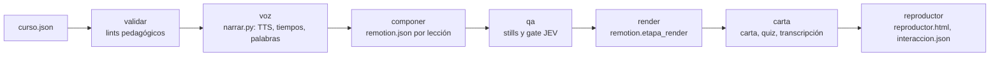
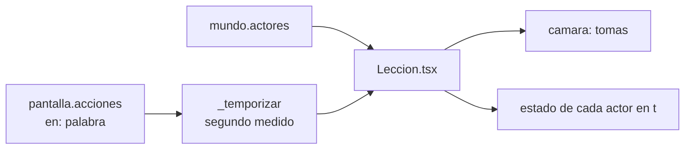

# Motor de cursos — `scripts/curso.py`

> Skill `crear-curso` en [[SKILL]]. Pedagogía en [[Metodologia-Cursos-Video]]. Render en [[Motor-Remotion]]. El agente solo escribe `curso.json`.

## Arquitectura



```
proyectos/<slug>_<DDMMAAAA>/
  curso.json  carta-descriptiva.md  quiz.json  quiz.md  info.txt  reproductor.html  interaccion.json
  recursos/  img/ (+creditos.json)  avance.jsonl  costos.jsonl  curso/{validacion.json, qa/, jev/}
  lecciones/<id>/  remotion.json  <slug>_<id>.mp4|.srt|.vtt  <slug>_<id>-transcripcion.md
                   recursos/  voz/  tiempos.json  voz.wav  img/ (hard links)  remotion/props.json
```

**Cursos largos:** `scripts/curso_spec.py` trae constructores (`leccion`, `gancho`…`cierre`, `pregunta`, `imagen`, `dato`, `enfoca`…) que producen este mismo contrato; un `recursos/armar_curso.py` del proyecto arma con ellos `curso.json` sin repetir llaves (verificado con las 21 lecciones de Star Trek).

**Una lección es un proyecto Remotion completo.** Así `remotion.etapa_render`, el acabado y los checks se reutilizan sin cambios, y cada render empaqueta solo sus recursos. `remotion.Proyecto` expone `avance_dir`, `avance_rango`, `etiqueta` y `lufs`: `curso.py` los usa para reportar en el tablero del curso y entregar a −16 LUFS. Previsualizar una lección: `python3 scripts/remotion.py estudio proyectos/<curso>/lecciones/<id>`.

## Contrato de `curso.json`

Ejemplo completo: `cursos/ejemplo/curso.json`.

- **curso:** `titulo, publico, perfil_ingreso, objetivo_general, duracion_h, modalidad, evaluacion{diagnostica, formativa, sumativa, acreditacion}` obligatorios. `area_tematica, instructor, tutor, idioma, voz, modo, estilo{orientacion, tema, colores, subtitulos_quemados, musica, cama}, bibliografia` opcionales.
- **módulo:** `id, titulo, objetivo, lecciones[]`.
- **lección (un video):** `id, titulo, objetivo, nivel_bloom, tipo, escenas[], preguntas[]`, más `criterio_exito, practica{consigna, rubrica, min}, recursos[], mundo, prueba_final[]`.
- **escena:** `id, tipo, min, tts, pantalla, imgs[]`, y en preguntas `pregunta_ref, tts_retro, retro_acciones`.
- **`pantalla`, además:** `acciones[]`, `marcas[]` (`{en, texto, color}`: palabras del texto que se encienden con la voz) y `plano: "estacion"`.
- **elemento de `concepto`:** `{en, forma: caja|circulo|flecha|linea|texto, texto, x, y, w, h, x2, y2}` en % del escenario. `en` debe decirse en `tts`, en orden.
- **pregunta:** `id, objetivo_ref, enunciado, opciones[2–4], correcta (base 0), retro`.

`tts` va en letra, con cifras solo en pantalla. `voz: {}` hereda `voz_default`. `estilo.sonido: false` apaga los SFX.

## Modo del curso

`curso.modo` lo llena el cuestionario de `crear-curso`. Sin él, el curso se valida como siempre.

| Campo | Valores | Efecto |
|---|---|---|
| `proposito` | `aprendizaje` (default), `presentacion` | `presentacion` omite Bloom, EC0301, DC-3, práctica y carta. En curso y lección solo exige `titulo`, `publico`, `objetivo_general` y `escenas`. `evaluacion` pasa a `ninguna` por defecto |
| `evaluacion` | `intercalada` (default), `entre-lecciones`, `ambas`, `ninguna` | Escenas `pregunta`, `prueba_final`, las dos o ninguna |
| `visual` | `animado`, `imagenes`, `mixto` | Exige `mundo`, una imagen o ambos; sin declarar no exige nada |

Las escenas `pregunta` y `prueba_final` que contradicen el modo son `E-CURSO-MODO`. Una pregunta no puede estar en ambas.

## Mundo continuo

Una lección es **un solo mundo que una cámara recorre**: sin láminas ni fundidos. Ejemplo completo: `m1-l1` de `cursos/ejemplo/curso.json`. El agente no escribe TSX.



- **Unidades:** el mundo mide 1920x1080 con el origen al centro; `x, y` de actores y cámara van en esas unidades. `mundo.vista` `{x, y, z}` es el plano general.
- **Actores (`tipo`):** íconos `camara, grabador, switch, router, servidor, pc, telefono, nube, persona, disco` (con `etiqueta`); `dato` (`partes[], sep, fs`); `enlace` (`de, a`); `zona` (`w, h, texto`); `panel` (`w, h, titulo, lineas[]`); `imagen` (`clave, w, h, pie`, con crédito desde `creditos.json`; acepta `aparece, oculta, mueve, enfoca, clic`). Un actor con `aparece` o `copia` no existe antes de esa acción; sin ellas existe desde el inicio.

| Acción | Sobre | Campos |
|---|---|---|
| `aparece`, `oculta` | cualquiera | `d`; en `dato`, `partes` |
| `mueve` | cualquiera | `x, y, d` |
| `divide`, `une` | `dato` | `numera` |
| `resalta` | `dato` o ícono | `partes, color` |
| `llave` | `dato` | `partes, color, texto` |
| `copia` | `dato` | `desde, partes, color, d`: vuela desde otro actor |
| `conecta`, `envia` | `enlace` | `d`; `envia`: `falla, veces, cada, color` |
| `transforma` | ícono, `enlace`, `dato` | `a: "vivo"` enciende; en `dato`, `texto, partes` |
| `escribe` | `panel` | `texto, color, d` |
| `clic` | actor o punto | `x, y, dx, dy`: cursor virtual |
| `enfoca` | actor, punto o nada | `z, d, dx, dy, aisla`; sin destino vuelve a `mundo.vista` |

Cada acción lleva `en` (palabra del `tts`, en orden) o `junto: true` (mismo instante que la previa); `retraso` suma segundos. Colores: `acento, alerta, correcta, peligro, texto, tenue`.

**Escenas sobre el mundo.** Con `acciones` solo se ve el mundo, más `solucion` o `puntos` como rótulos. Sin ellas, la escena aparece como panel sobre el mundo velado (`objetivo` va abajo y sin velo). En `pregunta`, `retro_acciones` usa las palabras de `tts_retro` y retira el panel en su primera acción para **demostrar** la respuesta.

**Sin `mundo`:** cada escena es una estación y la cámara viaja entre ellas. Los cursos anteriores funcionan sin cambios; `elementos` sigue vigente.

## Reproductor

`curso.py reproductor` escribe `reproductor.html` (autónomo, sin backend) e `interaccion.json`. Pausa al terminar la voz de cada pregunta, no deja adelantarse, da `retro_opciones` por distractor, permite `acreditacion.reintentos` y reanuda en la escena de respuesta. El puntaje cuenta solo el primer intento y se compara con `minimo_pct`. Solo incluye lecciones con video. Para publicarlo, sube también `lecciones/`.

**Test entre lecciones:** al terminar el video muestra `prueba_final` con la misma retroalimentación. Aprueba con `minimo_pct` sobre el primer intento de cada pregunta de esa ronda; cada ronda fallida permite repetir hasta `reintentos` veces. Al aprobar o agotarlos se abre la siguiente lección, y el puntaje global conserva las respuestas de la primera ronda. Sin preguntas se oculta la caja de avance.

## Códigos

| Familia | Códigos |
|---|---|
| Contrato | `E-CURSO-JSON, -VERSION, -CAMPO, -ID, -TIPO-LECCION, -ESCENA-TIPO, -ESCENA-PANTALLA, -RECURSO, -TEMA, -TIEMPOS, -MUNDO, -ACTOR, -ACCION, -MODO` |
| Objetivos | `E-CURSO-OBJETIVO-VERBO, -NIVEL`; `W-CURSO-BLOOM-NIVEL, -OBJETIVO-DOBLE, -CRITERIO` |
| Preguntas | `E-CURSO-PREGUNTAS-MIN, -PREGUNTA-OPCIONES, -PREGUNTA-CORRECTA, -PREGUNTA-REF`; `W-CURSO-DISTRACTOR, -PREGUNTA-AJENA, -PREGUNTA-SIN-ESCENA, -SIN-PREGUNTA-INTERCALADA, -PREGUNTA-ESPACIO` |
| Diseño | `E-CURSO-SYNC, -DURACION`; `W-CURSO-INICIO, -SIN-EJEMPLO, -SIN-RESUMEN, -SIN-PRACTICA, -VINETAS, -SIN-PUNTERO, -PUNTOS, -PALABRAS-PANTALLA, -ESCENA-LARGA, -DURACION, -TONO, -CONTRASTE, -MUSICA, -MODULO, -HORAS, -DC3, -ANIM-SIN-EN, -ESTATICA, -REPRODUCTOR, -SIN-EVALUACION, -PRUEBA-MP4, -IMG-SIN-LUGAR, -IMG-CREDITO` |
| Voz | `E-TTS-*`, `W-CURSO-COSTO, -CPS, -SYNC-ESTIMADA` |
| QA | `E-CURSO-JEV-*`, `W-CURSO-JEV-SIN-API` |

Salida: `0` ok · `1` interno · `2` corrige `curso.json` · `3` entorno · `4` API.

## Decisiones

- **Tiempos medidos:** la toma manda sobre el guion; `dur = max(min, 0.35 + voz + pausa)`.
- **Sincronía:** faster-whisper da marcas por palabra sobre cada toma y `difflib` las alinea con el guion. Sin Whisper se reparte por sílabas con aviso. El trazo arranca 150 ms antes de la palabra.
- **Atenuado:** lo previo baja a 0.35 solo mientras se narra; al terminar la voz todo recupera el contraste pleno (WCAG 1.4.3).
- **Trazo:** el SVG va en píxeles. Escalar con `preserveAspectRatio="none"` y `non-scaling-stroke` rompe `pathLength` y el trazo sale punteado.
- **Subtítulos:** `.srt` y `.vtt` siempre; quemados solo con `estilo.subtitulos_quemados`.
- **Música:** apagada por defecto.
- **Tema:** `cine` (oscuro) es para lecciones de poco texto; para texto denso conviene `claro`. El default del repo es `cine`; cada copia puede cambiarlo en `config.local.json > cursos.tema`.
- **SFX:** `pop, tick, whoosh, exito, tecleo` de `promo/sonidos/recetas.json` a −33 LUFS momentáneos, solo en viajes, entradas y respuesta correcta; dos golpes a menos de 120 ms se funden en uno.
- **Glow:** con gradientes radiales, nunca `filter: blur` animado (costo de render).
- **Caché de voz:** una toma simulada o lenta nunca queda como válida para una corrida real.

## Pruebas

```bash
python3 -m unittest scripts.pruebas.test_curso scripts.pruebas.test_curso_spec scripts.pruebas.test_narrar scripts.pruebas.test_remotion scripts.pruebas.test_enrutar
```

```bash
npm --prefix remotion test
```

Humo sin costo: `PROMO_TTS_STUB=1 python3 scripts/curso.py todo <proyecto> --borrador --qa`. `CURSO_RAIZ` desvía `proyectos/` a otra carpeta.

## Límites

- El MP4 no fuerza la respuesta; `reproductor.html` sí, pero no registra alumnos: las respuestas viven en el navegador. Para constancia o DC-3 el quiz se carga en un LMS.
- Sin exportación SCORM/xAPI.
- El test entre lecciones no existe en el MP4 suelto.
- El mundo está diseñado para 1920x1080; vertical no validado.
- Render ≈ 0.85 s por segundo de video en M3, el doble que antes del mundo continuo.
- `tiempos.json` y el `.srt` dependen de la voz: cambiarla regenera las tomas y hay que recomponer.
- La revisión humana de subtítulos y contenido no se automatiza.

## Animaciones 3D (Blender)

Una escena `screencast` puede llevar un clip propio hecho en Blender (`"pantalla": {"clip": "clips/<lección>/<escena>.mp4"}`).
Flujo probado en las lecciones de drywall:

1. Guion con **palabras ancla únicas** por acción y sin anclas numéricas (Whisper desordena los números).
2. Clips marcadores de 1 s en negro (FFmpeg) → `validar` → `voz` → `lecciones/<id>/recursos/tiempos.json`.
3. Escenas con `W("palabra", n)` para cada aparición, rebote y cotas que se dibujan
   (`[[Lecciones-2026-11-11-drywall-vanos-animado]]`).
4. **Estilo a todo color**: `scripts/blender_estilo.py` (`PALETA` + `caricatura(sc)`); rótulos ≥ 60 px.
5. `python3 scripts/lint_w3d.py escenas.py lecciones/<id>/recursos/tiempos.json` y hojas de contacto a 50 % / 12 muestras.
6. Render 1080p con 20 muestras en segundo plano (~2 s por cuadro en un i7 de laptop), luego `componer`, `qa`, `render`.

## Enlaces

[[AGENT]] · [[SKILL]] · [[Metodologia-Cursos-Video]] · [[Motor-Remotion]] · [[Lecciones-2026-11-01-metodologia-cursos]] · [[Lecciones-2026-11-01-cursos-mundo-continuo]] · [[Lecciones-2026-11-01-cuestionario-cursos]] · [[Lecciones-2026-11-11-drywall-refuerzos-rack]]
