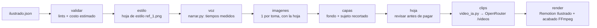

# Motor ilustrado — `scripts/ilustrar.py` + `scripts/video_ia.py`

> Skills `explicador-ilustrado` y `animar-imagen` en [[SKILL]]. Investigación de origen (precios, herramientas, MCPs) en
> [[Investigacion-2026-11-10-estilo-ilustrado]]. Bitácora del primer video en [[Lecciones-2026-11-10-estilo-ilustrado]].
> El agente solo escribe `ilustrado.json`; no escribe TSX ni FFmpeg.

Explicadores de historia o divulgación con look de **ilustración a mano**: contorno de tinta irregular, color plano con
trazo de lápiz y papel. Todo con la misma `OPENROUTER_API_KEY`; Remotion solo compone.

## Arquitectura



```
proyectos/<slug>_<DDMMAAAA>/
  ilustrado.json  remotion.json (lo escribe render)  <slug>.mp4  <slug>_hoja.jpg  info.txt
  recursos/  estilo/ref_1.png  img/<toma>.png  img/<toma>_fondo.png  img/<toma>_sujeto.png  img/<toma>_fin.png
             clips/<toma>.mp4  voz/  voz.wav  tiempos.json  mezcla.wav  audio/cama.wav  costos.jsonl  avance.jsonl
```

## Contrato de `ilustrado.json`

```json
{
 "version": 1, "titulo": "…", "orientacion": "vertical", "voz": {}, "musica": "ambiental",
 "estilo": {"prompt": "Hand-drawn editorial illustration … (≥ 12 palabras: trazo, relleno, papel, paleta, época)",
            "referencias": [], "muestra": "escena para la hoja de estilo", "tinta": "#26262b", "papel": "#f3ead6",
            "subtitulos": false, "textura": 0.35, "hervor": 2.2, "fps_animacion": 12},
 "tomas": [
  {"id": "t1", "tts": "narración", "imagen": "encuadre, sujeto, acción (sin texto)", "movimiento": "imagen",
   "camara": {"escala": [1.0, 1.12], "x": [0, 0], "y": [0, 0], "rot": [0, 0], "curva": "suave"},
   "titulo": {"texto": "TITULAR ≤ 34", "pos": "arriba|centro|abajo", "en": 0.15, "tam": 92}, "fundido": 0.25, "min": 0},
  {"id": "t2", "movimiento": "parallax", "capas": {"sujeto": "el sujeto que va al frente"}, "…": "…"},
  {"id": "t3", "movimiento": "video_ia", "video": {"prompt": "solo el movimiento", "ultimo": "opcional", "modelo": null}},
  {"id": "t4", "movimiento": "clip", "clip": "clips/blender.mp4"}
 ]
}
```

- `camara.x/y` en fracción del ancho (0.03 = 3 %); `escala` [inicio, fin]. Sin `camara`: empuje suave 1.0 → 1.12.
- `musica`: `"ambiental"` (cama documental procedural de `componer.cama_ambiental`, 0 USD), un archivo de `recursos/`
  (CC0 o propio, renivelado a −18 LUFS) o `null`. La mezcla (voz −15 LUFS, ducking) la hace `componer.mezclar`.
- `voz`: igual que en cursos (`voz.resolver_voz`); vacío = `config.json > voz_default`.

## Los cuatro niveles de movimiento

| `movimiento` | Qué hace | Costo extra | Cuándo |
|---|---|---|---|
| `imagen` | Empuje/paneo/rotación sobre la ilustración (curva suave) | 0 | La mayoría de las tomas |
| `parallax` | Fondo (sin sujeto) y sujeto recortado se mueven según su profundidad | 2 ediciones de imagen (~0.08 USD) | Personaje u objeto protagonista |
| `clip` | MP4 propio a pantalla completa (render NPR de Blender, metraje) | 0 | Lo técnico exacto |
| `video_ia` | Imagen a video por OpenRouter con primer (y último) cuadro | ~0.026 USD/s (Seedance 1.5 Pro 720p) | 1–3 tomas «héroe»: agua, fuego, mecanismos |

Todas las tomas comparten el **hervor** del trazo (desplazamiento con ruido que cambia de semilla a 12 fps) y la
**textura de papel** en multiply: eso unifica ilustraciones, clips de IA y renders de Blender en un solo look.

## Etapas

- **validar** — lints sin LLM (estilo ≥ 12 palabras, sujeto en parallax, prompt de movimiento, texto pedido dentro de la
  imagen → aviso, titular > 34 caracteres → aviso) y costo estimado con precios leídos del catálogo de OpenRouter.
- **estilo** — si `estilo.referencias` está vacío, genera `recursos/estilo/ref_1.png` con `estilo.muestra`. Esa imagen
  viaja como referencia en **todas** las llamadas: es lo que da consistencia entre tomas. Revisarla antes de seguir.
- **voz** — `narrar.narrar` por toma (caché por huella; `tiempos.json` con palabras absolutas). La duración de cada toma
  sale de la voz medida, nunca del guion.
- **imagenes** — una ilustración por toma con `modelos.imagen_ilustrado` + hoja de estilo + regla «sin texto». Las
  existentes se saltan; `--rehacer t3,t5` las repite.
- **capas** — para `parallax`: edición «quita el sujeto y pinta lo que había detrás» (fondo) y «solo el sujeto sobre verde
  #00FF00» (sujeto), recortado con `colorkey` sobre el color muestreado en las esquinas + `despill` (receta del banner Hikvision).
- **hoja** — `<slug>_hoja.jpg` con todas las imágenes (magenta = transparencia). Revisar **antes** de pagar clips.
- **clips** — `video_ia.generar_uno` en paralelo (4 hilos) con duración = toma + fundido, redondeada a lo que acepte el
  modelo. Se niega a pasar de `ilustrado.tope_usd_por_pieza` sin `--confirmar`. El prompt se completa con «keep the
  hand-drawn look… no photorealism, no 3D shading, no text».
- **render** — escribe `remotion.json` (composición `Ilustrado`) y llama a `remotion.etapa_render` (h264 → acabado FFmpeg
  BT.709, −14 LUFS, faststart, checks). Una toma `video_ia` sin clip cae a `imagen` con aviso; un clip más corto que su
  toma se reproduce más lento (≥ 0.6×).

## `scripts/video_ia.py` (uso suelto: skill `animar-imagen`)

- `modelos [--i2v] [--resolucion 720p] [--relacion 9:16]` — catálogo con USD/s calculado de `pricing_skus` (formatos
  vistos: `cents_per_video_output_second_<res>`, `duration_seconds[_with(out)_audio][_<res>]`,
  `image_to_video_duration_seconds_<res>`, `video_tokens[_without_audio]` con tokens = ancho × alto × 24 × s / 1024).
- `estimar`, `generar` (tope por llamada `ilustrado.tope_usd_por_llamada` sin `--confirmar`; `--borrador` = 480p),
  `comparar` (mismo cuadro y prompt en varios modelos, en paralelo, con `comparar.json`).
- Contrato verificado 2026-11-10: `POST /api/v1/videos` (`frame_images` con `frame_type` `first_frame`/`last_frame`,
  `generate_audio`, `seed`, `provider.options.<slug>` para `watermark`) → 202 `{id, polling_url}` → sondeo cada 20 s →
  `unsigned_urls[0]` con `Authorization` (la descarga solo se permite a `openrouter.ai`) → `usage.cost`.
- Cada clip registra `{"tarea": "video_ia", "usage": {"cost": …}}` en `costos.jsonl` y reporta al tablero.

## Composición `Ilustrado` (remotion/src/composiciones/Ilustrado.tsx)

- Declarativa: pinta `props.tomas` por `tipo` (`imagen`, `parallax`, `clip`) con `Sequence` y fundido cruzado.
- Titular cinético: palabra por palabra con muelle, entra alternando lados, **desenfoque horizontal proporcional a la
  velocidad** (un `feGaussianBlur stdDeviation="x 0"` por palabra) y contorno de papel (`-webkit-text-stroke` +
  `paint-order`) para leerse sobre cielo oscuro o papel claro. Sora 800 en mayúsculas.
- Subtítulo karaoke opcional (`estilo.subtitulos`) con `Karaoke.tsx` y palabras relativas a la toma.
- Filtros SVG: `#ilu-hervor` (feTurbulence + feDisplacementMap, semilla = ⌊t·fps_animacion⌋) y `#ilu-papel` (grano).

## Costos medidos (primer video, 52.6 s, 8 tomas)

Ver [[Lecciones-2026-11-10-estilo-ilustrado]]. Imágenes ~0.04 USD (Nano Banana 2.1), clip Seedance 1.5 Pro 720p de
8 s 0.21 USD, voz Gemini TTS < 0.05 USD.

## Límites conocidos

- La hoja de estilo **transmite su composición**: si deja papel vacío arriba, las escenas lo heredan aunque el prompt pida
  «full-bleed». Pedir la hoja ya a sangre completa (o aprovechar el hueco para los titulares en 9:16).
- `parallax` exige nombrar **solo** el sujeto («the man only, not the workbench»): si el sujeto incluye muebles que también
  quedan en el fondo, se ven duplicados al moverse.
- Texto dentro de las imágenes: los modelos garabatean «escritura» en papeles; si molesta, pedirlo en blanco en la escena.
- El video en OpenRouter **no admite Zero Data Retention**: no mandar fotos de personas reales sin permiso ni `muestras/`.
- Términos comerciales de cada proveedor de video: revisarlos antes de vender la pieza (riesgos en la investigación §10).

## Enlaces

- [[SKILL]] · [[AGENT]] · [[Motor-Remotion]] · [[Investigacion-2026-11-10-estilo-ilustrado]] · [[Home]]
