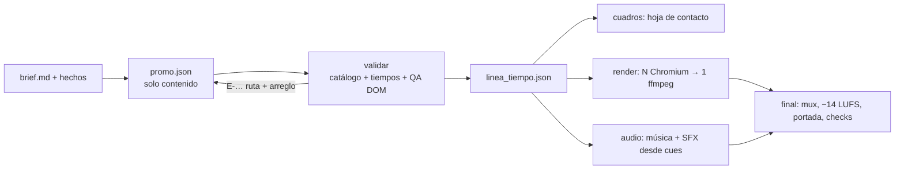

# Motor promo — videos con UI animada (HTML → cuadros → FFmpeg)

> Skill de uso: `promo-ui` en [[SKILL]]. Reglas generales en [[AGENT]]. Audio CC0 en [[Audio-CC0]].

## Por qué existe

El video de referencia de la casa (promo de asistente IA con UI animada, 9:16, 30 s) se hizo con el
método **HTML + `seek(t)`**: un modelo fuerte escribió a mano cientos de líneas de HTML/CSS/JS por video.
Un **orquestador barato** (p. ej. `deepseek/deepseek-v4.1-flash`) no puede hacer eso con calidad
constante, pero sí puede llenar un JSON pequeño y corregir errores precisos.

Por eso todo el oficio vive en **código determinista**: componentes, tema, tiempos automáticos,
auto-ajuste de texto, validador y QA del DOM. El agente solo escribe el contenido (`promo.json`)
copiando un ejemplo de oro. El costo que domina, la sesión del agente, baja porque hay menos turnos y la salida de consola es corta.

## Arquitectura

| Pieza | Dónde | Qué hace |
|---|---|---|
| CLI del agente | `scripts/promo.py` | Única puerta: `nuevo`, `validar`, `cuadros`, `render`, `audio`, `final`, `todo`, `estado`, `ayuda` |
| Motor Node | `promo/motor.mjs` | `validar`, `cuadros`, `render`, `ayuda`, `esquema` (stdout = 1 JSON) |
| Catálogo | `promo/catalogo.json` + `promo/componentes/<tipo>/catalogo.json` | Props, límites y defaults (fuente única) |
| Planificador | `promo/lib/planificador.mjs` | Beats → duraciones → ajuste al total → cuadros, cues y tiempos de QA |
| Runtime | `promo/runtime/` | `seek(t)`, escenas, titular, subtítulo, QA, kit de UI |
| Componentes | `promo/componentes/` | `intro`, `texto`, `chat`, `acciones`, `diagrama`, `telefono`, `cierre`, `fondo` |
| Tema | `promo/temas/neutro/` | Tokens medidos, fuentes OFL, logo (en `privado/`, no versionado) |
| Audio | `scripts/sonido.py`, `scripts/fetch_audio.py` | Cama procedural o pista (archivo/CC0), SFX, loudnorm 2 pasadas |

## Contratos

- **`promo.json`** (lo escribe el agente): sin tiempos, coordenadas ni colores. Ver `promo.py ayuda`,
  el esquema `promo/esquema/promo.schema.json` (se regenera con `node promo/motor.mjs esquema`) y los
  ejemplos de `promo/ejemplos/`.
- **`recursos/promo/linea_tiempo.json`** (lo escribe `validar`): escenas con `ini/fin/dur`, beats por
  componente, frases del titular y del subtítulo con el instante de cada palabra, `cues` de SFX,
  secciones musicales, tiempos de QA y portada. Es el único contrato entre Node (video) y Python (audio).
- **Salidas:** `0` ok · `2` error del spec (el agente corrige) · `3` entorno (preguntar al usuario) ·
  `4` API externa (reintentar una vez).

## Cómo se reparten los tiempos (planificador)

1. Cada componente declara sus beats (`min`/`pref`); el titular y el subtítulo exigen su tiempo de
   lectura (preferido ≈ 3 palabras/s; mínimo al ritmo de la referencia, ≈ 4.5 palabras/s en titulares).
2. Duración natural por escena = lo más largo de lo anterior; el total se ajusta a `salida.duracion`
   estirando reposos/beats flexibles o comprimiéndolos hacia el mínimo.
3. Si ni al mínimo cabe, se **acelera hasta un 28 %** con aviso `W-TIEMPO-RAPIDO` (así de rápida es la
   referencia: escenas de memoria y app de ~2.5 s). El **cierre nunca se acelera** (`"comprimible": false`
   en su catálogo): el CTA se sostiene ≥ 2 s. Si aun así no cabe: `E-TIEMPO-EXCEDE` con qué recortar.
4. Con cama procedural, cada cambio de escena se corre al **beat** más cercano si está a ≤ 0.15 s.
5. Todo se cuantiza a la rejilla de cuadros: 30 s = 900 cuadros exactos.
6. **Voz en off** (opcional, `audio.voz`; por defecto Fish, TTS puro que lee al pie de la letra): se locuta el texto de los `subtitulo`. `promo.py voz` genera
   `recursos/voz/tiempos.json` (duración real y tiempo de cada palabra por toma); al re-validar, las
   escenas se dimensionan con esas duraciones y el karaoke sigue la voz real. Sin tomas: tiempos
   estimados y aviso `W-VOZ-PENDIENTE`.

## Reglas de determinismo (no negociables)

- Cada cuadro es función pura de `t`: nada de `Date.now`, `Math.random`, timers, `requestAnimationFrame`
  ni transiciones/animaciones CSS (`promo/pruebas/estatico.test.mjs` las detecta).
- Todo el DOM se construye al montar; `actualizar(t)` **solo escribe** estilos; se mide en `medir()`
  (después de `document.fonts.load` con el texto real y de `img.decode()`).
- El azar sale de `ctx.rng(clave)` (mulberry32 con semilla del spec).
- `validar` verifica que `seek(a); seek(t)` y `seek(b); seek(t)` produzcan el mismo estado
  (`E-QA-DETERMINISMO`), y la prueba de navegador compara píxeles hacia adelante y hacia atrás.

## Decisiones técnicas (y por qué)

| Decisión | Motivo |
|---|---|
| Runtime servido con `page.route()` en `http://promo.local` | Chrome bloquea módulos ES y `fetch` en `file://`; así el render es 100 % offline y un recurso faltante es un error claro |
| N **procesos** Chromium (no pestañas) + **un** ffmpeg con búfer de reorden | Las pestañas comparten proceso de render; un solo codificador evita costuras de GOP/grano |
| `--force-color-profile=srgb` + `scale=out_color_matrix=bt709` → `yuv420p` → `noise` → `setparams` | Sin esto los colores de marca se corren y el MP4 queda sin etiquetas de color |
| Chrome del sistema (`channel: 'chrome'`) por defecto | El Chromium que trae Playwright queda fijado y sin parches (aviso de CVEs, nov 2026); Chrome se actualiza solo. Medido: misma velocidad y SSIM ≥ 0.997 contra las golden |
| `playwright-core` fijado a 1.62.1 + su Chromium (rev 1234) como **respaldo** | Sin Chrome instalado (Linux, CI) se usa el fijado con aviso en el log; `PROMO_NAVEGADOR=fijado` lo fuerza para reproducir un render viejo cuadro por cuadro |
| `chromiumSandbox: true` al lanzar | Playwright lanza con `--no-sandbox` por defecto; el sandbox más el bloqueo de toda petición fuera de `promo.local` contienen cualquier CVE del renderer |
| x264 `slow` crf 17 + grano `c0s=4` | Calidad sobre rapidez (regla de la casa). Medido: el codificador es el cuello de botella (~70 ms/cuadro); `medium` ahorra ~30 % |
| Fuentes Sora / Figtree / JetBrains Mono vendorizadas (subconjuntos latin + latin-ext) | Render reproducible y sin red; el validador rechaza glifos fuera de cobertura (→ ✓ ≈, emojis) |

Rendimiento medido (M-series, 2026-09-28): 10 s = 300 cuadros en ~35–40 s de render; `todo` completo
(validar + cuadros + render ∥ audio + final) ≈ 45 s. Captura ≈ 65 ms/cuadro por navegador.

## QA del DOM (lo que el orquestador sí puede "leer")

| Código | Qué detecta | Arreglo típico |
|---|---|---|
| `E-QA-NO-CABE` | El texto no cabe en sus líneas ni con la letra mínima | Quitar 2–4 palabras |
| `E-QA-ZONA` | Texto o CTA en la zona segura (150 px arriba / 420 abajo) | Acortar |
| `W-QA-ZONA-DER` | Texto en la columna de íconos de la plataforma | Acortar si es importante |
| `E-QA-CHOQUE` | Dos grupos de la misma escena se enciman (titular vs contenido…) | Acortar el titular o quitar un item |
| `E-QA-FUERA` | Elemento fuera del cuadro | Acortar / quitar |
| `E-QA-TAMANO` | Letra efectiva < 22 px (o el mínimo del elemento) | Acortar para que no se achique |
| `E-QA-DESBORDE` | Contenido desbordado de una caja fija | Acortar ese campo |
| `W-QA-VIUDA` | Una sola palabra en la última línea | Reordenar |
| `E-QA-IMG` / `E-REC-*` | Imagen o recurso faltante | Copiar a `recursos/` o quitar |
| `E-QA-DETERMINISMO` | El motor dibuja distinto según el cuadro previo | Error del motor: reportarlo |

Validación estática (antes de abrir el navegador): `E-ESQ-*` (tipos, faltantes, desconocidos con
"¿quisiste decir…?"), `E-TXT-LARGO`, `E-TXT-GLIFO`, `E-TXT-ENFASIS`, `E-REF-HECHO`, `E-ESTILO-KICKER`,
`E-ESTRUCTURA-CIERRE`, `E-MARCA-REPETIDA` (el producto repite la marca: "ACME PRO" → "PRO"),
`E-TIEMPO-EXCEDE` / `E-TIEMPO-FALTA` / `E-TIEMPO-CORTA`, `W-TIEMPO-RAPIDO`, `W-VOZ-PENDIENTE`,
`W-HECHOS-FALTAN` (escenas de demostración sin `respaldo` en `hechos` confirmados con fuente).
El traslape de textos durante una transición es por diseño y no se reporta.

## Cómo agregar un componente

1. Carpeta `promo/componentes/<tipo>/` con `<tipo>.js`, `<tipo>.css` y `catalogo.json`.
2. `planear(props, tema)` (puro): `{pasos: [{id, min, pref, cue?}], reposo: {min, pref}, arranque?}`.
3. `montar(raiz, props, lt, ctx)` → `{medir?(), actualizar(t)}`; usa `runtime/ui.css` + `ui.js` para
   que se vea como el mismo producto. Marca los textos con `data-qa`, `data-qa-ruta` y `data-qa-grupo`.
4. En `catalogo.json`: `doc`, `tinte_defecto`, `duracion {min,max}`, `titular`/`subtitulo` (true si los
   admite) y `props` con límites que garanticen que el texto cabe.
5. `node promo/motor.mjs esquema` y `npm --prefix promo test`; prueba con `cuadros --ref <video>`.

## Pruebas

- `npm --prefix promo test`: matemática, validador, planificador, estática (determinismo + esquema al día),
  determinismo en navegador (píxeles hacia adelante vs. hacia atrás) y **golden**: 8 cuadros del ejemplo
  de oro comparados por SSIM (≥ 0.98) contra `promo/pruebas/golden/`. Se renderizan con el wordmark de
  respaldo (sin el logo privado) para que sean reproducibles en cualquier copia y el logo nunca llegue a
  git. Si un cambio visual es intencional: `node promo/motor.mjs golden --actualizar`.
- `python3 -m unittest discover -s scripts/pruebas`: CLI, audio y descarga CC0.
- `python3 scripts/e2e_orquestador.py --brief …`: simula al orquestador barato (spec → validar →
  corrección) y mide rondas, tokens y costo.

## Enlaces

- [[AGENT]] · [[SKILL]] · [[Audio-CC0]] · [[Subtitulos-y-Silencios]] · [[Musica-Libre-de-Derechos]] · [[Home]]
- [[Lecciones-2026-09-28-motor-promo]]
