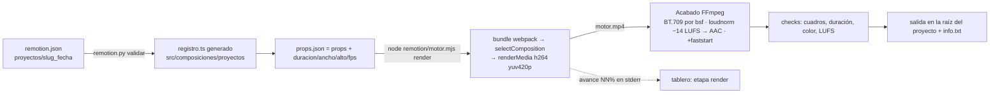

# Motor Remotion — composiciones libres (React → MP4), motor opcional

> Skill de uso: `remotion-video` en [[SKILL]]. Reglas generales en [[AGENT]] §6. Bitácora: [[Lecciones-2026-10-31-remotion-y-longcat]].

## Por qué existe (y cuándo no usarlo)

El [[Motor-Promo]] es el camino de la casa: catálogo cerrado, tiempos automáticos, QA del DOM y un spec pequeño que un
orquestador barato llena sin escribir código. Eso lo hace determinista y barato, pero **solo expresa lo que hay en el
catálogo**. Remotion es lo contrario: el agente escribe una composición React (TSX) con libertad total (gráficas desde
datos, Lottie, mapas, metraje real con animación, tipografía cinética) a cambio de más tokens y de que nadie vigile el
DOM. Por eso es **opcional** y es la última opción:

| Necesidad | Herramienta |
|---|---|
| Cortes, uniones, overlays, `drawtext`, `xfade`, Ken Burns, mezcla, formatos | **FFmpeg** (regla base, [[AGENT]] §6) |
| Promo vertical con la UI de la casa (chat, WhatsApp, tarjetas, teléfono, intro/cierre) | **promo-ui** ([[Motor-Promo]]) |
| Reel narrado con fotos | `armar-reel` |
| Motion graphics a la medida que el catálogo no expresa | **remotion-video** (este motor), y la salida se termina con FFmpeg |

## Licencia

Remotion no es MIT. Es gratuito para personas físicas, organizaciones sin fines de lucro, **empresas de hasta 3
personas** y evaluación sin uso comercial; cualquier empresa con **4 o más empleados** necesita la Company License
(https://remotion.pro/license; Creators desde 25 USD por asiento al mes, Automators desde 100 USD al mes). Los videos
renderizados por quien es elegible pueden usarse comercialmente. El toolkit no puede comprobarlo: `validar` y `render`
avisan (`W-REMOTION-LICENCIA`) hasta que el usuario fije `remotion.licencia` (`"gratuita"` o `"company"`) en `config.local.json`: depende de quién renderiza, así que es un valor personal de cada copia (`[[AGENT]]` §16) y `config.json` lo deja en `null`.
Versión fijada: 4.0.539 (la 5.0 cambiará "ligeramente" la licencia; `/remotion-upgrade` queda para después).

## Arquitectura



| Pieza | Dónde | Qué hace |
|---|---|---|
| `scripts/remotion.py` | Python, stdlib | CLI del agente: `nuevo`, `validar`, `estudio`, `render`, `todo`, `estado`, `ayuda`. Valida el spec, genera `registro.ts`, inyecta la metadata en los props, corre el motor, hace el acabado y los checks, reporta avance y escribe `info.txt`. |
| `remotion/motor.mjs` | Node (ESM) | Mismo contrato que `promo/motor.mjs`: stdout = **un** JSON, logs y `avance NN%` en stderr, códigos 0/1/2/3. `render` = `bundle()` + `selectComposition()` + `renderMedia()`; `composiciones` lista los ids. |
| `remotion/src/Root.tsx` | React | Una `<Composition>` por entrada de `COMPOSICIONES`; `calculateMetadata` toma `duracion`, `ancho`, `alto`, `fps` de los props. |
| `remotion/src/composiciones/index.ts` | TS | `BASE` (versionadas: `Ejemplo`) + `PROYECTOS` (de `registro.ts`). |
| `remotion/src/composiciones/proyectos/<Nombre>.tsx` | TSX del agente | Gitignored. Exporta `Composicion` y `meta`. `nuevo` lo copia de `Ejemplo.tsx`. |
| `remotion/src/composiciones/proyectos/registro.ts` | generado | Un `import` por TSX, orden alfabético; solo se reescribe si cambia (no invalida la caché de webpack). Si falta (clon limpio), `motor.mjs` crea uno vacío antes de empaquetar y `npm test`/`estudio`/`composiciones` lo garantizan con `node motor.mjs registro` en su `pre*`. |
| `remotion/src/lib/props.ts` | TS puro | `PropsBase`, `Meta`, `metadataDesde()` (probada con `node --test`). |
| `scripts/comun.py > correr_motor_node` | Python | Generalización de `promo.correr_motor` para cualquier motor Node de la casa. |

Por qué los TSX viven dentro de `remotion/` y no en `proyectos/<slug>/`: el bundler resuelve `react` y `remotion`
subiendo desde el archivo que importa; fuera de `remotion/` habría que sobreescribir la configuración de webpack. Los
recursos del proyecto sí se quedan en `proyectos/<slug>/recursos/`: el render pasa `--public-dir recursos/` y la
composición los lee con `staticFile('voz.wav')`.

## Contratos

**`remotion.json`** (lo escribe el agente):

```json
{"version": 1, "composicion": "DemoProducto", "salida": "demo-producto.mp4", "orientacion": "vertical",
 "fps": 30, "duracion": 12.0, "props": {"titulo": "…", "clip": "clip1.mp4", "audio": "voz.wav"}}
```

- `orientacion`: clave de `config.json > salida.resoluciones` (`vertical`, `1080p`, `720p`, `4k`, `cuadrada`) o `horizontal` (= `1080p`).
- `props`: libres. Toda cadena con extensión de medio (`.mp4 .wav .png .json .ttf …`) se exige en `recursos/` (`E-REMOTION-RECURSO`).
- Errores de `validar`: `E-REMOTION-VERSION|COMPOSICION|REGISTRO|SALIDA|ORIENTACION|FPS|DURACION|PROPS|RECURSO|JSON`, `E-ENTORNO`; avisos `W-REMOTION-LICENCIA|NAVEGADOR|ARCHIVO`. Formato: `CÓDIGO  ruta: mensaje arreglo`.

**`recursos/remotion/props.json`** (lo escribe `render`/`estudio`): `props` + `{"duracion", "ancho", "alto", "fps"}`.

**Motor** (`node remotion/motor.mjs render --composicion <id> --props <json> --public-dir <dir> --salida <mp4> [--crf N] [--x264-preset P] [--concurrencia N|50%] [--borrador]`) → `{"ok", "video", "cuadros", "fps", "ancho", "alto", "duracion", "segundos", "borrador"}` o `{"ok": false, "errores": [{codigo, ruta, msg, arreglo}]}`. El API de Node de Remotion **no lee `remotion.config.ts`** (solo el CLI y el Studio), por eso el motor recibe codec, CRF y preset explícitos desde `config.json > remotion`.

**Acabado** (`scripts/remotion.py > acabar`): Remotion entrega h264 yuv420p **sin etiquetas de color**; se agregan con `-bsf:v h264_metadata` (sin recodificar). Si hay audio: extraer → `comun.loudnorm_2p` (−14 LUFS, dos pasadas, lineal) → AAC 256k 48 kHz; `+faststart`. Checks como en promo: cuadros = `round(duracion × fps)`, duración ±1 cuadro, `yuv420p`/bt709, −14 ±0.5 LUFS, TP ≤ −1 dBTP.

## Cómo agregar una composición

1. `python3 scripts/remotion.py nuevo <slug> [--composicion Nombre] [--orientacion …] [--duracion s]`.
2. Editar `remotion/src/composiciones/proyectos/<Nombre>.tsx` con `/remotion-markup` (reglas: `useCurrentFrame()` para
   todo, `random(semilla)` en vez de `Math.random`, nada de timers ni CSS animations, fuentes con `@remotion/google-fonts`
   o vendorizadas, recursos con `staticFile()`), y `remotion.json` (props, duración).
3. `validar` → `estudio` (http://localhost:3000, `--detener` para parar) → `render` (o `todo`).
4. Música/SFX: `scripts/sonido.py` o `scripts/fetch_audio.py` (CC0) y mezcla con `scripts/componer.py` (abajo).

## Piezas de la versión base

Lo que se repetía de proyecto en proyecto vive en la base (2026-11-09); la composición y el `componer.py` del proyecto
solo declaran diseño y contenido.

| Pieza | Dónde | Qué resuelve |
|---|---|---|
| `Karaoke` | `remotion/src/componentes/Karaoke.tsx` | Subtítulo por oración con realce de la palabra que suena (tiempos medidos). Props: `porFrase`, `abajo`, `tam`, `colores`, `fuente`. |
| `Titular`, `Apoyo` | `remotion/src/componentes/Texto.tsx` | Titular con `*resalte*` y entrada palabra por palabra en contenedor flex con `flexWrap`; texto de apoyo con rampa. |
| `muelle`, `soltar`, `entra`, `desliza` | `remotion/src/lib/movimiento.ts` | Curvas de la casa (spring amortiguado, rampa cúbica), deterministas. |
| `FUENTE`, `FUENTE_UI` | `remotion/src/lib/fuentes.ts` | Sora 600–800 y Figtree 500–700 empaquetadas con `@remotion/google-fonts` (antes la composición dependía de que otro TSX del registro las cargara). |
| `frases`, `palabraActiva`, `segmentos` | `remotion/src/lib/karaoke.ts` | Lógica pura del karaoke, probada con `node --test`. |
| `escenas_props`, `encadenar_tomas`, `cama_procedural`, `cama_ambiental`, `mezclar`, `recortar_clip`, `logo_con_color`, `escribir_specs` | `scripts/componer.py` | De `tiempos.json` (o de las tomas grabadas) a props, mezcla con ducking y specs por orientación. |

**Karaoke en pausas (corregido 2026-11-09):** antes, en un silencio entre palabras se tomaba como activa la *última
palabra de la escena*; su oración aún no empezaba y el subtítulo **desaparecía** durante cada pausa (15 y 20 pausas en los
dos videos animados de referencia). `palabraActiva` ahora conserva la última palabra que ya sonó.

**Cama ambiental determinista:** `anoisesrc` sin `seed` usa una semilla aleatoria; `cama_ambiental` la fija (`semilla=7`).

Verificación de la extracción: los stills de `AcmeIa` y `AcmeIaV2` (24 cuadros en 9:16 y 16:9) y las mezclas y specs de
los cuatro proyectos migrados salieron idénticos byte a byte antes de aplicar las dos correcciones.

## Promo con metraje real (grabación de pantalla)

`promo-ui` solo dibuja UI simulada; si el valor está en el producto real, va aquí. Receta verificada el 2026-11-02 en
[[Lecciones-2026-11-02-promo-disenador-videovigilancia]]:

1. **Localizar tomas:** hojas de contacto con marca de tiempo (`fps=1/6` + `drawtext` + `tile`) y tiras de 1 fps de los tramos candidatos.
2. **Privacidad en origen:** revisar personas, correos y datos reales, y excluirlos con `crop` al cortar el clip, no con un
   parche en la composición: lo que no entra al clip no puede filtrarse.
3. **Un TSX, dos orientaciones:** cada escena declara `foco: {v, h}` (`cx, cy, z0, z1`) y `componer.py` escribe
   `remotion.vertical.json` y `remotion.horizontal.json`; se copia el que toque a `remotion.json` antes de renderizar.
4. **Tiempos desde la voz medida:** `dur = entrada + voz + respiro`; `atempo` ajusta sin regenerar el TTS
   (`componer.encadenar_tomas`; clips con `componer.recortar_clip`).
5. **QA:** borrador por orientación (`--borrador`, 540x960 en ~33 s) y cuadros clave antes del render final.

## Skills oficiales

`npx skills add remotion-dev/skills -a claude-code -y` (CLI `skills` 1.7.4; exige Node ≥ 22.20: usar el de nvm). Copia
`/remotion-best-practices`, `/remotion-create`, `/remotion-markup`, `/remotion-render`, `/remotion-captions`,
`/remotion-studio`, `/remotion-docs`, `/remotion-interactivity`, `/remotion-maps`, `/remotion-multimedia`,
`/remotion-saas`, `/remotion-upgrade` a `.claude/skills/` (gitignored: el repo `remotion-dev/skills` no declara licencia
y se actualizan con `/remotion-upgrade`). `skills-lock.json` sí se versiona: `npx skills experimental_install` las
restaura en otra copia del repo.

## Pruebas

- `python3 -m unittest scripts.pruebas.test_remotion` — 12 pruebas con `--raiz` temporal, `REMOTION_DIR` (copia mínima del
  motor) y `REMOTION_MOTOR` (stub Node): `nuevo`, `validar`, `render` con acabado real de FFmpeg, códigos 1/2/3,
  `estudio` con `Popen` simulado, registro determinista.
- `python3 -m unittest scripts.pruebas.test_comun.TestMotorNode` — `correr_motor_node`.
- `npm --prefix remotion test` — `tsc --noEmit` + `node --test` (`metadataDesde`, registro, `asegurarRegistro`, karaoke); funciona en un clon limpio porque `pretest` crea `registro.ts` vacío.
- `python3 -m unittest scripts.pruebas.test_componer` — props relativas, `encadenar_tomas`, mezcla estéreo con cama y SFX, determinismo, clips, logo y specs.
- `python3 -m unittest scripts.pruebas.test_tablero` — elección del proyecto reciente (excluye `_enrutador`) y `terminado` solo con `estado: listo`.
- Humo real: `python3 scripts/remotion.py nuevo prueba-remotion --duracion 3 && python3 scripts/remotion.py todo prueba-remotion`
  → 1080x1920, 90 cuadros, yuv420p/bt709, 0 USD.

## Medidas (M3 16 GB, 2026-10-31)

- `npm install`: 8 s; `remotion browser ensure`: 13 s; `node_modules` 845 MB (579 MB es el Chrome Headless Shell).
- Ejemplo de 3 s (90 cuadros, 1080x1920): motor 3–6 s (empaquetado ~3 s incluido) + acabado 1 s; `composiciones` en frío 10 s.
- Studio: arranca en ~10 s con `--no-open`; `--props` aplica a todas las composiciones; el aviso "Can't save default
  props" es esperado (los `defaultProps` vienen calculados; se edita `remotion.json`).

## Enlaces

- [[AGENT]] · [[SKILL]] · [[Motor-Promo]] · [[Preflight-Software]] · [[Audio-CC0]] · [[Home]]
- [[Lecciones-2026-10-31-remotion-y-longcat]] · [[Lecciones-2026-11-06-video-animado-syscom-ia]]
