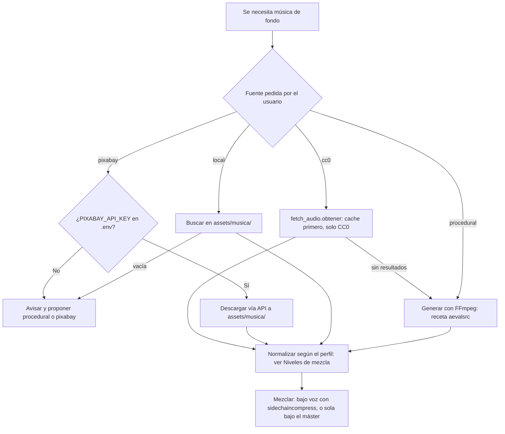

# Música libre de derechos

Fuentes permitidas de música de fondo y cómo usarlas. Configuración en `config.json > musica_libre`; skill operativo en [[SKILL]] → `musica-fondo`.

## Fuentes y licencias

| Fuente | Requiere key | Licencia | Notas |
|---|---|---|---|
| `local` | No | La que tenga cada archivo | Carpeta `assets/musica/` (`musica_libre.carpeta_local`). El usuario deposita ahí su música. |
| `procedural` | No | Generada in-house (sin licencia) | Música ambient generada con FFmpeg (receta abajo). Verificada en [[Lecciones-2026-09-23-IMG_7347]]. |
| `pixabay` | `PIXABAY_API_KEY` | [Pixabay Content License](https://pixabay.com/service/license-summary/) | Uso libre sin atribución obligatoria; no revender el audio tal cual. |
| `cc0` | No (Freesound opcional con `FREESOUND_TOKEN`) | CC0 1.0 únicamente | Loops, pads y efectos de Openverse/Freesound con `scripts/fetch_audio.py` (cache primero en `~/Music/media-stock`). Detalles, cupo y política en [[Audio-CC0]]. En el [[Motor-Promo]]: `audio.musica.tipo: "cc0"` y `audio.sfx_fuente: "cc0"`, con respaldo procedural; lo elegido queda en `recursos/audio/cc0/seleccion.json` (0 peticiones en el siguiente render) y una búsqueda vacía se reintenta a las 24 h o ya con `promo.py audio --refrescar-cc0`. |

**Regla de oro:** solo estas fuentes. Nunca música con copyright (aunque "sea solo para una prueba").

## Flujo de selección



## Receta procedural (verificada 2026-09)

Pad ambient suave de 60 s con `aevalsrc` (acorde La mayor: 220 + 277.18 + 329.63 Hz), filtrado, eco y normalización:

```bash
ffmpeg -f lavfi -i "aevalsrc=0.15*sin(2*PI*220*t)+0.10*sin(2*PI*277.18*t)+0.08*sin(2*PI*329.63*t):d=60:s=48000" \
  -af "lowpass=f=900,aecho=0.8:0.7:60|120:0.4|0.2,loudnorm=I=-18:TP=-2:LRA=11" \
  musica_fondo.wav
```

- Variar el acorde (frecuencias de `aevalsrc`) cambia el carácter; subir/bajar `lowpass` lo hace más brillante/opaco.
- La duración se fija con `:d=<segundos>` en `aevalsrc`.
- El [[Motor-Promo]] usa una cama procedural más completa (v2, `scripts/sonido.py`): kick, hats, bajo bombeado, pads Am–Fmaj7–C–G, arpegio, riser y golpe de cierre, anclada al corte de escena y determinista.

## Niveles de mezcla

| Pieza | Voz | Música | Ducking / máster |
|---|---|---|---|
| Reels narrados (`scripts/reel.py`, [[SKILL]] `crear-video`) | -15 LUFS | -18 LUFS | `sidechaincompress=threshold=0.05:ratio=3:attack=25:release=350` |
| Motor promo, solo música | — | -20 LUFS pre-mezcla | limitador + `loudnorm` 2 pasadas lineal a -14 LUFS / -1.5 dBTP |
| Motor promo, con voz | -16 LUFS medida **después** de su cadena (highpass 80, +2.5 dB en 3 kHz, compresor 3:1) | -24 LUFS con -6 dB en 2.5 kHz | `threshold=0.03:ratio=4:attack=20:release=600` (~12.5 dB de atenuación en cada línea) + compresor de bus 2:1 (umbral -20 dBFS); máster -14 / -1.5 |
| Motor promo, sin música ni voz | — | — | los SFX quedan a su nivel (cama nominal -20 LUFS) y solo se limitan a -1.5 dBTP: subirlos a -14 LUFS los haría sonar a golpes |

- Ducking: `sidechaincompress` con la voz como sidechain — **con `asplit=2` explícito y `apad`+`atrim`** del sidechain a la duración total (bugs documentados en [[Lecciones-2026-09-23-IMG_7347]] §5). Con -21 LUFS y `ratio=8` la música queda inaudible.
- Verificar con `volumedetect` en 3 ventanas (bajo voz, pausa, cola): la música debe oírse en las dos últimas. El motor promo lo imprime solo en la etapa `audio`.
- **Afinación del perfil con voz (2026-09-28, tomas reales de gpt-audio-mini).** Con música a -28 LUFS y la voz normalizada *antes* del compresor (que con `makeup=2` la subía a ~-11), el LRA final salía en **16.8 LU** (la voz quedaba 13 dB arriba de las partes sin voz). Con los valores de la tabla: LRA **6.5 LU** (12 s, 2 líneas) y **4.5 LU** (30 s, 6 líneas), voz **17–18 dB** sobre la música atenuada, música en pausas a **-18/-20 LUFS** momentáneos, -14.0 LUFS y ≤ -2.2 dBTP ya en AAC, loudnorm en modo lineal. El compresor de bus aporta ~2 LU (sin él: 8.8 y 5.3).
- **`sidechaincompress` recorta la cola de la pista principal** aunque voz y música midan lo mismo (47 360 muestras menos en 30 s, 18 688 aun con el sidechain rellenado): rellenar **las dos** entradas (`apad` infinito en el sidechain, `apad=pad_dur=1` en la música) y recortar a la duración después.
- Patrón completo en [[SKILL]] → `crear-video`.

## Enlaces

- [[SKILL]] — skill `musica-fondo`
- [[Audio-CC0]] — música y efectos CC0 (`scripts/fetch_audio.py`)
- [[Motor-Promo]] — motor de videos promo (cama procedural v2, CC0, mezcla con voz)
- [[Imagenes-Libres-de-Derechos]] — equivalente para imágenes
- [[Lecciones-2026-09-23-IMG_7347]] — origen de la receta y los niveles
- [[Home]] — índice de la bóveda
