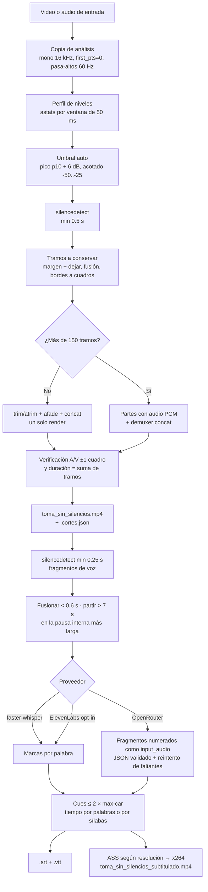

# Subtítulos y silencios — `silencios.py` + `subtitulos.py`

Dos herramientas de **un solo comando** pensadas para un orquestador barato (`modelos.razonamiento`):
salida compacta (≤ 8 líneas + `Siguiente:`), códigos de salida fijos y errores accionables en español.
Catálogo y opciones en [[SKILL]] (`quitar-silencios`, `crear-subtitulos`); reglas generales en [[AGENT]].

**Orden recomendado:** primero `silencios.py`, luego `subtitulos.py` sobre el video ya cortado. Al revés,
cada corte desplazaría todos los subtítulos posteriores.

```bash
python3 scripts/silencios.py  proyectos/<slug>_<DDMMAAAA>/recursos/toma.mp4 --proyecto proyectos/<slug>_<DDMMAAAA>
python3 scripts/subtitulos.py proyectos/<slug>_<DDMMAAAA>/toma_sin_silencios.mp4 --quemar \
    --glosario "ACME,HIKVISION,WhatsApp" --proyecto proyectos/<slug>_<DDMMAAAA>
```

## Pipeline



## Por qué los tiempos salen de `silencedetect` y no del LLM

- **Los LLM con audio no dan tiempos confiables.** En [[Lecciones-2026-09-23-IMG_7347]] §2 las marcas
  del modelo de visión llegaron con **~4 s de desfase**. Un subtítulo 4 s tarde es peor que ninguno.
- **Las pausas sí se miden bien:** `silencedetect` reporta el primer y último sample bajo el umbral, con
  precisión de milisegundos. Los bordes de voz de un subtítulo son justamente esas pausas.
- **Reparto de trabajo:** el script corta el audio en fragmentos entre pausas (≤ 7 s) y el LLM solo
  devuelve el **texto** de cada fragmento numerado (`{"segmentos":[{"i":1,"texto":"…"}]}`). Si falta un
  índice se pide otra vez. Dentro de un fragmento, los cortes entre cues se reparten por sílabas
  (heurística española: hiatos, diptongos, "y" vocálica, cifras). Es la única parte estimada, y su error
  está acotado por la duración del fragmento.
- **Verificado en línea (2026-09-28):** con voz `say -v Paulina`, el habla empieza en 0.50 s y el cue en
  0.451 s (anticipo de 50 ms a propósito).

## Por qué la receta anterior de silencios desincronizaba

`silenceremove` + `-c:v copy` recorta **solo el audio**: la imagen sigue completa y, tras el primer
corte, la voz se adelanta a los labios. Por eso `silencios.py` corta ambas pistas con la misma lista de
tramos. Tres detalles medidos al construirlo:

1. **Bordes a la rejilla de cuadros.** Si un tramo mide 1.01 s, el video lleva 31 cuadros (1.033 s) y el
   audio 1.01 s. Con cien cortes el desfase camina ±5 cuadros. Redondear cada borde a `k/fps` hace que
   imagen y audio midan lo mismo en cada tramo.
2. **`atrim` por muestras (`start_sample`/`end_sample`), no por segundos.** Por segundos se perdían
   ~10 muestras por tramo, un error que se acumula.
3. **`-r <fps>` a la salida.** Tras `concat` la base de tiempo es 1 µs y el muxer perdía la duración del
   último cuadro (164 cuadros reportados como 5.433 s en vez de 5.467 s).

Prueba de sincronía (en `scripts/pruebas/test_silencios.py`): un cuadro se pone blanco justo cuando suena
el tono. Tras cortar, cada arranque de tono cae a ≤ 1 cuadro del arranque del blanco, también en modo
por partes.

## Umbral automático: pico, no RMS

`silencedetect` compara **muestra por muestra**. Con umbral = RMS del ruido + 10 dB, los picos del ruido
(≈ RMS + 12 dB en medio segundo) cortan cada silencio. Medido con ruido rosa de RMS -66 dB: 0 silencios
a -56 dB, fragmentados a -55/-53 dB y estables solo desde -51 dB. Por eso el piso se mide como el
**percentil 10 del pico por ventana de 50 ms**, y el umbral es piso + 6 dB (≈ RMS del ruido + 15 dB),
acotado a [-50, -25] dB. Nunca queda a menos de 15 dB de la voz (percentil 90 del RMS), para no comerse
palabras en grabaciones ruidosas.

## Estilo del subtítulo quemado (libass 0.17.3)

- **Zona segura vertical 1080×1920:** 420 px abajo y 150 arriba (igual que `promo.zonas_seguras`).
  Fuente de 56 px; la caja medida en el cuadro final va de y=1350 a y=1495.
  Horizontal 1920×1080: 46 px y margen 70. Todo se escala con la resolución real.
- **`pastilla` = `BorderStyle=4`:** una sola caja por evento, del color `BackColour` (`&H30000000`). Con
  `BorderStyle=3` cada línea lleva su propia caja y el traslape entre las dos se ve como una franja más
  oscura. `\blur` también desenfoca el texto, y libass no redondea esquinas. Con libass < 0.17 el script
  cae a `BorderStyle=3` con `\ybord` chico.
- **Fuentes:** las woff2 de `promo/temas/neutro/fuentes` fallan en libass ("Error opening memory font":
  el FreeType de Homebrew no trae brotli). Se usa Helvetica Neue del sistema.
- **Ruta del `.ass`:** se escapa en dos niveles (opción del filtro y filtergraph). Probado con espacios,
  dos puntos, comas, apóstrofos y corchetes.
- **Número y unidad nunca se separan** ("250 m" usa espacio duro `\h`), y ninguna línea termina en
  "de/la/el…".

## Glosario: corrección fonética local

Aun con los nombres en el prompt, `gemini-2.5-flash` escribió "Akme" por ACME (misma confusión que
documenta `scripts/verificar_voz.py`). `subtitulos.py` compara la **clave fonética** de cada palabra, o de
dos palabras seguidas como "Hik Vision", con la de cada término del glosario y reemplaza solo si son
**iguales**. No usa parecido: un "Cisco" legítimo no se toca.

## Límites conocidos

- **Tiempos dentro de un fragmento largo:** los cortes entre cues de un mismo fragmento se estiman por
  sílabas (error típico de unas décimas de segundo). Los bordes de fragmento son exactos.
- **Música o ruido continuo de fondo:** si no hay pausas bajo el umbral, `silencios.py` reporta 0 cortes
  y los fragmentos de voz se parten por energía. Conviene usar `--umbral` manual o quitar la música antes.
- **Dos personas hablando a la vez:** un solo fragmento con el texto de ambas; no hay separación de
  hablantes.
- **HDR (HLG/PQ):** se recodifica a SDR sin tonemap y el script avisa.
- **`--motor auto-editor`:** opcional y no verificado en esta máquina (no está instalado).
- **Costo:** ~$0.0015 por 30 s de voz con OpenRouter. La caché (`transcripcion.json`) evita volver a
  pagar al repetir el comando.

## Tiempos más precisos: faster-whisper en un venv

El Python de Homebrew bloquea `pip install` global (PEP 668). Los scripts solo usan la librería estándar,
así que basta correrlos con el Python de un venv que tenga faster-whisper:

```bash
python3 -m venv ~/.venvs/whisper
~/.venvs/whisper/bin/pip install faster-whisper
~/.venvs/whisper/bin/python scripts/subtitulos.py <video> --proveedor whisper --quemar   # --modelo small|medium
```

Con whisper, los cortes entre cues salen de las marcas **por palabra**, con los bordes aún anclados a
las pausas medidas. El costo es $0 (local), pero la primera corrida descarga el modelo (cientos de MB).
`auto` elige whisper solo si puede importarlo con el Python que corre el script.

## Números medidos (E2E 2026-09-28, video vertical de prueba de 40 s)

| Paso | Resultado |
|---|---|
| `silencios.py` | 40.00 s → 29.40 s (−26.5 %), 6 cortes, umbral -50 dB (piso -64.3 dB), A/V Δ 0.000 s, 7 s de render |
| `subtitulos.py --quemar` | 9 cues, 28.8 s cubiertos, OpenRouter `gemini-2.5-flash` $0.0015, 12.6 s en total |
| Repetición del comando | $0 (caché), sin llamadas a la API |

## Códigos de salida (ambos scripts)

| Código | Significado | Qué hace el orquestador |
|---|---|---|
| 0 | OK | seguir con la línea `Siguiente:` |
| 1 | falló FFmpeg o la verificación | reportar al usuario (no reintentar) |
| 2 | argumentos o entrada | corregir el comando y repetir |
| 3 | entorno: FFmpeg/libass, key, proveedor | preguntar al usuario |
| 4 | API caída (solo `subtitulos.py`) | repetir el MISMO comando una vez |

## Enlaces

- [[SKILL]] — `quitar-silencios` y `crear-subtitulos`
- [[AGENT]] — §6 prioridad de herramientas, §13 estructura de proyectos, §10 costos
- [[Home]] — índice de la bóveda
- [[Lecciones-2026-09-23-IMG_7347]] — desfase de ~4 s en tiempos de modelos de visión
- [[Lecciones-2026-09-24-narracion-tts]] — ASS dual, gotchas de zsh
